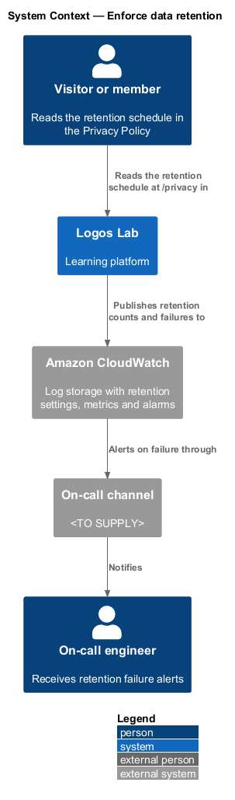
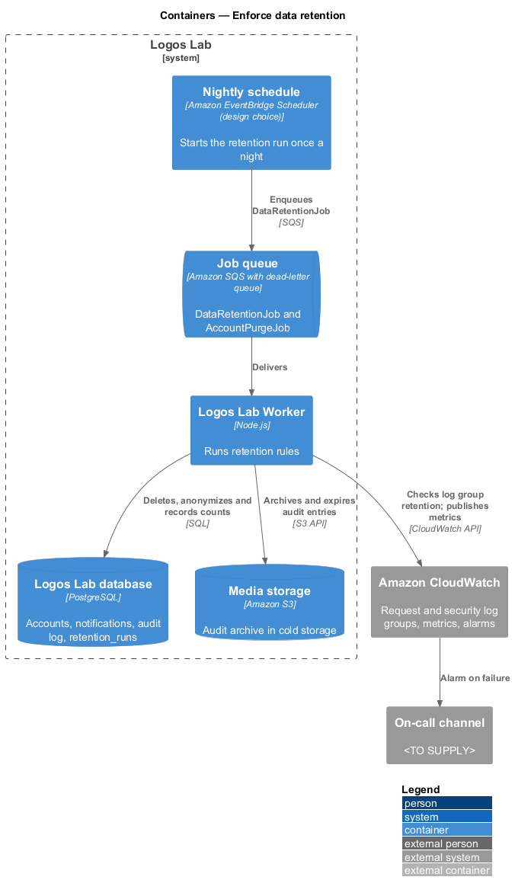
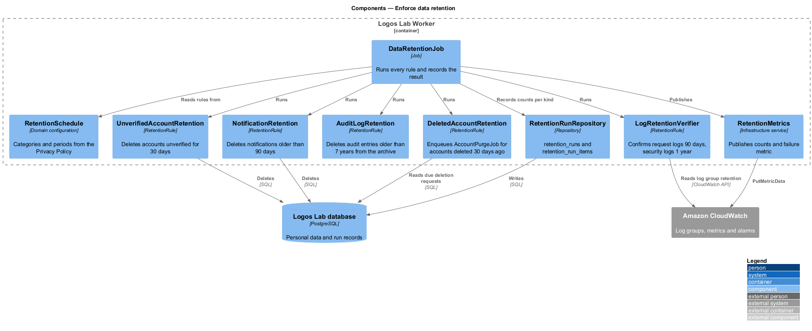
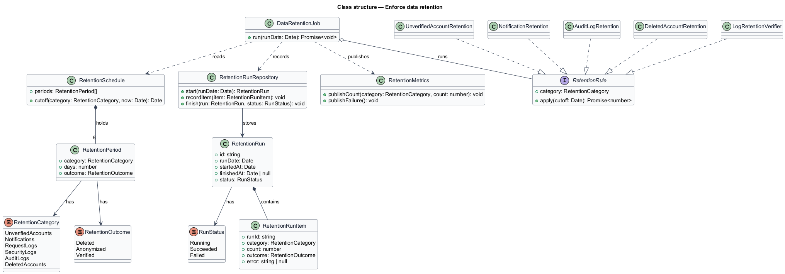
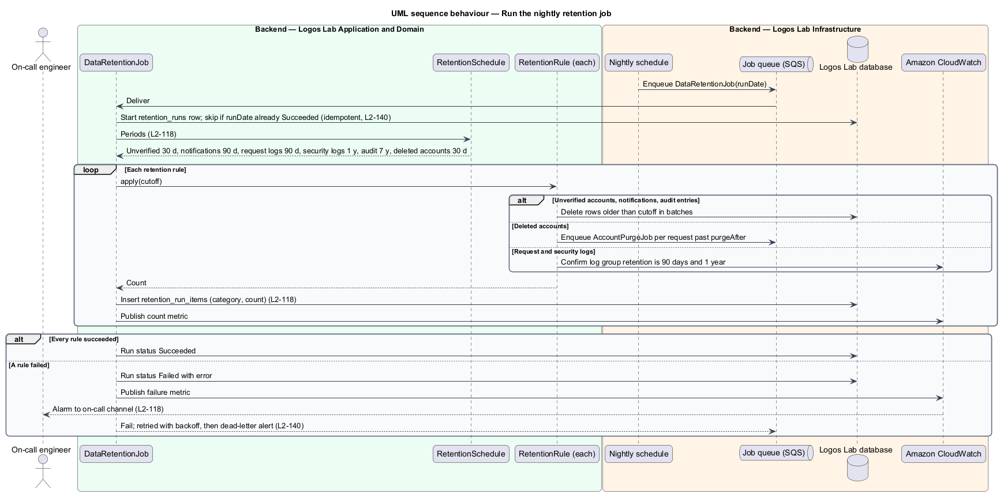

# Enforce data retention

## Overview

Canadian privacy law requires that personal data is kept only as long as its purpose requires
(`L1-019`). Logos Lab publishes a retention schedule in its Privacy Policy and enforces it with a
nightly background job.

**retention period** — length of time one kind of data is kept before it is deleted or anonymized

**retention schedule** — published set of retention periods, one per kind of data

**retention run** — one nightly execution of the retention job, with a recorded count per kind of data

This feature belongs to the privacy subsystem. It has no screen of its own beyond the schedule table
on the Privacy Policy page. It starts the account purges described in `delete-account`, and it
depends on the log retention settings of the operations subsystem.

## Description

**Published schedule.** `PolicyPage` (`/privacy`, mock `docs/mocks/pages/policy/`) shows the
"Retention schedule" table in `ll-table`. The table text is part of the policy version
(`record-privacy-consent`), so a schedule change is a new policy version.

| Data | Retention period | Enforced by |
|---|---|---|
| Unverified accounts | 30 days, then deleted | `UnverifiedAccountRetention` |
| Notifications | 90 days | `NotificationRetention` |
| Request logs | 90 days | CloudWatch log group retention, checked by `LogRetentionVerifier` |
| Security logs | 1 year | CloudWatch log group retention, checked by `LogRetentionVerifier` |
| Audit logs | 7 years | `AuditLogRetention` (archived to cold storage after 2 years, `L2-099`) |
| Deleted accounts | Purged 30 days after deletion | `DeletedAccountRetention`, which enqueues `AccountPurgeJob` |

**Trigger.** A nightly schedule (Amazon EventBridge Scheduler, a design choice to confirm by ADR)
enqueues **`DataRetentionJob`** on the SQS job queue. The run time is `<TO SUPPLY>`.

**Worker components.**

- **`DataRetentionJob`** — starts a **`RetentionRun`**, runs each **`RetentionRule`**, records one
  **`RetentionRunItem`** per category with its count, and finishes the run as `Succeeded` or
  `Failed`. A second delivery for a run date that already succeeded does nothing (`L2-140`).
- **`RetentionSchedule`** — six **`RetentionPeriod`** values (`RetentionCategory`, days,
  `RetentionOutcome`: `Deleted`, `Anonymized` or `Verified`) that match the published table.
- **`UnverifiedAccountRetention`** — deletes accounts still `Unverified` 30 days after creation.
- **`NotificationRetention`** — deletes in-app notifications older than 90 days.
- **`AuditLogRetention`** — deletes archived audit entries older than 7 years.
- **`DeletedAccountRetention`** — finds `AccountDeletionRequest` rows still `Pending` past
  `purgeAfter` and enqueues one `AccountPurgeJob` each. The purge itself deletes some data and
  anonymizes the attribution of comments and cohort posts.
- **`LogRetentionVerifier`** — confirms that the request log groups keep 90 days and the security log
  groups keep 1 year, and records the result with outcome `Verified`.
- Rules delete in batches. Batch size is `<TO SUPPLY>`.
- **`RetentionRunRepository`** — tables `retention_runs` and `retention_run_items`.
- **`RetentionMetrics`** — publishes a count metric per category and a failure metric to Amazon
  CloudWatch. A CloudWatch alarm on the failure metric notifies the on-call channel
  (`<TO SUPPLY>`). A job that exhausts its 5 retries also reaches the dead-letter queue alarm
  (`L2-140`).

**Rules from the acceptance criteria.**

- The nightly run deletes or anonymizes data past its retention period, using the schedule above.
- Each run records how many records of each kind it deleted, and a failure raises an alert.
- CloudWatch expires log events itself, so the run cannot count expired log entries; for logs it
  records the verified retention setting instead. Whether this satisfies the counting rule is
  `<TO SUPPLY>`.

## Requirements

| L2 ID | Refines (L1) | Requirement |
|-------|--------------|-------------|
| `L2-118` | `L1-019` | **Data retention.** Personal data shall be kept no longer than its purpose requires. |

## Diagrams

### System context

Readers see the retention schedule in the Privacy Policy. Logos Lab publishes retention counts and
failures to Amazon CloudWatch, which alerts the on-call channel.

### Containers

The nightly schedule enqueues the job, and the Worker deletes data in the database and the audit
archive. The Worker also checks log retention and publishes metrics to CloudWatch.

### Components

`DataRetentionJob` reads `RetentionSchedule`, runs the five rules and records each count through
`RetentionRunRepository` and `RetentionMetrics`.

### Class structure

`RetentionSchedule` holds six `RetentionPeriod` values. Each rule implements `RetentionRule`, and a
`RetentionRun` contains one `RetentionRunItem` per category.

### Behaviour — nightly retention run

The job applies each rule, records the count per kind and publishes metrics. A failed rule marks the
run `Failed`, raises the alarm and leaves the message to retry (`L2-118`, `L2-140`).

