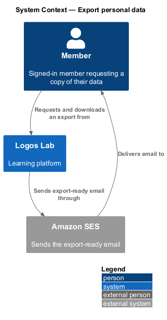
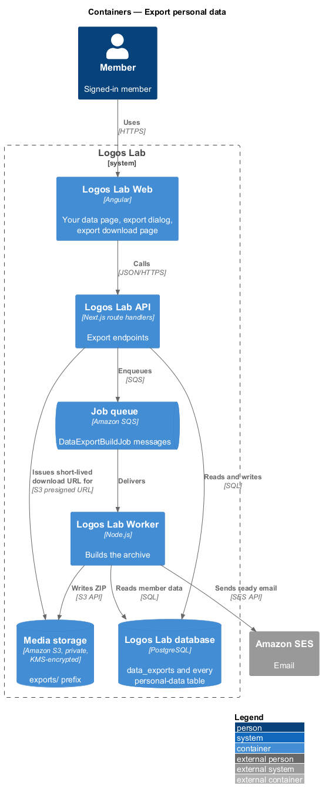
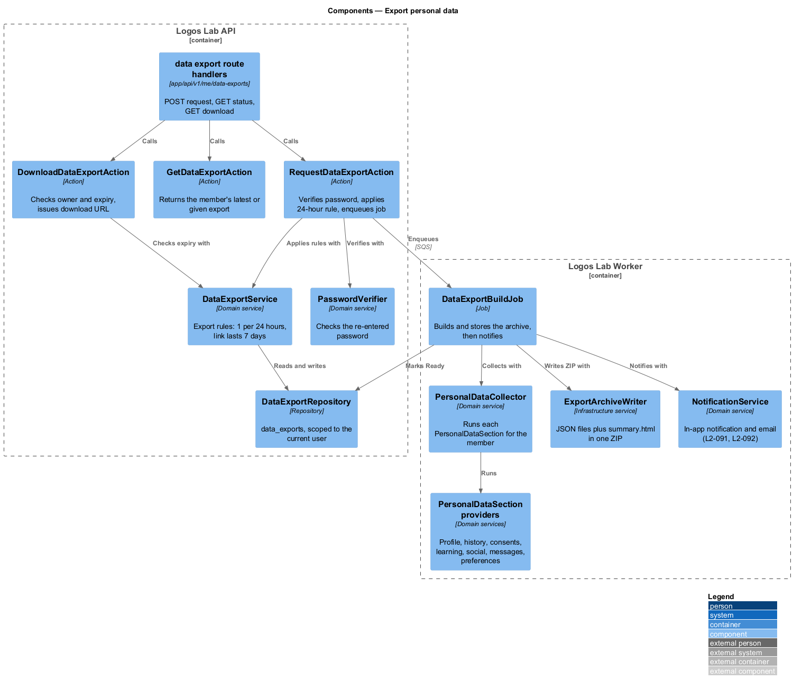
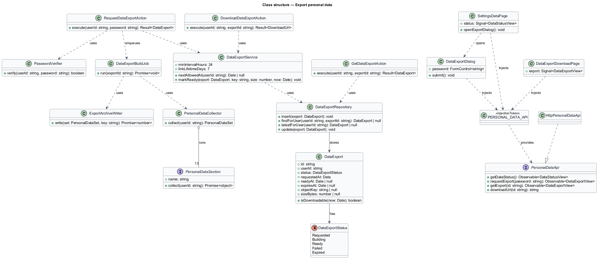
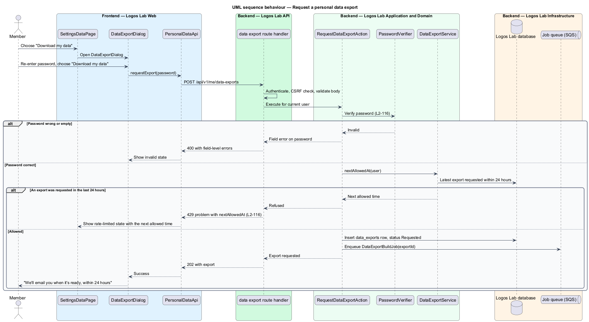
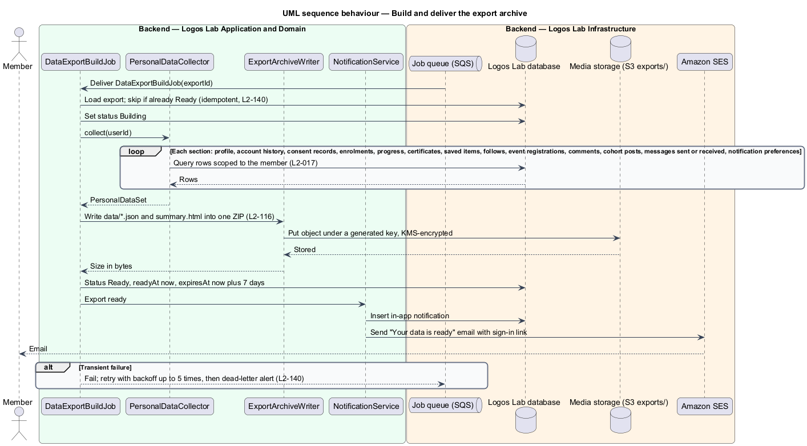
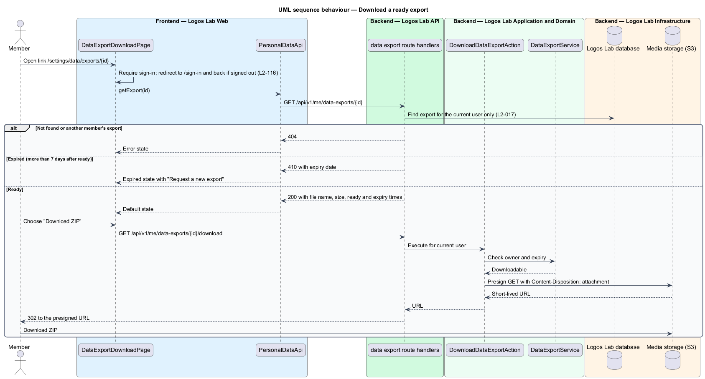

# Export personal data

## Overview

Canadian privacy law gives each person the right to see the personal data an organization holds about
them (`L1-019`). Logos Lab meets this with a self-service export: a signed-in member asks for a copy,
and a background job builds an archive and tells the member when it is ready to download.

**personal data export** — ZIP archive of everything Logos Lab holds about one member, in machine-readable JSON with a readable HTML summary

**export request** — member's request for one export, which starts a background build and limits the next request for 24 hours

**download link** — sign-in-protected address of a ready export that stops working 7 days after the export is ready

This feature belongs to the privacy subsystem, next to account deletion on the same "Your data"
settings page. It reads data owned by every other subsystem, so each subsystem contributes one
section to the archive.

## Description

**Screens.**

- **`SettingsDataPage`** (`/settings/data`, mock `docs/mocks/pages/settings-data/`) — shows "Download
  your data" with the list of what the archive covers and "Download my data". It also hosts account
  deletion (`delete-account`). States: default, loading, error, export-pending (requested time and
  the time of the next allowed request), export-ready (file name, size and expiry), rate-limited (the
  next allowed time), limited (after a declined policy, `L2-119`), deletion-blocked. Components:
  `ll-page-header`, `ll-sidebar-navigation`, `ll-panel`, `ll-alert`, `ll-button`, `ll-danger-zone`,
  `ll-skeleton`.
- **`DataExportDialog`** (CDK dialog, mock `docs/mocks/dialogs/data-export/`) — explains the archive
  and asks for the password, using `ll-form-field` and `ll-text-field` with a show-password toggle and
  a "Forgot your password?" link. States: default, busy, invalid ("Enter your password to confirm
  it's you"), failed ("Nothing was requested, so you can try again straight away"), success ("We'll
  email … when it's ready, within 24 hours").
- **`DataExportDownloadPage`** (`/settings/data/exports/{id}`, mock
  `docs/mocks/pages/data-export-download/`) — lists the file, size, requested, ready and expiry times
  in `ll-description-list`, with "Download ZIP". States: default, loading, error, expired ("This
  download link has expired", with "Request a new export" in `ll-empty-state`).
- The ready notice reaches the member as an in-app notification (`ll-notification-item`, mock
  `docs/mocks/notifications/notification/`) and an email.

**API library.** **`PersonalDataApi`** (`PERSONAL_DATA_API`, `HttpPersonalDataApi`) —
`getDataStatus()`, `requestExport(password)`, `getExport(id)`, `downloadUrl(id)`.

**Endpoints** (all require a signed-in member and are scoped to that member, `L2-017`).

| Method and path | Purpose |
|---|---|
| `POST /api/v1/me/data-exports` | Verify password and start an export; 202, 400 with field errors, or 429 with `nextAllowedAt` |
| `GET /api/v1/me/data-exports/{id}` | Export status; 404 for another member's id, 410 after expiry |
| `GET /api/v1/me/data-exports/{id}/download` | 302 to a short-lived presigned S3 URL with `Content-Disposition: attachment` |

**Application and domain.**

- **`RequestDataExportAction`** — verifies the password with **`PasswordVerifier`**, asks
  **`DataExportService`** for the next allowed time, inserts a **`DataExport`** with status
  `Requested`, and enqueues **`DataExportBuildJob`**.
- **`GetDataExportAction`** and **`DownloadDataExportAction`** — load the export for the current
  member; the download action checks expiry and presigns the S3 object. Presigned URL lifetime:
  `<TO SUPPLY>`.
- **`DataExportService`** — holds the rules: one request per 24 hours, link valid for 7 days after
  ready.
- **`DataExportRepository`** — table `data_exports`: `id`, `userId`, `status` (`DataExportStatus`:
  `Requested`, `Building`, `Ready`, `Failed`, `Expired`), `requestedAt`, `readyAt`, `expiresAt`,
  `objectKey`, `sizeBytes`.

**Worker.**

- **`DataExportBuildJob`** — idempotent job (`L2-140`). It sets `Building`, collects the data, writes
  the archive, sets `Ready` with `expiresAt` 7 days after `readyAt`, and notifies the member through
  **`NotificationService`** (in-app, `L2-091`, and email through Amazon SES, `L2-092`). Transient
  failures retry with exponential backoff up to 5 times, then move to the dead-letter queue, which
  alerts the on-call channel.
- **`PersonalDataCollector`** — runs 13 **`PersonalDataSection`** providers, one per kind of data:
  profile, account history, consent records, enrolments, progress, certificates, saved items, follows,
  event registrations, comments, cohort posts, messages sent or received, and notification
  preferences. Each provider is owned by the subsystem that holds the data.
- **`ExportArchiveWriter`** — writes one JSON file per section under `data/` and a `summary.html`
  page into one ZIP. It stores the ZIP under a generated key in the private, KMS-encrypted `exports/`
  prefix of media storage in Canada (`L2-113`). Export objects are deleted after expiry by the
  storage lifecycle rule.

**Rules from the acceptance criteria.**

- A request starts only after the member re-enters their password; the member is told they will be
  emailed when it is ready.
- The archive is a ZIP with machine-readable JSON and a readable HTML summary, covering the 13 kinds
  of data listed above.
- The download link requires sign-in and expires after 7 days. The export is available within 24
  hours of the request. The alarm that fires when an export is not ready within 24 hours is
  `<TO SUPPLY>`.
- A second request within 24 hours is refused with the time of the next allowed request.
- A member held at re-consent (`L2-119`) keeps access to these endpoints.

## Requirements

| L2 ID | Refines (L1) | Requirement |
|-------|--------------|-------------|
| `L2-116` | `L1-019` | **Personal data export.** Members shall be able to download a copy of their personal data. |

## Diagrams

### System context

A member requests and downloads an export from Logos Lab. Amazon SES delivers the email that says the
export is ready.

### Containers

The API records the request and enqueues the build. The Worker reads the member's data from the
database, writes the ZIP to media storage and sends the email; the API later issues a short-lived
download URL.

### Components

The three route handlers call one action each. `DataExportBuildJob` uses `PersonalDataCollector` and
its section providers, then `ExportArchiveWriter` and `NotificationService`.

### Class structure

`DataExport` carries its status and expiry. `PersonalDataCollector` runs 13 `PersonalDataSection`
providers, and the three screens depend on the `PersonalDataApi` contract through its token.

### Behaviour — request an export

The action verifies the password and applies the 24-hour rule before it records the request and
enqueues the build. A refused request returns field errors or a 429 with the next allowed time.

### Behaviour — build the export

The job collects each section scoped to the member and writes the ZIP. It then marks the export ready
for 7 days and notifies the member in the app and by email.

### Behaviour — download the export

The download page requires sign-in, and the API serves only the member's own, unexpired export. The
file itself comes from a short-lived presigned URL.

