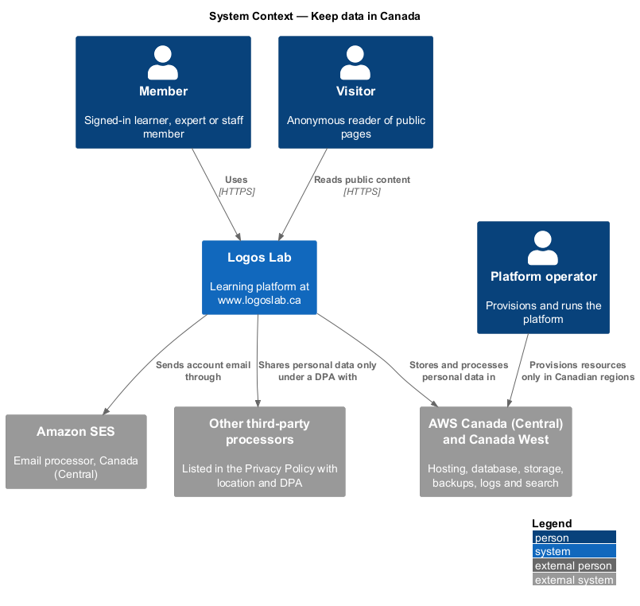
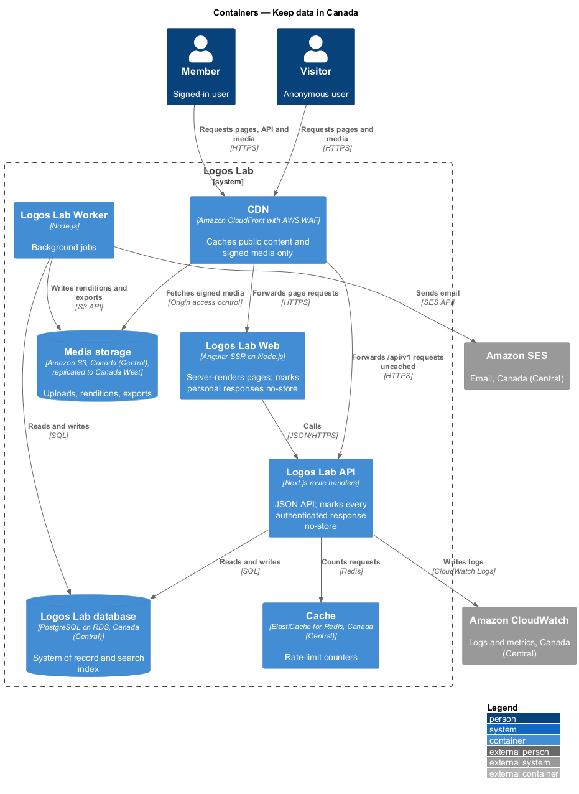
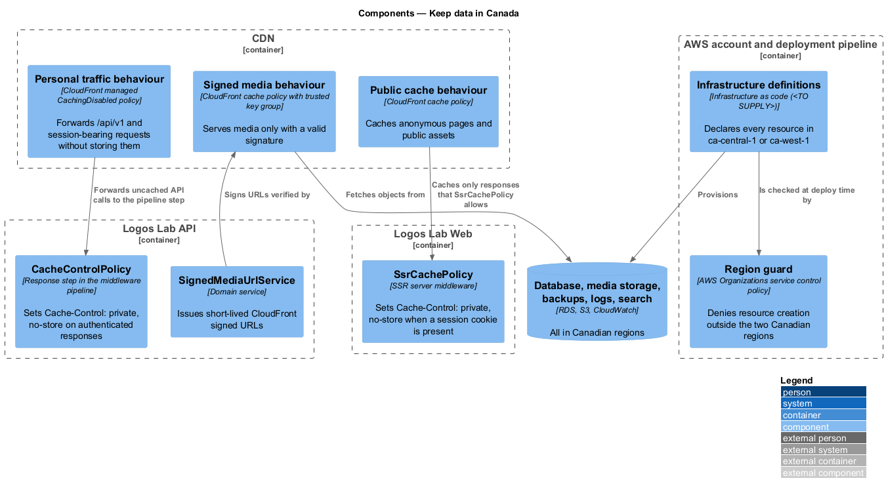
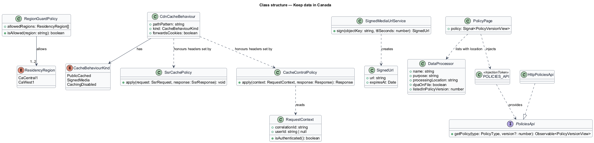
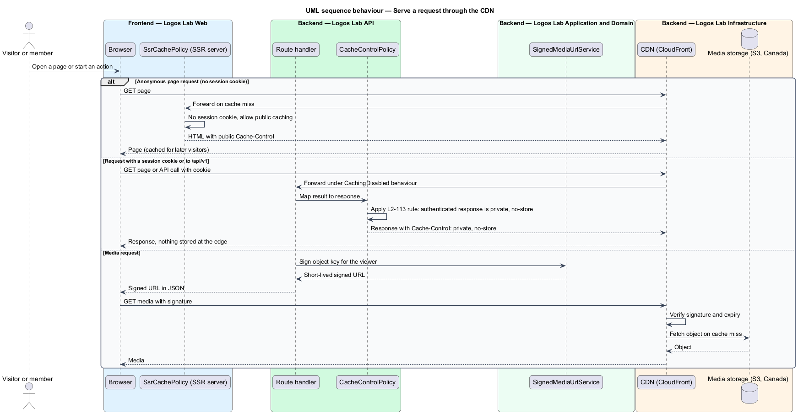
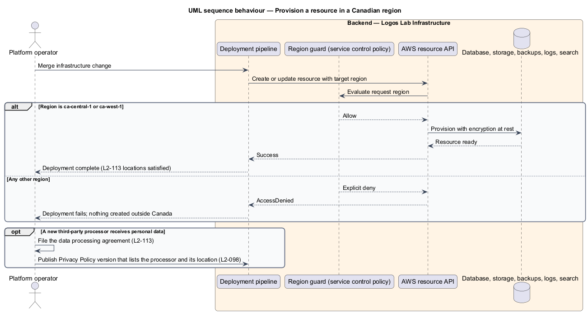

# Keep data in Canada

## Overview

Logos Lab is a learning platform for the meeting point of Christianity and artificial intelligence. It
holds personal data about its members: names, email addresses, learning records, comments, messages
and security records. Canadian privacy law (PIPEDA) and the platform's own commitment (`L1-019`)
require that this data stays in Canada.

**data residency** — rule that fixes the geographic locations where personal data is stored and processed

**third-party processor** — outside service that receives personal data to perform work for Logos Lab, such as sending email

**signed media** — media object served only through a URL that carries a time-limited cryptographic signature

This feature belongs to the privacy subsystem. It is a cross-cutting slice: it has no screen of its
own, but it constrains where every container runs, what the CDN may cache, and which processors the
Privacy Policy lists. Other privacy features (export, deletion, retention) rely on it, because they
assume that every copy of personal data sits in a Canadian region.

## Description

The slice enforces residency at three points: where resources are provisioned, what the edge may
cache, and which processors receive data.

**Region pinning.**

- **Infrastructure definitions** — the infrastructure-as-code source (tool `<TO SUPPLY>`) declares
  every resource in AWS Canada (Central) (`ca-central-1`) or Canada West (`ca-west-1`). This covers
  the Logos Lab database (RDS), media storage (S3), backups, CloudWatch logs, the Cache and the
  full-text search index, which lives in the database.
- **Region guard** — an AWS Organizations service control policy on the production account. It
  denies resource-creating API calls in any region other than the two Canadian regions, so a
  misconfigured deployment fails instead of creating data outside Canada. This is a design choice to
  confirm by ADR.
- **`ResidencyRegion`** — enumeration of the two allowed regions, used by the guard configuration and
  by deployment checks.
- Object storage replicates to a second Canadian region (`L2-138`), which stays within the allowed
  pair.

**Edge caching.**

- **CDN** — Amazon CloudFront with AWS WAF, configured with three cache behaviours
  (`CdnCacheBehaviour`):
  - *Public cache behaviour* caches anonymous pages and public assets.
  - *Signed media behaviour* serves media only when the URL carries a valid signature issued by
    `SignedMediaUrlService`, and fetches from the private S3 origin.
  - *Personal traffic behaviour* uses the CloudFront `CachingDisabled` policy for `/api/v1/*` and
    for any request that carries the session cookie. Nothing is stored at the edge.
- **`SsrCachePolicy`** — middleware in the Angular SSR server of Logos Lab Web. When a request carries
  a session cookie, it sets `Cache-Control: private, no-store` on the rendered HTML.
- **`CacheControlPolicy`** — response step in the Logos Lab API middleware pipeline. It sets
  `Cache-Control: private, no-store` on every authenticated response, so no authenticated API
  response is ever cached by the CDN.
- **`SignedMediaUrlService`** — domain service that issues short-lived CloudFront signed URLs. URL
  lifetime: `<TO SUPPLY>`.
- CloudFront edge locations outside Canada may hold cached public content and signed media. The
  CloudFront price class and whether signed media for private items is acceptable at those edges are
  `<TO SUPPLY>`.

**Processors and policy text.**

- **`DataProcessor`** — record of a third-party processor: name, purpose, processing location,
  whether a data processing agreement (DPA) is on file, and the Privacy Policy version that lists it.
  The register's storage location is `<TO SUPPLY>`.
- The Privacy Policy (`PolicyPage` at `/privacy`, mock `docs/mocks/pages/policy/`) carries a section
  "Where your data is kept". The mock lists Amazon Web Services, Canada (Central) and Canada West, for
  hosting, database, file storage, backups, logs and search, and Amazon Simple Email Service, Canada
  (Central), for account email.
- Adding a processor requires a new Privacy Policy version (`L2-098`) that lists it with its
  location, and a signed DPA. The analytics provider (`manage-cookie-consent`) and the malware
  scanner (`L2-108`) are processors whose names and locations are `<TO SUPPLY>`.
- `PoliciesApi`, its `POLICIES_API` token and `HttpPoliciesApi` read the policy text for
  `PolicyPage`; the policy endpoints are described in `record-privacy-consent`.

The rules from the acceptance criteria are:

- The production database, object storage, backups, logs and search index are all in AWS Canada
  (Central) or Canada West.
- Every processor that receives personal data is listed in the Privacy Policy with its processing
  location, and has a DPA on file.
- The CDN caches only public content and signed media, never personal data or authenticated API
  responses.

## Requirements

| L2 ID | Refines (L1) | Requirement |
|-------|--------------|-------------|
| `L2-113` | `L1-019` | **Data residency.** Personal data shall be stored and processed in Canada. |

## Diagrams

### System context

Members and visitors use Logos Lab, which stores and processes personal data only in the two
Canadian AWS regions. Amazon SES and any other processor receive data only under a DPA and appear in
the Privacy Policy.

### Containers

Every request passes through the CDN. Page and API traffic that carries personal data passes through
uncached, while the database, media storage, cache and logs all run in Canadian regions.

### Components

The three CDN cache behaviours honour the headers that `SsrCachePolicy` and `CacheControlPolicy` set.
The region guard checks every resource that the infrastructure definitions provision.

### Class structure

`RegionGuardPolicy` allows one or two `ResidencyRegion` values. `CdnCacheBehaviour` honours the
cache headers set by the two policies, and `PolicyPage` lists each `DataProcessor` with its location.

### Behaviour — serve a request through the CDN

Anonymous pages may be cached at the edge. Session-bearing and API requests leave the API marked
`private, no-store`, and media is fetched from Canadian storage only with a valid signature.

### Behaviour — provision a resource in a Canadian region

The region guard allows resource creation only in `ca-central-1` or `ca-west-1`, and a deployment
that targets any other region fails. A new processor is added only with a DPA and a Privacy Policy
version that lists it.

