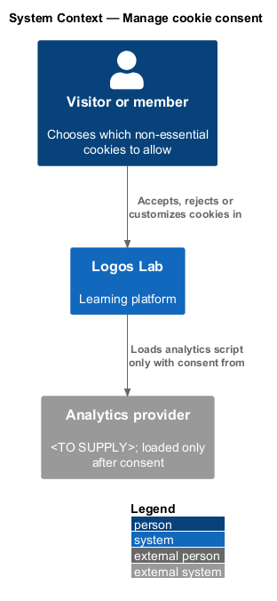
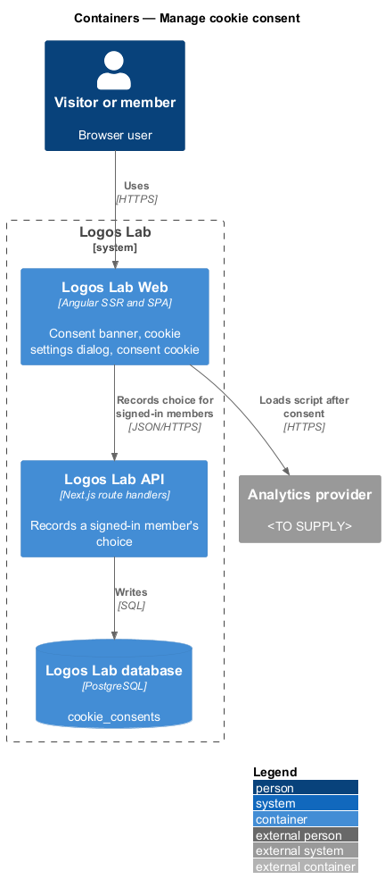
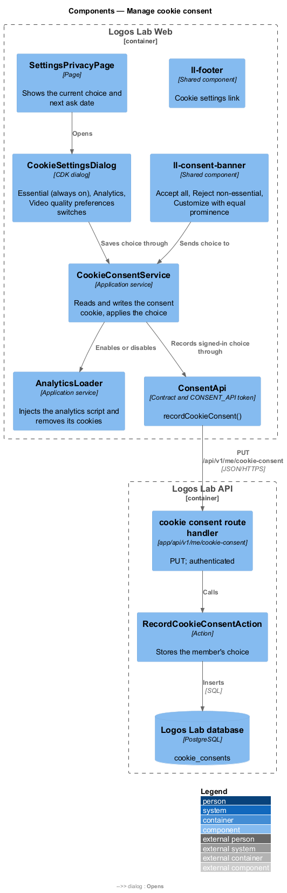
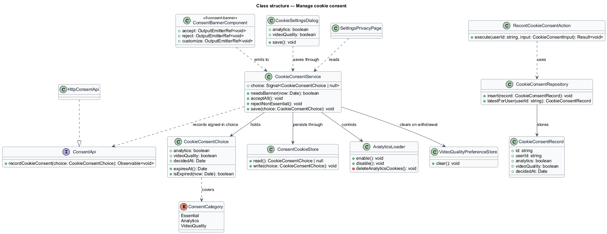
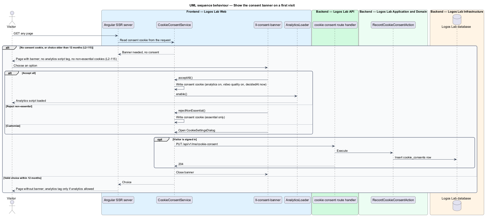
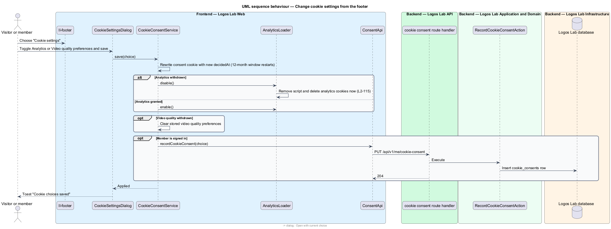

# Manage cookie consent

## Overview

Logos Lab sets a small number of cookies in the visitor's browser. Some are essential: they keep a
member signed in, protect forms and remember the consent choice itself. Others are optional:
analytics cookies that count visits and lesson completions, and stored video quality preferences.
Canadian privacy law (`L1-019`) requires consent before optional cookies or tracking scripts run.

**essential cookie** — cookie without which a requested feature cannot work, set without consent

**non-essential cookie** — cookie used for analytics, preferences or tracking, set only with consent

**consent choice** — visitor's recorded decision for each non-essential cookie category, with the time it was made

This feature belongs to the privacy subsystem. It runs mostly in the browser: a banner on the first
visit, a settings dialog reachable from the footer and from Settings, and a loader that starts
analytics only when allowed. For signed-in members the API also stores each choice as a consent
record.

## Description

**Screens and components.**

- **`ll-consent-banner`** (design system `consent-banner`, mock `docs/mocks/notifications/cookie-banner/`)
  — region shown on a first visit with "Accept all", "Reject non-essential" and "Customize". "Accept
  all" and "Reject non-essential" use the same button variant and size, so accepting and rejecting
  have equal visual prominence. States: info, persistent, stacked.
- **`CookieSettingsDialog`** (CDK dialog, mock `docs/mocks/dialogs/cookie-settings/`) — lists three
  categories in an `ll-switch` list: Essential (always on), Analytics, and Video quality preferences.
  The copy states that the choice "applies straight away and lasts 12 months". Saving closes the
  dialog and shows the `ll-toast` "Cookie choices saved". States: default, selected, scroll, success.
- **`ll-footer`** — carries the "Cookie settings" link that opens the dialog.
- **`SettingsPrivacyPage`** (`/settings/privacy`, mock `docs/mocks/pages/settings-privacy/`) — shows
  the current choice, the date it was made and the date the banner will ask again, with "Change
  cookie settings".

**Browser services in Logos Lab Web.**

- **`CookieConsentService`** — holds the current `CookieConsentChoice` as a signal. It decides
  whether the banner is needed, applies a new choice, and for a signed-in member records it through
  `ConsentApi`.
- **`ConsentCookieStore`** — reads and writes the consent cookie. The cookie is essential, first-party
  and lasts 12 months. Its name is `<TO SUPPLY>`. The SSR server reads the same cookie, so the
  server-rendered page already omits or includes the banner and the analytics tag.
- **`AnalyticsLoader`** — adds the analytics script only when Analytics is allowed, and on withdrawal
  removes the script and deletes the analytics cookies. The analytics provider and its cookie names
  are `<TO SUPPLY>`; the script origin is allow-listed in the Content Security Policy (`L2-104`).
- **`VideoQualityPreferenceStore`** — holds the playback quality and caption choices of the Tessera
  video-player; it is cleared when Video quality preferences is turned off.
- **`CookieConsentChoice`** — value holding `analytics`, `videoQuality` and `decidedAt`; it expires 12
  months after `decidedAt`.

**API and data.**

- **`ConsentApi`** (`CONSENT_API`, `HttpConsentApi`) — `recordCookieConsent(choice)`.
- **`PUT /api/v1/me/cookie-consent`** — authenticated route handler in
  `app/api/v1/me/cookie-consent/route.ts`. It calls **`RecordCookieConsentAction`**, which inserts a
  **`CookieConsentRecord`** (table `cookie_consents`: `userId`, `analytics`, `videoQuality`,
  `decidedAt`) through **`CookieConsentRepository`**. Records are append-only and are included in the
  personal data export as consent records (`L2-116`).
- Anonymous visitors' choices stay in the browser only.

**Rules from the acceptance criteria.**

- On a first visit the banner offers "Accept all", "Reject non-essential" and "Customize", with equal
  visual prominence for accepting and rejecting.
- Until consent is given, no analytics or third-party tracking script loads and no non-essential
  cookie is set.
- A change saved through "Cookie settings" in the footer takes effect immediately. Withdrawing
  consent deletes the non-essential cookies.
- A choice is remembered for 12 months, after which the banner is shown again.

## Requirements

| L2 ID | Refines (L1) | Requirement |
|-------|--------------|-------------|
| `L2-115` | `L1-019` | **Cookie consent.** Non-essential cookies and tracking shall require consent. |

## Diagrams

### System context

A visitor or member decides which non-essential cookies Logos Lab may use. Logos Lab loads the
analytics provider's script only after consent.

### Containers

Logos Lab Web holds the banner, the dialog and the consent cookie. The API stores a signed-in
member's choice in the database.

### Components

The banner and the dialog send choices to `CookieConsentService`. The service controls
`AnalyticsLoader` and records signed-in choices through `ConsentApi`.

### Class structure

`CookieConsentService` persists through `ConsentCookieStore`, controls `AnalyticsLoader` and clears
`VideoQualityPreferenceStore`. On the API side, `RecordCookieConsentAction` stores a
`CookieConsentRecord`.

### Behaviour — first visit

Without a valid consent cookie, the SSR server renders the banner and no analytics tag. Each banner
choice writes the cookie, and only "Accept all" starts analytics.

### Behaviour — change cookie settings

Saving the dialog rewrites the cookie and applies the change at once. Withdrawn analytics consent
deletes the analytics cookies, and a signed-in member's choice is recorded by the API.

