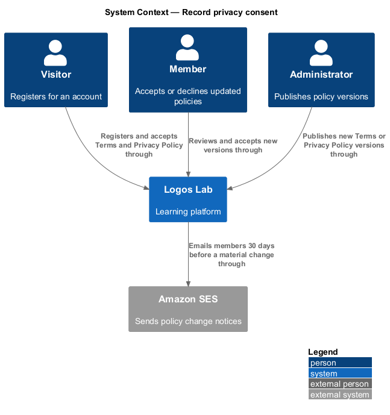
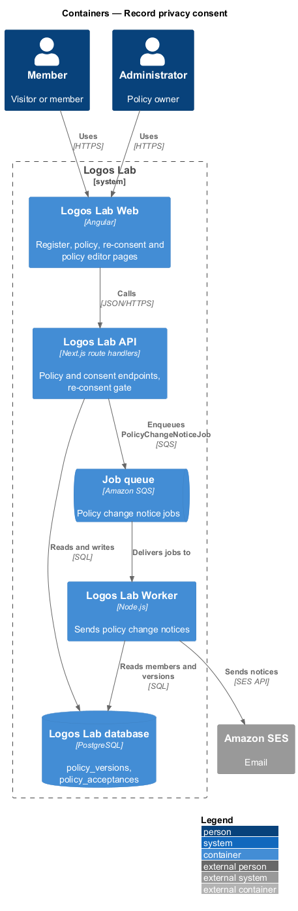
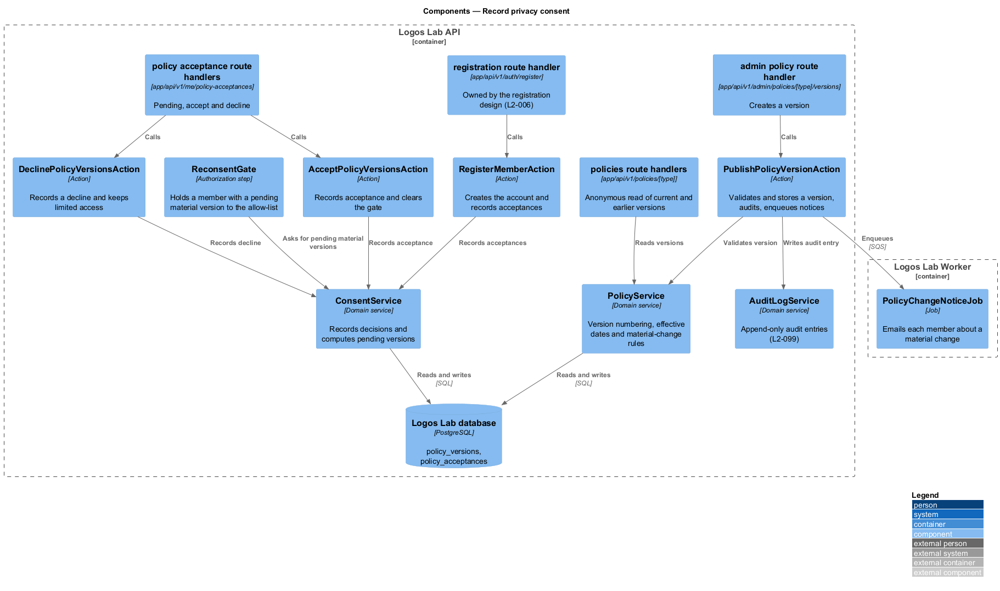
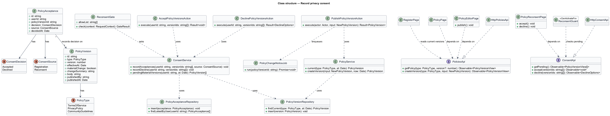
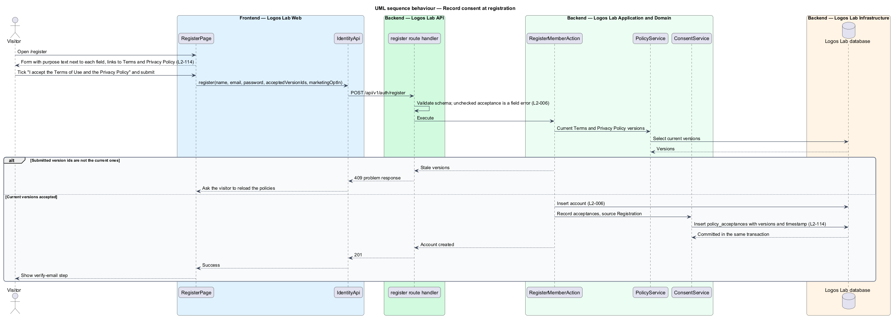
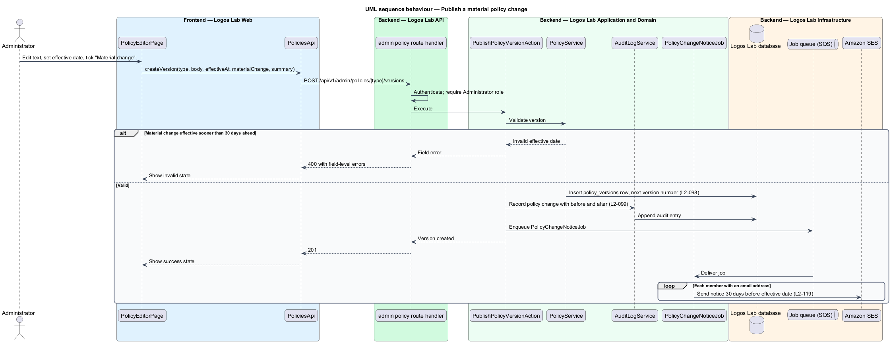
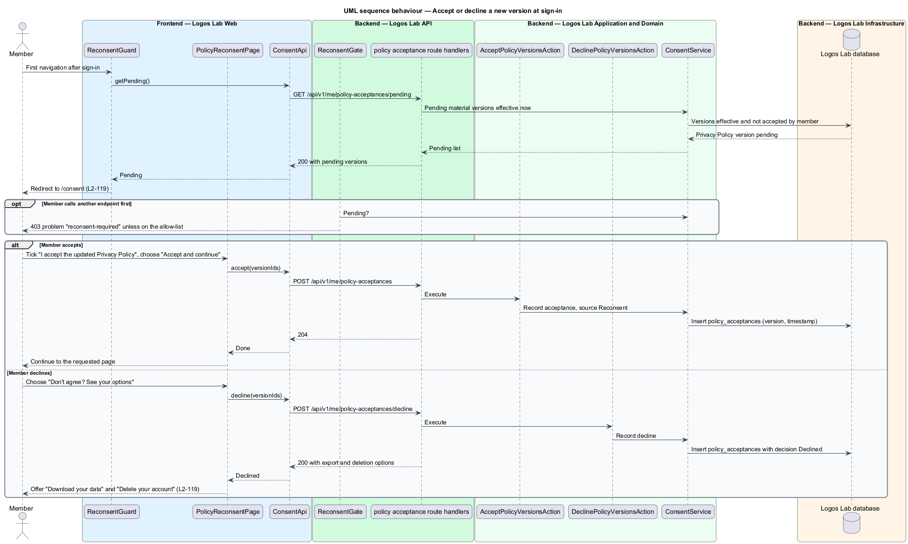

# Record privacy consent

## Overview

Logos Lab collects personal data from members, so it shall say what it collects and why, and keep a
record of each member's agreement to its policies (`L1-019`). Policies change over time. When a
change is material, members are told in advance and asked to accept the new version before they
continue.

**policy** — published legal text that governs use of Logos Lab: the Terms of Service, the Privacy Policy or the Community Guidelines

**policy version** — numbered, immutable edition of one policy with an effective date (`L2-098`)

**material change** — policy version that an Administrator marks as changing members' rights or obligations enough to require new acceptance

**consent record** — stored decision by one member on one policy version, with its timestamp

**re-consent** — acceptance of a material policy version, requested at the member's next sign-in after it takes effect

This feature belongs to the privacy subsystem. It records consent at registration, lets Administrators
publish versions, sends advance notice of material changes, and holds members at a re-consent step.
The consent records it creates appear in the personal data export (`export-personal-data`).

## Description

**Screens.**

- **`RegisterPage`** (`/register`, mock `docs/mocks/pages/register/`) — the registration form owned
  by the registration design (`L2-006`). This feature adds a plain-language purpose under each field
  (for example "Shown on your comments and certificates" under the name), links to the Terms of Use
  and the Privacy Policy, the required acceptance checkbox and the note "We record which versions you
  accepted and when". The marketing email checkbox carries the "Optional" label (`L2-094`).
  Components: `ll-auth-card`, `ll-form-field`, `ll-text-field`, `ll-checkbox`, `ll-button`,
  `ll-alert`.
- **`PolicyPage`** (`/privacy`; the Terms route is `<TO SUPPLY>`, mock `docs/mocks/pages/policy/`) —
  shows the current version, an earlier version, or an upcoming version with a notice of its
  effective date. States: default, previous-version, upcoming, long, error. Components:
  `ll-page-header`, `ll-prose`, `ll-table`, `ll-alert`.
- **`PolicyReconsentPage`** (`/consent`, mock `docs/mocks/pages/policy-reconsent/`) — shows "What
  changed", links to the full and previous version, an acceptance checkbox, "Accept and continue",
  and "Don't agree? See your options". States: default, long, submitting, declined, loading, error.
  The declined state offers "Download your data", "Delete your account" and "Review the changes
  again".
- **`ReconsentGuard`** — Angular route guard. It redirects a member with a pending material version
  to `/consent`, except on the allow-listed routes (`/consent`, `/settings/data`, the policy pages,
  sign-out). `/settings/data` then shows its limited state (mock
  `docs/mocks/pages/settings-data/limited.html`).
- **`AdminPoliciesPage`** (`/admin/policies`, mock `docs/mocks/pages/admin-policies/`) — lists each
  policy with its current version, effective date and next version, and marks material changes with
  an `ll-badge`.
- **`PolicyEditorPage`** (`/admin/policies/{type}/new`, mock `docs/mocks/pages/policy-editor/`) —
  starts from the current text and takes an effective date, a "Material change" checkbox, a summary
  of changes of up to 500 characters and the policy text in `ll-rich-editor`. States: default,
  loading, invalid, material-change, submitting, success, error.

**API library.**

- **`ConsentApi`** (`CONSENT_API`, `HttpConsentApi`) — `getPending()`, `accept(versionIds)`,
  `decline(versionIds)`.
- **`PoliciesApi`** (`POLICIES_API`, `HttpPoliciesApi`) — `getPolicy(type, version?)`,
  `listPolicies()`, `createVersion(type, input)`.

**Endpoints.**

| Method and path | Access | Purpose |
|---|---|---|
| `GET /api/v1/policies/{type}` | Anonymous | Current version, with the upcoming version if one exists |
| `GET /api/v1/policies/{type}/versions/{version}` | Anonymous | One earlier or upcoming version |
| `POST /api/v1/auth/register` | Anonymous | Registration (`L2-006`); carries the accepted version ids |
| `GET /api/v1/me/policy-acceptances/pending` | Member | Material versions effective now and not yet accepted |
| `POST /api/v1/me/policy-acceptances` | Member | Accept the listed versions |
| `POST /api/v1/me/policy-acceptances/decline` | Member | Decline; returns the export and deletion options |
| `GET /api/v1/admin/policies` | Administrator | Policy list |
| `POST /api/v1/admin/policies/{type}/versions` | Administrator | Create a version |

**Application and domain.**

- **`RegisterMemberAction`** — owned by the registration design. In the same transaction as the
  account insert, it calls `ConsentService.recordAcceptances` with source `Registration`. It refuses
  the request with 409 when the submitted version ids are not the current ones.
- **`PublishPolicyVersionAction`** — validates the version through `PolicyService`, stores it, writes
  an audit entry through `AuditLogService` (`L2-099`), and for a material change enqueues
  `PolicyChangeNoticeJob`.
- **`PolicyService`** — assigns the next version number and resolves the current version at a given
  time. It refuses a material change whose effective date is less than 30 days after publication, so
  the 30-day notice is always possible.
- **`AcceptPolicyVersionsAction`** and **`DeclinePolicyVersionsAction`** — record the member's
  decision through `ConsentService`.
- **`ConsentService`** — records decisions and computes the material versions that are effective and
  not yet accepted by a member.
- **`ReconsentGate`** — authorization step in the API middleware pipeline. While a member has a
  pending material version, it refuses requests outside the allow-list (pending and decision
  endpoints, policy reads, data export, account deletion, sign-out) with a 403 problem response of
  type `reconsent-required`.
- **`PolicyChangeNoticeJob`** — Worker job that emails every member about a material change through
  Amazon SES. It is idempotent per member and version (`L2-140`).

**Data.**

- **`PolicyVersion`** (table `policy_versions`) — `type` (`PolicyType`: `TermsOfService`,
  `PrivacyPolicy`, `CommunityGuidelines`), `version`, `effectiveAt`, `materialChange`,
  `changeSummary`, `body`, `publishedBy`, `publishedAt`. Rows are never updated after publication.
- **`PolicyAcceptance`** (table `policy_acceptances`) — `userId`, `policyVersionId`, `decision`
  (`ConsentDecision`: `Accepted`, `Declined`), `source` (`ConsentSource`: `Registration`,
  `Reconsent`), `decidedAt`. Rows are append-only and scoped to their member (`L2-017`).
- Marketing email consent is recorded by the CASL design (`L2-094`), not here.

**Rules from the acceptance criteria.**

- The registration form links to the Privacy Policy and Terms and states in plain language what is
  collected and why, next to the fields.
- Registration stores the accepted policy versions and the timestamp.
- Each field on a form that collects personal data serves a stated purpose; optional fields carry the
  label "Optional". `ll-form-field` provides the purpose hint and the "Optional" label; review of
  each form against this rule is part of design review.
- A material version is emailed to members 30 days before it takes effect. At the next sign-in after
  the effective date, the member accepts it to continue.
- A member who declines is offered data export and account deletion.
- Whether sessions already open at the effective date are also held at re-consent is `<TO SUPPLY>`;
  the specification names only the next sign-in.

## Requirements

| L2 ID | Refines (L1) | Requirement |
|-------|--------------|-------------|
| `L2-114` | `L1-019` | **Privacy notice and consent records.** The platform shall state what it collects and why, and shall record consent. |
| `L2-119` | `L1-019` | **Policy updates and re-consent.** Members shall be told about material changes to policies. |

## Diagrams

### System context

Visitors accept the policies when they register, members review new versions, and Administrators
publish them. Amazon SES carries the advance notice of a material change.

### Containers

Logos Lab Web hosts the registration, policy, re-consent and editor pages. The API records decisions
in the database and enqueues notice jobs that the Worker sends through Amazon SES.

### Components

Route handlers call one action each. `ConsentService` and `PolicyService` hold the rules, and
`ReconsentGate` asks `ConsentService` for pending material versions on each request.

### Class structure

Each `PolicyAcceptance` records one decision on one `PolicyVersion`. The frontend pages depend on
the `ConsentApi` and `PoliciesApi` contracts.

### Behaviour — record consent at registration

The registration action records the current Terms and Privacy Policy versions with a timestamp in the
same transaction as the new account (`L2-114`).

### Behaviour — publish a material change

An Administrator publishes a version with an effective date at least 30 days ahead. The action audits
the change and enqueues the notice that emails every member (`L2-119`).

### Behaviour — accept or decline at sign-in

After sign-in the guard sends a member with a pending material version to `/consent`. Acceptance
lets the member continue; a decline is recorded and the member is offered export and deletion.

