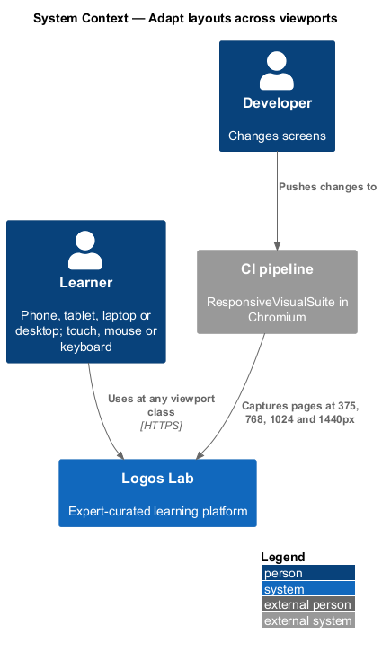
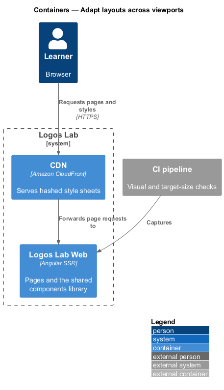
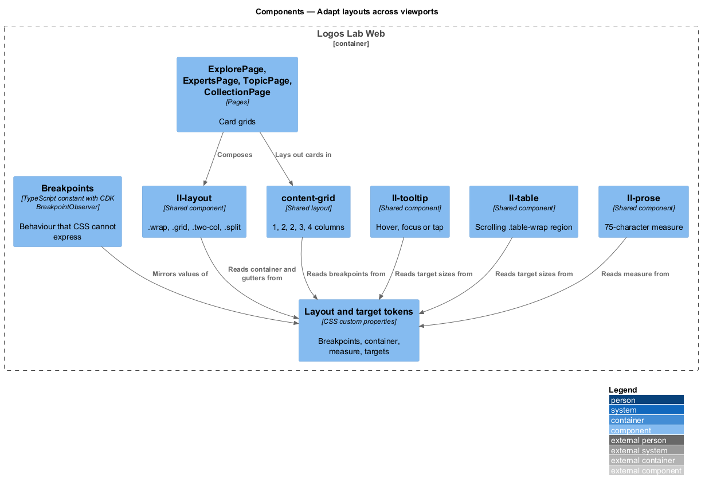
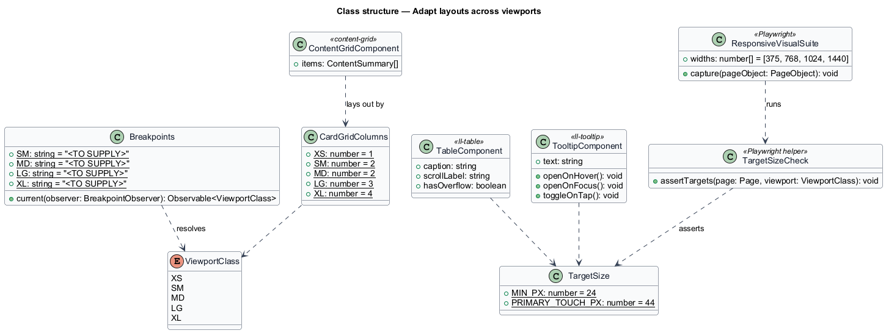
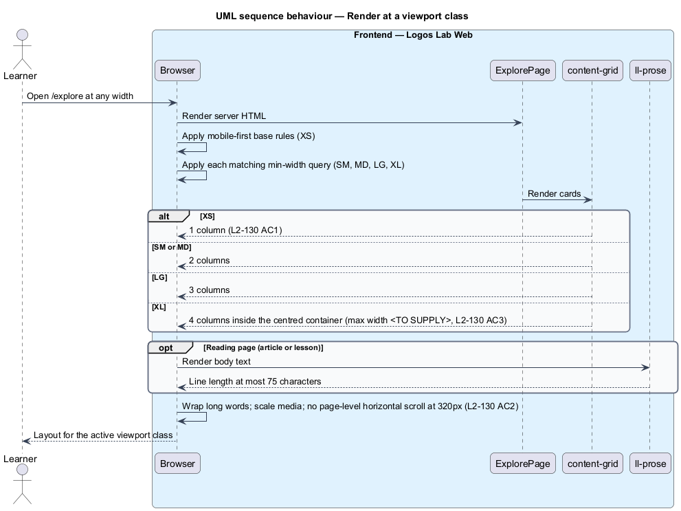
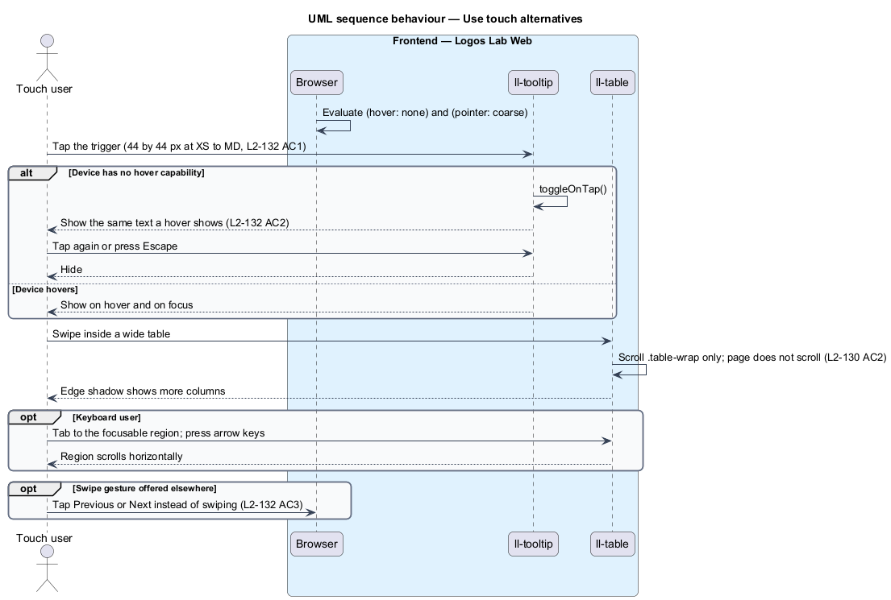
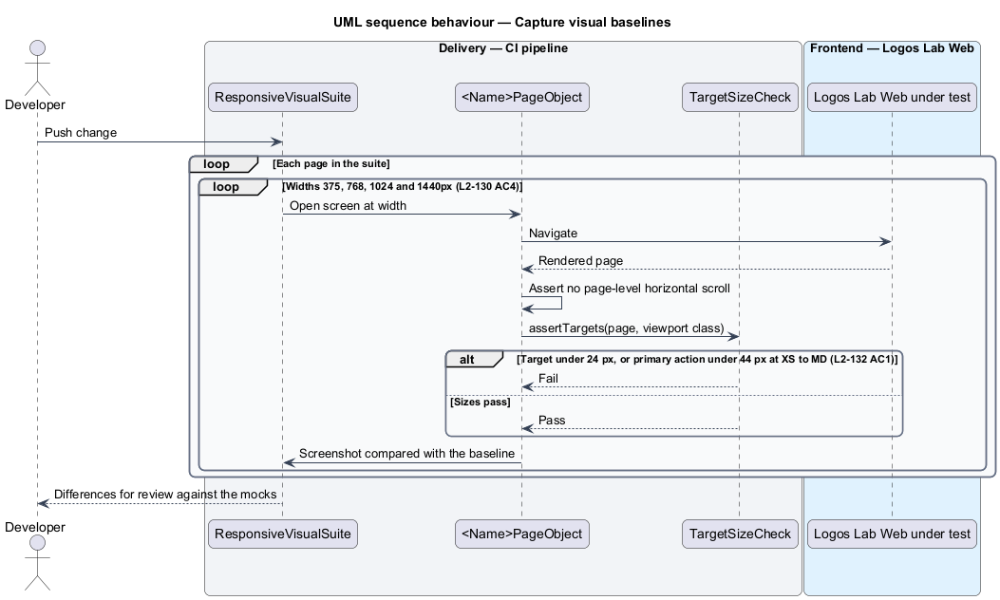

# Adapt layouts across viewports

## Overview

Logos Lab is used on phones, tablets, laptops and wide desktop screens, by mouse, keyboard and touch.
Level 1 requirement `L1-022` names 5 viewport classes, and every screen works in each of them. This
feature defines how page layouts change across those classes and how controls stay usable by touch.

The feature belongs to the responsive and theming subsystem, next to navigate globally (the header)
and select theme. It is a front-end slice in Logos Lab Web and the shared components library. It calls
no API of its own.

- **viewport class** — width band in which a layout applies: extra-small (XS, under 576px), small (SM,
  576px and up), medium (MD, 768px and up), large (LG, 992px and up) and extra-large (XL, 1200px and up),
  as `L1-022` defines them
- **card grid** — layout that places content cards in equal columns, used by the catalogue, topic,
  collection and expert directory pages
- **content container** — centred wrapper that bounds the width of a page's content
- **measure** — maximum line length of reading text, counted in characters
- **target size** — width and height of the area that accepts a click or tap
- **hover capability** — ability of the primary pointer to hover, exposed by the CSS `hover` media
  feature

## Description

### Breakpoints

- **Breakpoint tokens** — `--layout-breakpoint-sm`, `-md`, `-lg` and `-xl` in
  `docs/design-system/tokens/tokens.css`. Styles are mobile-first: base rules serve XS, and `min-width`
  media queries add room at each class.
- **`Breakpoints`** — Logos Lab Web constant that names the same 4 values for TypeScript code. Code reads
  it through the CDK `BreakpointObserver` only for behaviour that CSS cannot express, such as closing
  the navigation drawer.
- **Open contradiction** — `L1-022` sets the boundaries at 576px, 768px, 992px and 1200px. The design
  system sets them at 40rem (640px), 48rem (768px), 64rem (1024px) and 80rem (1280px). The values that
  ship are `<TO SUPPLY>`; the design system and this design change together.

### Layout components

- **`ll-layout`** — container, grid and stack primitives (`.wrap`, `.grid`, `.two-col`,
  `.sidebar-layout`, `.split`). Multi-column layouts collapse to 1 column below LG unless the content is
  a short, related pair.
- **`content-grid`** — card grid used by `ExplorePage` (`docs/mocks/pages/explore/`), `TopicPage`,
  `CollectionPage` and `ExpertsPage` (`docs/mocks/pages/experts/`). It shows 1 column at XS, 2 at SM and
  MD, 3 at LG and 4 at XL (`L2-130` AC1). The design-system `.grid` places as many 18rem columns as fit,
  so `content-grid` sets fixed column counts per class instead.
- **Content container** — `.wrap` caps content at `--layout-container-max` and centres it.
  `L2-130` AC3 gives the cap as 1280px; the token today is 74rem (1184px). The value that ships is
  `<TO SUPPLY>`.
- **Reading measure** — `ll-prose` limits articles and lesson text to 75 characters per line
  (`L2-130` AC3). The token `--layout-measure-article` is 70ch today; it is set to 75ch or the
  difference is resolved in the design system (`<TO SUPPLY>`).
- **`ll-table`** — wraps every wide table in `.table-wrap`, which scrolls horizontally inside its own
  box. The wrapper is focusable (`tabindex="0"`), has `role="region"` and an `aria-label` naming the
  table, and shows a visible shadow at the scrolling edge (`L2-130` AC2).
- **No page scroll at 320px** — long words and names wrap (`overflow-wrap: anywhere`), media scales to
  its container, and no component sets a fixed width wider than 320px (`L2-130` AC2).

### Touch and pointer input

- **Target tokens** — `--target-min` (1.5rem, 24px) is the floor for every interactive target, and
  `--target-comfortable` (2.75rem, 44px) applies to primary actions at XS to MD (`L2-132` AC1).
  `ll-button`, `ll-menu` items, `ll-chip` remove buttons and `ll-pagination` use these tokens.
- **Hover alternatives** — information shown on hover, such as `ll-tooltip` text and card previews, also
  appears on focus and on tap. Under `@media (hover: none)` the trigger toggles on tap and the content
  closes on a second tap or Escape (`L2-132` AC2).
- **Gesture alternatives** — swipe and multi-point gestures, such as swiping between carousel items or
  pinch-zooming a certificate, each have a single-tap control: previous and next buttons, or zoom
  buttons (`L2-132` AC3).

### Visual verification

- **`ResponsiveVisualSuite`** — Playwright visual tests, in Chromium only. Each page object captures its
  screen at 375px, 768px, 1024px and 1440px, and reviewers compare the differences with the mocks
  (`L2-130` AC4). Baselines change only for intentional design changes.
- **`TargetSizeCheck`** — Playwright test helper that measures interactive elements on each captured
  screen and fails when a target is under 24 by 24 CSS pixels, or a primary action at XS to MD is under
  44 by 44.

## Requirements

| L2 ID | Refines (L1) | Requirement |
|-------|--------------|-------------|
| `L2-130` | `L1-022` | **Responsive layouts.** Every screen shall adapt to the five viewport classes. |
| `L2-132` | `L1-022` | **Touch and pointer input.** The interface shall work well with touch. |

## Diagrams

### System context

Learners reach Logos Lab from devices of every width and input type. The CI pipeline captures each page
at 4 widths for review.

### Containers

The slice lives in Logos Lab Web and its shared components library. The CDN serves the same style sheets
to every device.

### Components

Pages compose layout components that read the breakpoint and target tokens. `ll-table` and
`ll-tooltip` supply the scroll and touch alternatives.

### Class structure

`ViewportClass` names the 5 classes. `CardGridColumns` maps each class to a column count, and
`ResponsiveVisualSuite` captures each page object at the 4 review widths.

### Behaviour — render at a viewport class

The browser applies the mobile-first rules, then each matching `min-width` query. The card grid, the
container and the reading measure follow from the active class.

### Behaviour — use touch alternatives

On a device without hover, a tap reveals what a hover would show. A wide table scrolls inside its own
focusable region.

### Behaviour — capture visual baselines

The suite captures every page at 375px, 768px, 1024px and 1440px and checks target sizes. Reviewers
compare differences with the mocks.

