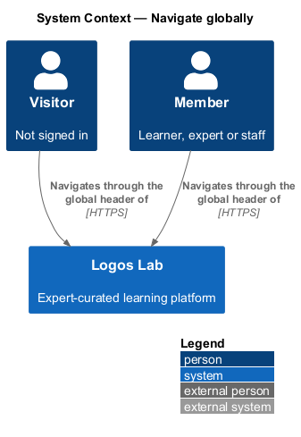
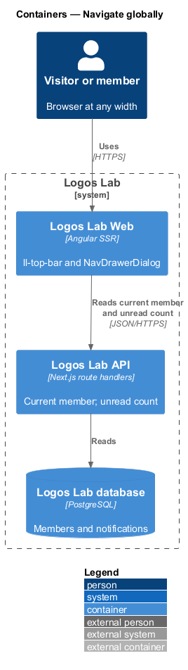
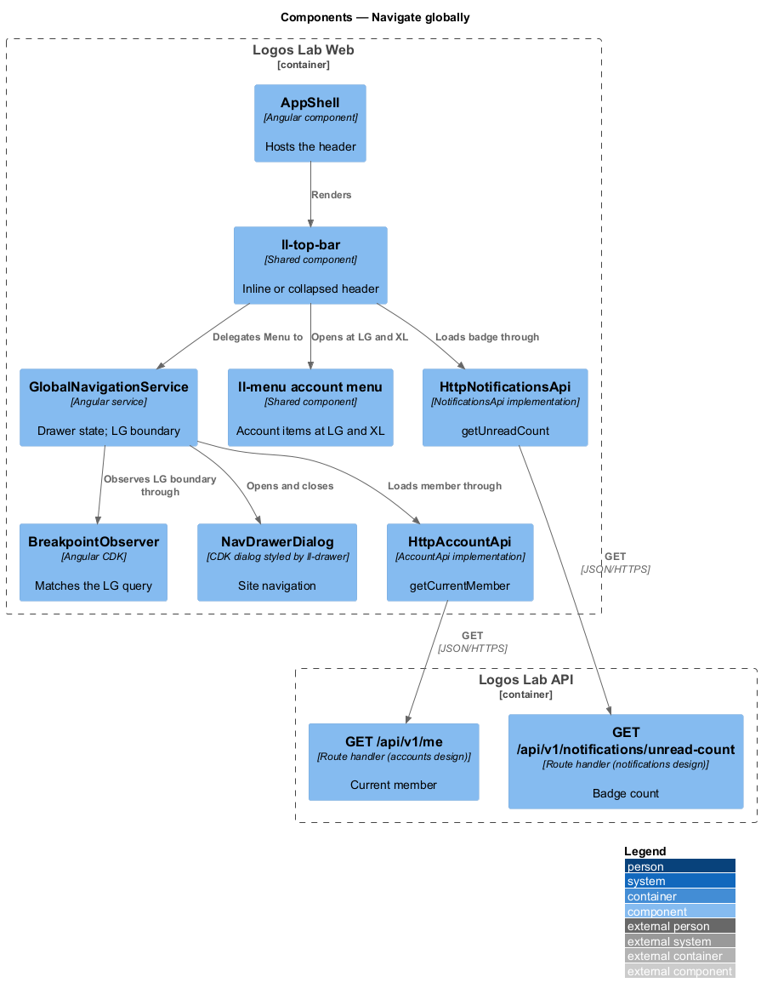
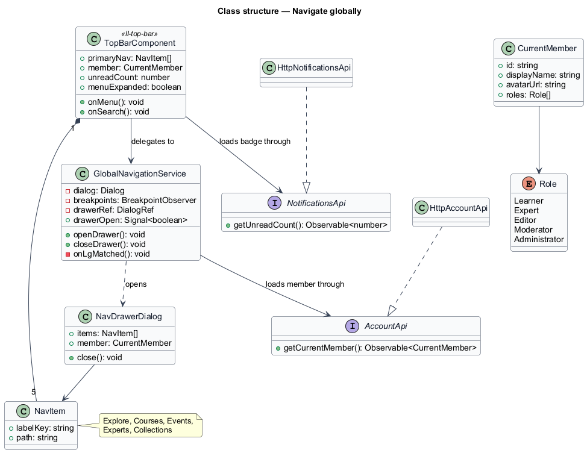
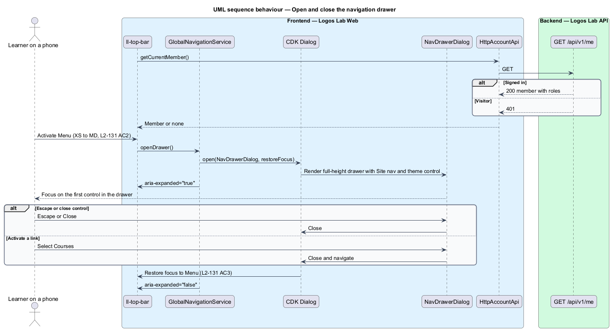
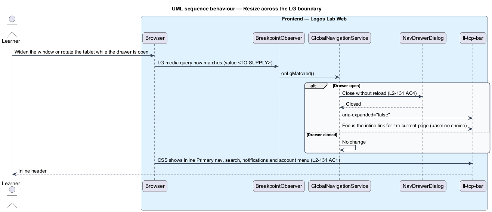

# Navigate globally

## Overview

Every Logos Lab page starts with the same global header. The header carries the brand, the primary
navigation, search, notifications and the account menu. On a wide screen all of these fit on 1 line.
On a phone they do not, so the header folds the navigation into a drawer. This feature defines both
forms and the change between them.

The feature belongs to the responsive and theming subsystem, next to adapt layouts across viewports
and select theme. It is a front-end slice. The header reads the signed-in member and the unread
notification count from APIs that other designs own.

- **global header** — top bar shown on every page, rendered by `ll-top-bar`
- **primary navigation** — the 5 top-level links: Explore, Courses, Events, Experts and Collections
- **inline navigation** — primary navigation shown as links inside the header
- **navigation drawer** — full-height modal panel that slides in from the side and holds the primary
  navigation on narrow viewports
- **LG boundary** — lower edge of the large viewport class; above it the header shows inline navigation,
  below it the drawer

## Description

### Components

- **`ll-top-bar`** — header component (`.header`, `.header__inner`, `.header__actions`). It renders
  `ll-brand`, the inline primary navigation `nav` labelled "Primary" (`.nav`, `.nav__list`,
  `.nav__link`), search, notifications and the account menu or the "Sign in" and "Create account"
  actions.
- **Inline form, LG and XL** — primary navigation, the header search field
  (`.search.header__search--wide`), the notifications button and the account menu are visible inline
  (`L2-131` AC1).
- **Collapsed form, XS to MD** — the inline navigation is hidden. A "Menu" button (`.menu-btn`) with
  `aria-expanded` opens the drawer, and a search icon button (`.icon-btn.header__search-btn`) opens the
  search suggestions dialog of the discovery design (`L2-131` AC2).
- **`NavDrawerDialog`** — drawer opened with the Angular CDK `Dialog` service and styled by `ll-drawer`
  (`.sheet.sheet--left`). It holds a "Site" `nav` built from `ll-sidebar-navigation` with a "Browse"
  group (the 5 primary links) and a "Display" group with the theme control. It ends with "Create
  account" and "Sign in" for visitors, or account links for members. A close control sits at the top.
  Mocks: `docs/mocks/dialogs/nav-drawer/` (states `default`, `signed-in`, `staff`); the `staff` state
  adds the studio and staff links for the member's roles.
- **`GlobalNavigationService`** — Logos Lab Web service that owns the drawer state. It opens and closes
  `NavDrawerDialog`, mirrors the state to the Menu button's `aria-expanded`, and watches the LG boundary
  through `BreakpointObserver`.
- **`ll-menu` account menu** — popup menu from the avatar button at LG and XL (mock
  `docs/mocks/dialogs/account-menu/`). Below LG its items move into the drawer.

### Rules

- At LG and XL, the primary navigation, search, notifications and account menu are inline
  (`L2-131` AC1).
- At XS to MD, the primary navigation sits behind "Menu", whose `aria-expanded` reflects the drawer
  state. Search is reachable from a search icon button (`L2-131` AC2).
- Escape or the close control closes the drawer, and focus returns to the "Menu" button
  (`L2-131` AC3). The CDK `Dialog` provides the focus trap and the focus restoration.
- When the viewport crosses the LG boundary while the drawer is open, the drawer closes and the inline
  navigation appears without a reload (`L2-131` AC4). Focus then moves to the inline link for the
  current page, because the "Menu" button is hidden at LG (baseline choice; the specification does not
  say where focus goes).
- The LG boundary is 992px in `L1-022` and 64rem (1024px) in the design system and the mocks. The value
  that ships is `<TO SUPPLY>` and follows the decision in adapt layouts across viewports.

### Data the header reads

- **`AccountApi.getCurrentMember()`** — contract of the accounts design, backed by `GET /api/v1/me`
  and `GetCurrentMemberAction`. It returns the display name, avatar, roles and theme preference, or 401
  for a visitor. The header uses the roles to pick the drawer variant.
- **`NotificationsApi.getUnreadCount()`** — contract of the notifications design, backed by
  `GET /api/v1/notifications/unread-count`. It feeds the badge on the notifications button.
- Both calls return personal data and carry `Cache-Control: private, no-store`.

## Requirements

| L2 ID | Refines (L1) | Requirement |
|-------|--------------|-------------|
| `L2-131` | `L1-022` | **Global navigation across viewports.** The global header and navigation shall adapt to the viewport. |

## Diagrams

### System context

Visitors and members move around Logos Lab through the same global header on every device.

### Containers

Logos Lab Web renders the header and the drawer. Logos Lab API supplies the current member and the
unread notification count.

### Components

`ll-top-bar` renders either form. `GlobalNavigationService` opens `NavDrawerDialog` and watches the LG
boundary.

### Class structure

`GlobalNavigationService` owns the drawer state and the `CurrentMember` the header reads. The 5
`NavItem` values feed both the inline navigation and the drawer.

### Behaviour — open and close the drawer

Below LG, "Menu" opens the drawer and sets `aria-expanded="true"`. Escape or the close control closes
it and returns focus to "Menu".

### Behaviour — resize across the LG boundary

When the viewport widens past the LG boundary with the drawer open, the drawer closes. The inline
navigation appears without a reload.

