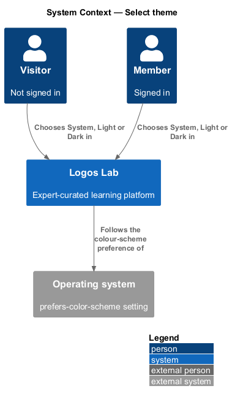
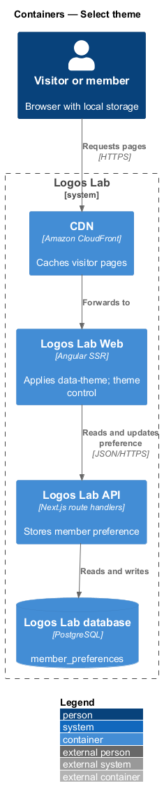
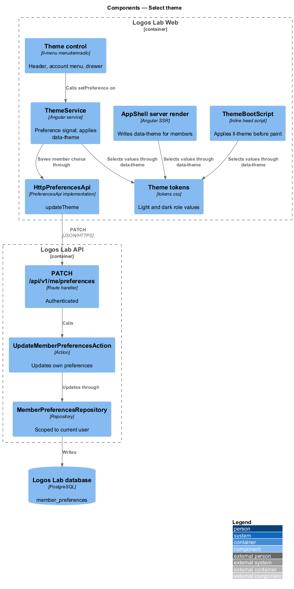
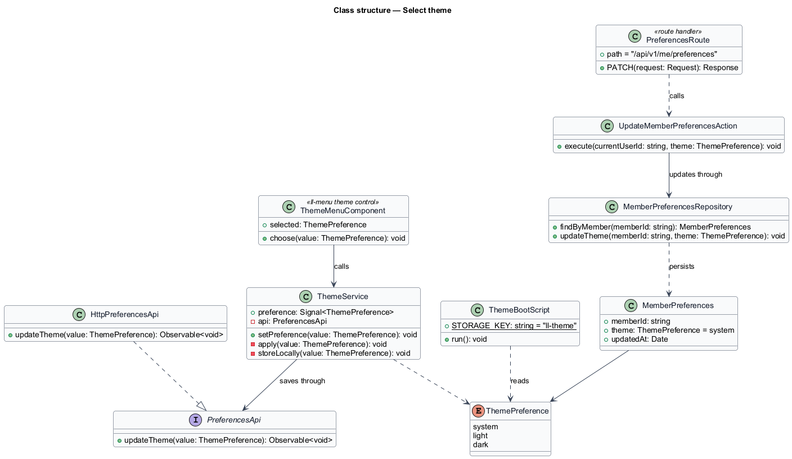
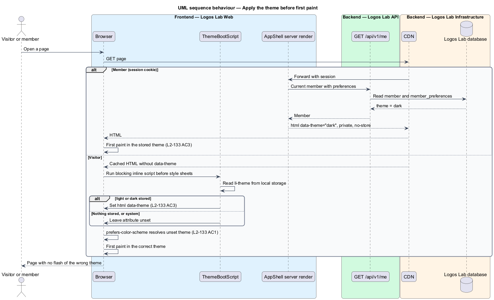
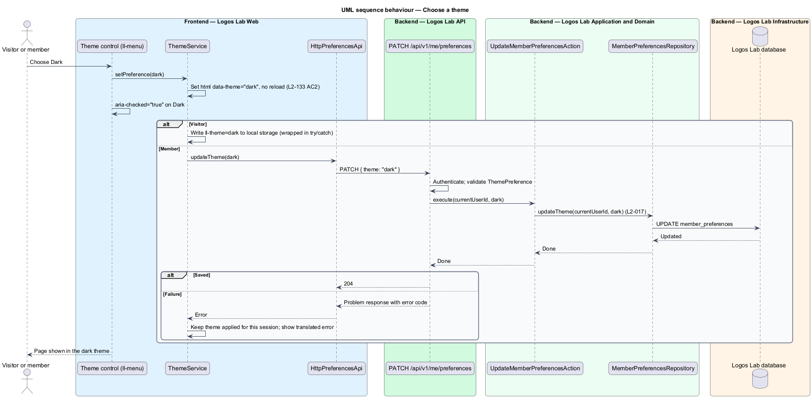

# Select theme

## Overview

Logos Lab has 2 themes: a light theme ("birch paper by day") and a dark theme ("lamplight at night").
A person may follow their device's setting or choose 1 theme for Logos Lab. This feature lets them
choose, remembers the choice, applies it before the page first paints, and keeps both themes complete
and legible.

The feature belongs to the responsive and theming subsystem, next to adapt layouts across viewports
and navigate globally. It spans Logos Lab Web, which applies the theme, and Logos Lab API, which stores
a signed-in member's choice.

- **theme** — set of colour values for the semantic colour roles, either light or dark
- **theme preference** — stored choice of `system`, `light` or `dark`; `system` follows the operating
  system
- **semantic colour role** — design token named for its purpose, such as `--color-fg-default` or
  `--color-bg-surface`, with a light and a dark value
- **flash of the wrong theme** — brief paint in one theme before the page switches to the stored theme
- **contrast pair** — foreground role and background role declared together so their contrast ratio
  can be checked

## Description

### Theme mechanism

- **Theme tokens** — `docs/design-system/tokens/tokens.css`. `:root` holds the light values, and
  `[data-theme="dark"]` holds the dark values. The build generates a
  `@media (prefers-color-scheme: dark)` block from the dark block, applied unless the page sets
  `data-theme="light"`. Components read roles only and never test the theme.
- **`<html data-theme>`** — the single switch. With no attribute, the theme follows
  `prefers-color-scheme` (`L2-133` AC1). With `light` or `dark`, that theme applies.

### Choosing a theme

- **Theme control** — 3 options rendered with `ll-menu` as `menuitemradio` items with `aria-checked`.
  It appears in 3 places: the header theme menu (`docs/mocks/dialogs/theme-menu/`, states `default`
  and `selected`), the account menu (`docs/mocks/dialogs/account-menu/`, states `default`, `selected`
  and `staff`) and the "Display" group of the navigation drawer (`docs/mocks/dialogs/nav-drawer/`).
  Below LG the header theme button folds into the drawer.
- **Option labels** — `L2-133` AC2 names the options System, Light and Dark. The mocks label the first
  option "Match my device". The shipped label is `<TO SUPPLY>`; the stored value is `system` either way.
- **`ThemeService`** — Logos Lab Web service. It holds the preference as a signal and sets or removes
  `data-theme` at once, without a reload (`L2-133` AC2). For a visitor it writes the preference to
  local storage under the key `ll-theme`. For a member it saves the preference through the API. Every
  storage access is wrapped so private browsing cannot break the page.
- **`PreferencesApi`**, **`PREFERENCES_API`**, **`HttpPreferencesApi`** — API contract, injection token
  and HTTP implementation. `updateTheme(preference)` sends `PATCH /api/v1/me/preferences`.
- **`PATCH /api/v1/me/preferences`** — authenticated route handler. It validates the value against
  `ThemePreference` and calls `UpdateMemberPreferencesAction`.
- **`UpdateMemberPreferencesAction`** — updates the current member's row through
  `MemberPreferencesRepository`. The query takes the current user's id, so one member cannot change
  another's preference (`L2-017`).
- **`MemberPreferences`** — entity in table `member_preferences`: `member_id` (primary key), `theme`
  (`system`, `light` or `dark`, default `system`) and `updated_at`.
- What happens to a visitor's stored choice when that visitor signs in is `<TO SUPPLY>`.

### Applying the theme before first paint

- **Members** — Logos Lab Web's server render already resolves the current member for the header. It
  writes `data-theme` on `<html>` from `MemberPreferences.theme` in the HTML it sends, so the first
  paint uses the stored theme (`L2-133` AC3). These responses carry `Cache-Control: private, no-store`.
- **Visitors** — public pages are cached at the CDN and cannot carry a per-visitor attribute. A
  **`ThemeBootScript`** — a small blocking inline script at the top of `<head>`, before any style
  sheet — reads `ll-theme` from local storage and sets `data-theme` before first paint (`L2-133` AC3).
  The Content Security Policy allows this script by hash.
- **System preference** — when the preference is `system`, no attribute is set and the CSS media query
  resolves the theme during style calculation, so no script runs before paint.

### Theme parity

- **Token-only colour** — every colour in Logos Lab Web comes from a semantic role with a dark value.
  No component writes `[data-theme="dark"]` rules or hex values (`L2-134` AC1). The frontend linter's
  style rules flag raw colour values.
- **Contrast pairs** — `docs/design-system/tokens/contrast-pairs.json` lists the pairs. The
  design-system contrast check verifies them in both themes against `L2-129` AC5: body text at least
  4.5:1, large text at least 3:1, component boundaries and icons at least 3:1 (`L2-134` AC2).
- **Dark-theme scans** — the `AccessibilityScan` and `ResponsiveVisualSuite` page objects run every page
  and state in both themes, so a light-only colour shows up as a contrast violation or a visual
  difference.
- **Images** — photographs, expert photos and cover images are never inverted or filtered. Images with
  transparent backgrounds sit on a token-defined surface such as `--color-bg-surface`, so they stay
  legible in the dark theme (`L2-134` AC3). Illustrated tiles use the tile roles (`.tile--sage`,
  `.tile--clay`, `.tile--oat`, `.tile--fjord`), which have dark values.

## Requirements

| L2 ID | Refines (L1) | Requirement |
|-------|--------------|-------------|
| `L2-133` | `L1-022` | **Theme selection.** Users shall be able to use a light or a dark theme. |
| `L2-134` | `L1-022` | **Theme parity.** Both themes shall be complete and shall meet contrast requirements. |

## Diagrams

### System context

Visitors and members choose a theme in Logos Lab. The operating system supplies the default through
`prefers-color-scheme`.

### Containers

Logos Lab Web applies the theme and keeps a visitor's choice in local storage. Logos Lab API stores a
member's choice in the Logos Lab database.

### Components

`ThemeService` drives the theme control and `data-theme`. `ThemeBootScript` and the server render apply
the stored theme before first paint.

### Class structure

`ThemePreference` has 3 values. `ThemeService` depends on the `PreferencesApi` contract, and
`UpdateMemberPreferencesAction` persists `MemberPreferences` through its repository.

### Behaviour — apply the theme before first paint

A member's page arrives with `data-theme` already set. A visitor's cached page sets it from local
storage in a blocking script before the style sheets apply.

### Behaviour — choose a theme

Choosing an option applies it at once. A member's choice is saved to the account, and a visitor's
choice is saved in local storage.

