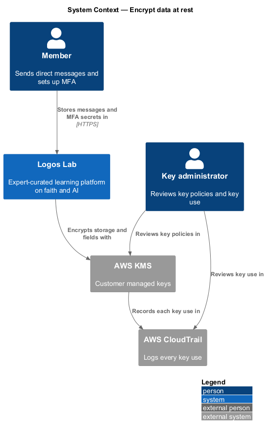
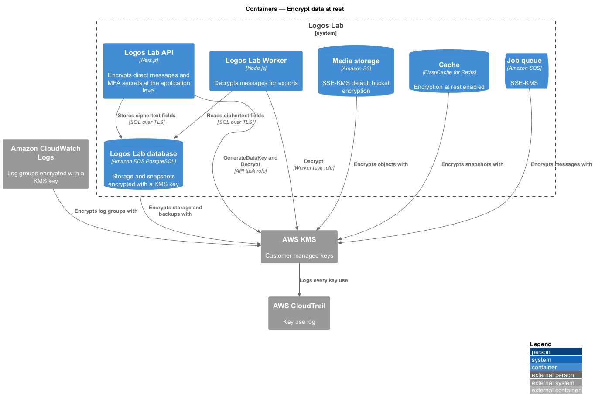
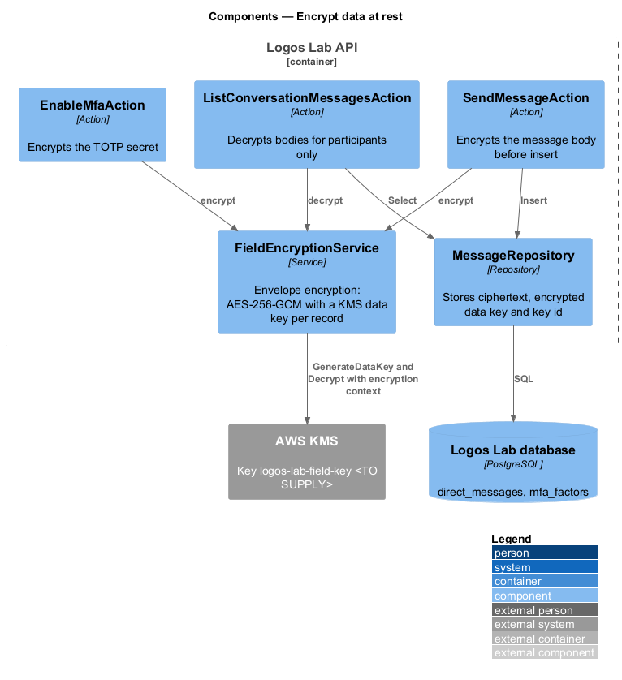
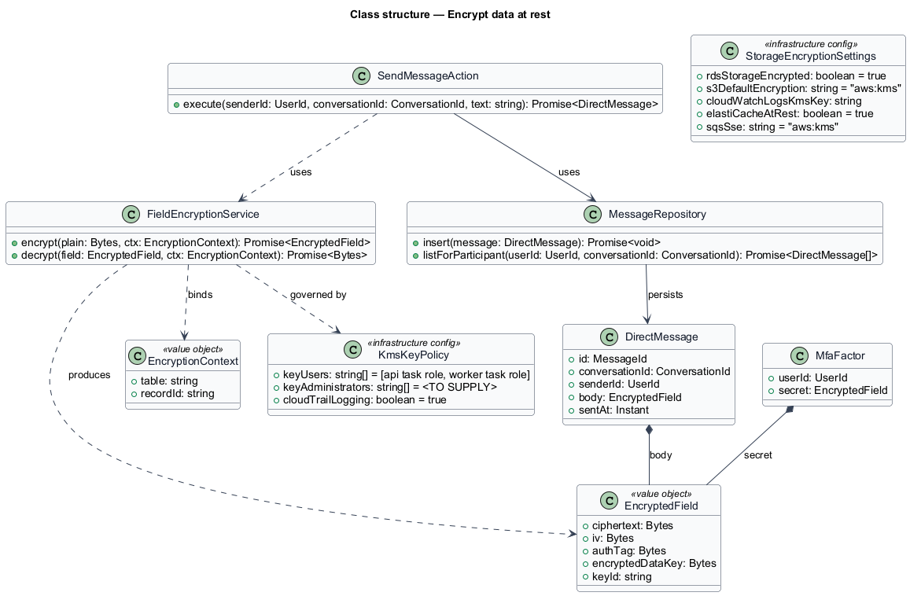
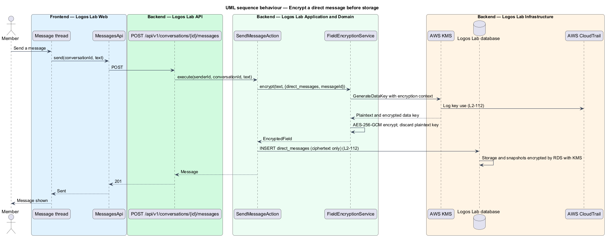
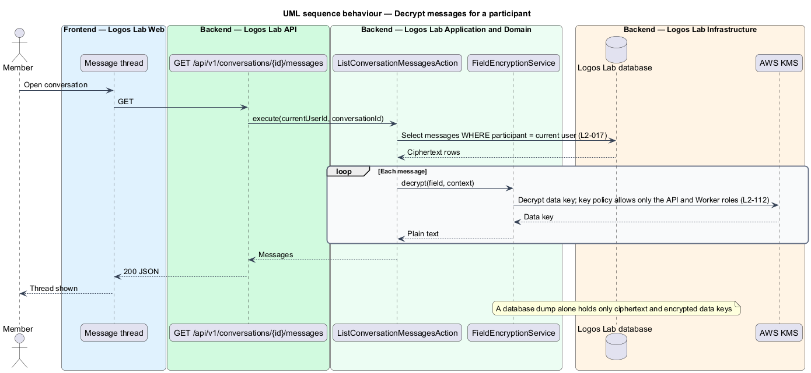

# Encrypt data at rest

## Overview

Logos Lab stores personal data in a database, object storage, caches, queues, backups and logs. A lost
disk, a leaked snapshot or a misused console session could expose that data. This feature encrypts every
store with managed keys and adds a second, application-level layer for the most sensitive fields.

- **encryption at rest** — encryption of stored data so that the storage medium alone does not reveal it
- **customer managed key** — AWS KMS key whose policy and use Logos Lab controls
- **envelope encryption** — scheme that encrypts each record with its own data key and stores that data
  key encrypted under a KMS key
- **application-level encryption** — encryption performed by Logos Lab code before a value reaches the
  database
- **encryption context** — non-secret values bound to a ciphertext, such as table and record id, that
  decryption checks for an exact match

The feature belongs to the security subsystem. Direct messaging (`L2-066`) and MFA (`L2-014`) store
their protected fields through it, and `store-passwords-and-secrets` (`L2-109`) shares
`FieldEncryptionService`.

## Description

**Storage encryption.** Each store uses a customer managed KMS key. The key aliases are `<TO SUPPLY>`.

| Store | Setting |
|---|---|
| Logos Lab database (Amazon RDS PostgreSQL) | Storage encryption on; automated backups and snapshots inherit it |
| Media storage and release artifact store (Amazon S3) | Default bucket encryption `aws:kms` |
| Cache (ElastiCache for Redis) | Encryption at rest on |
| Job queue (Amazon SQS) | Server-side encryption with KMS |
| Logs (Amazon CloudWatch Logs) | Each log group associated with a KMS key |
| Security log archive (S3 with Object Lock) | Default bucket encryption `aws:kms` |

`StorageEncryptionSettings` records these settings in infrastructure code (tool `<TO SUPPLY>`). A key
administrator can confirm each one in the cloud console.

**Application-level encryption.**
- **`FieldEncryptionService`** — for each record it asks KMS `GenerateDataKey` for a data key with the
  encryption context `{table, recordId}`. It encrypts the value with AES-256-GCM and discards the
  plaintext data key. The resulting `EncryptedField` holds the ciphertext, IV, authentication tag,
  encrypted data key and key id. Data-key caching is `<TO SUPPLY>`.
- **`SendMessageAction`** — encrypts the body of each direct message before it inserts the row in
  `direct_messages`.
- **`ListConversationMessagesAction`** — loads only the conversations the current member takes part in
  (`L2-017`) and decrypts each body.
- **`EnableMfaAction`** — encrypts the TOTP secret before it inserts the row in `mfa_factors`.

A database dump alone therefore holds only ciphertext and encrypted data keys for messages and MFA
secrets.

**Key policy and audit.**
- **`KmsKeyPolicy`** — allows `Encrypt`, `Decrypt` and `GenerateDataKey` only to the API and Worker task
  roles, and to the service principals of the stores above. Key administrators manage the key but cannot
  use it to decrypt. The administrator role names are `<TO SUPPLY>`.
- **AWS CloudTrail** — logs every key use, with the caller and encryption context, for review by a key
  administrator.

## Requirements

| L2 ID | Refines (L1) | Requirement |
|-------|--------------|-------------|
| `L2-112` | `L1-018` | **Encryption at rest.** All stored data shall be encrypted at rest. |

## Diagrams

### System context

Logos Lab encrypts its stores and protected fields with AWS KMS. CloudTrail records each key use, and the
key administrator reviews key policies and key use.

### Containers

Every data store encrypts with a KMS key. The API and Worker also encrypt and decrypt protected fields
under their own task roles.

### Components

`SendMessageAction`, `ListConversationMessagesAction` and `EnableMfaAction` call
`FieldEncryptionService`, which uses KMS data keys bound to an encryption context.

### Class structure

`DirectMessage` and `MfaFactor` each hold an `EncryptedField`. `FieldEncryptionService` produces it under
`KmsKeyPolicy`.

### Behaviour — encrypt a direct message

The action encrypts the body with a fresh data key, and CloudTrail logs the key use. Only ciphertext
reaches the database.

### Behaviour — decrypt messages for a participant

The action loads only the member's own conversation and decrypts each body. KMS permits the call only for
the API and Worker roles.

