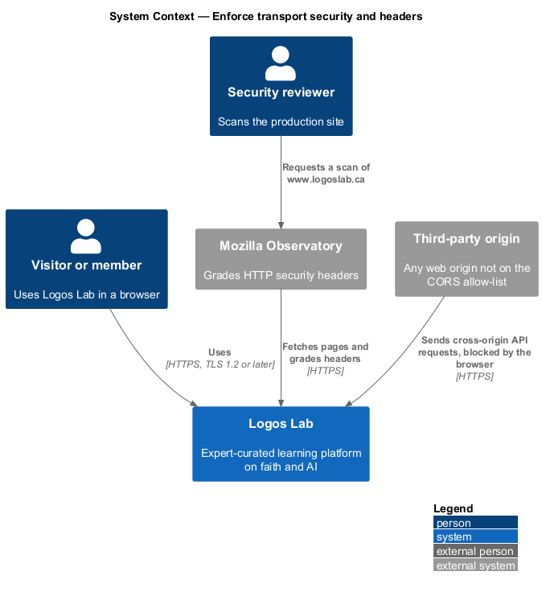
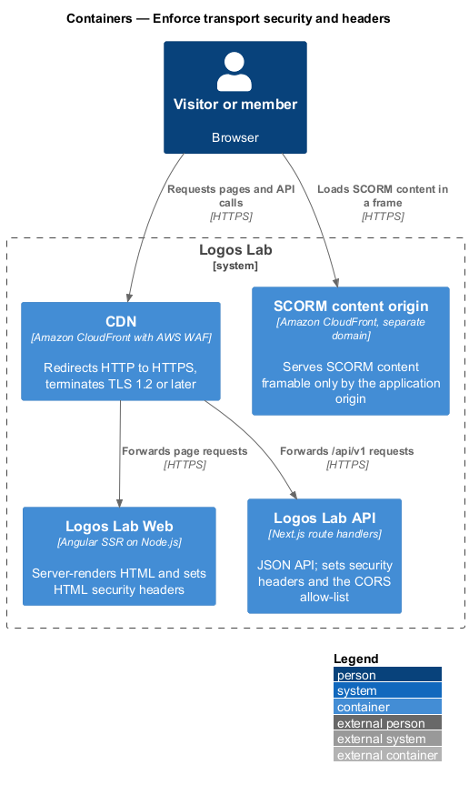
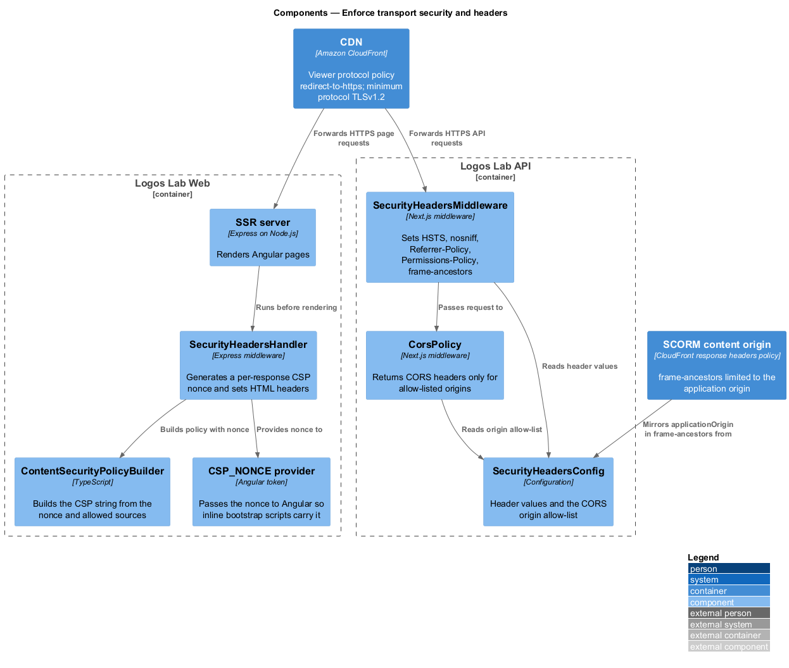
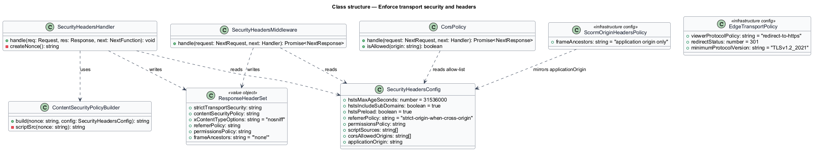
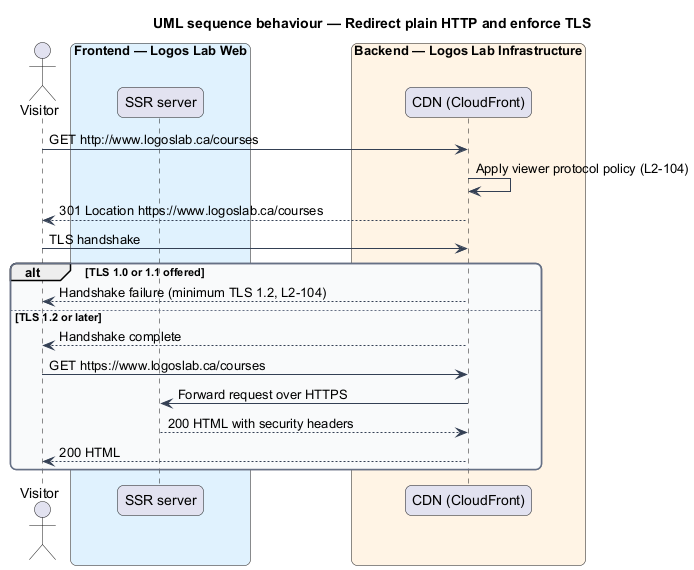
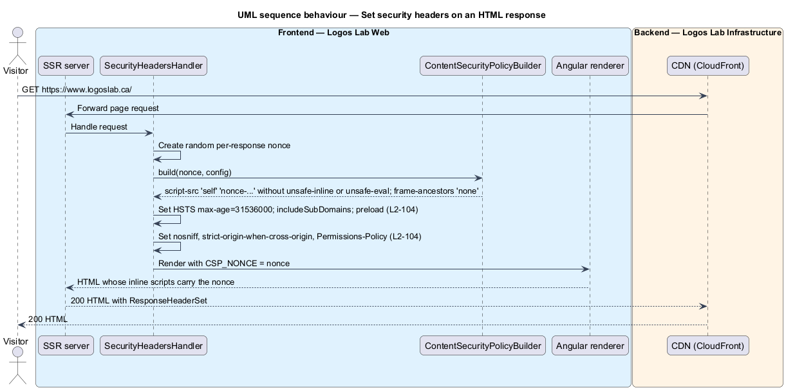
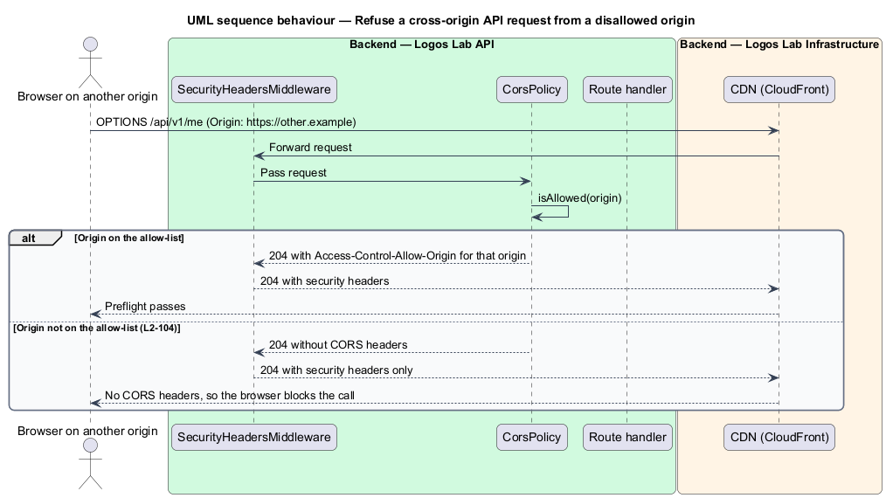

# Enforce transport security and headers

## Overview

Logos Lab is an expert-curated learning platform on Christian faith and artificial intelligence. It
serves pages and a JSON API to browsers over the public internet. This feature keeps that traffic
encrypted and instructs browsers to apply their built-in protections to every response.

Two mechanisms carry the feature. The first is transport security: every connection uses TLS, and plain
HTTP is redirected to HTTPS at the edge. The second is a fixed set of response headers on each HTML
page and API response.

- **security header** — HTTP response header that tells a browser to restrict how a page loads,
  frames or shares content
- **Content Security Policy (CSP)** — security header that lists the sources a page may load
  scripts, styles and frames from
- **nonce** — random, single-use value placed in the CSP and on each inline script that the server
  itself emitted
- **CORS allow-list** — set of web origins whose scripts may read Logos Lab API responses

The feature belongs to the security subsystem. It sits in front of every other feature: the CDN applies
it before a request reaches Logos Lab Web or the Logos Lab API, and the two containers add the headers on
the way out. The SCORM content origin (`L2-034`) is the single exception to the framing rule.

## Description

The slice is configuration and middleware; it adds no page or dialog. Every page in `docs/mocks/` is
delivered under these headers.

**Edge (CDN).**
- **CloudFront viewer protocol policy** — `redirect-to-https`. A plain HTTP request receives `301` with
  the HTTPS location.
- **CloudFront minimum protocol version** — `TLSv1.2_2021`. TLS 1.0 and TLS 1.1 handshakes fail.
- **SCORM origin response headers policy** — a CloudFront response headers policy on the SCORM content
  origin. It sets `frame-ancestors` to the application origin only, so SCORM content can be framed by
  `www.logoslab.ca` and by nothing else.

**Logos Lab Web.**
- **`SecurityHeadersHandler`** — Express middleware in the Angular SSR server. It creates a random nonce
  for each response and sets the HTML security headers before rendering.
- **`ContentSecurityPolicyBuilder`** — builds the CSP string. Scripts load from `'self'` and from the
  nonce only; the policy contains neither `unsafe-inline` nor `unsafe-eval` for scripts. It sets
  `frame-ancestors 'none'`.
- **`CSP_NONCE` provider** — passes the nonce to Angular, so the inline scripts Angular emits during
  server rendering and hydration carry it.

**Logos Lab API.**
- **`SecurityHeadersMiddleware`** — third stage of the API middleware pipeline. It sets the same
  headers on every API response.
- **`CorsPolicy`** — returns `Access-Control-Allow-Origin` and the related headers only when the request
  `Origin` is on the allow-list. For any other origin it returns no CORS headers, and the browser blocks
  the response. The allow-list contents are `<TO SUPPLY>`.
- **`SecurityHeadersConfig`** — one configuration object for header values and the CORS allow-list,
  shared by both containers.

**Headers on every HTML response.**

| Header | Value |
|---|---|
| `Strict-Transport-Security` | `max-age=31536000; includeSubDomains; preload` |
| `Content-Security-Policy` | Nonce-based `script-src` without `unsafe-inline` or `unsafe-eval`; `frame-ancestors 'none'`; other directives `<TO SUPPLY>` |
| `X-Content-Type-Options` | `nosniff` |
| `Referrer-Policy` | `strict-origin-when-cross-origin` |
| `Permissions-Policy` | Denies every feature the product does not use; exact feature list `<TO SUPPLY>` |

**Verification.** The production site shall score A or higher on Mozilla Observatory. The scan runs
before launch and after each change to `SecurityHeadersConfig`; whether it also runs on a schedule is
`<TO SUPPLY>`.

## Requirements

| L2 ID | Refines (L1) | Requirement |
|-------|--------------|-------------|
| `L2-104` | `L1-018` | **Transport security and security headers.** All traffic shall be encrypted, and every response shall carry protective security headers. |

## Diagrams

### System context

Visitors and members reach Logos Lab over HTTPS only. Mozilla Observatory grades the headers, and
browsers on origins outside the allow-list cannot read API responses.

### Containers

The CDN terminates TLS and redirects HTTP. Logos Lab Web sets the HTML headers, the Logos Lab API sets
API headers and CORS, and the SCORM content origin allows framing by the application origin only.

### Components

`SecurityHeadersHandler` builds a per-response CSP with `ContentSecurityPolicyBuilder` and hands the
nonce to Angular. In the API, `SecurityHeadersMiddleware` and `CorsPolicy` read `SecurityHeadersConfig`.

### Class structure

The handler and the middleware both write a `ResponseHeaderSet` from `SecurityHeadersConfig`. The edge and
SCORM origin settings are infrastructure configuration rather than code.

### Behaviour — redirect plain HTTP and enforce TLS

CloudFront answers a plain HTTP request with `301` and refuses TLS 1.0 and TLS 1.1 handshakes. Only an
HTTPS request over TLS 1.2 or later reaches the SSR server.

### Behaviour — set security headers on an HTML response

The SSR server creates a nonce, builds the CSP, sets the remaining headers and renders the page with the
nonce on each inline script.

### Behaviour — refuse a cross-origin request from a disallowed origin

`CorsPolicy` omits CORS headers for an origin that is not on the allow-list. The browser then blocks the
response.

