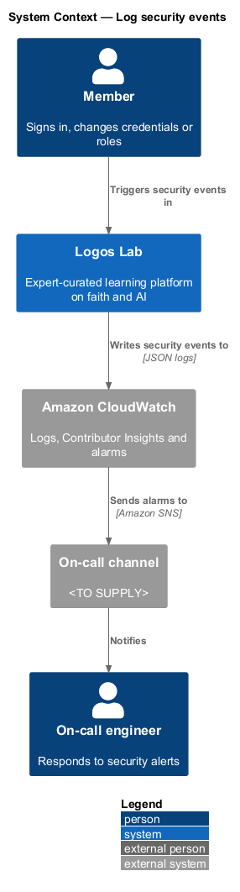
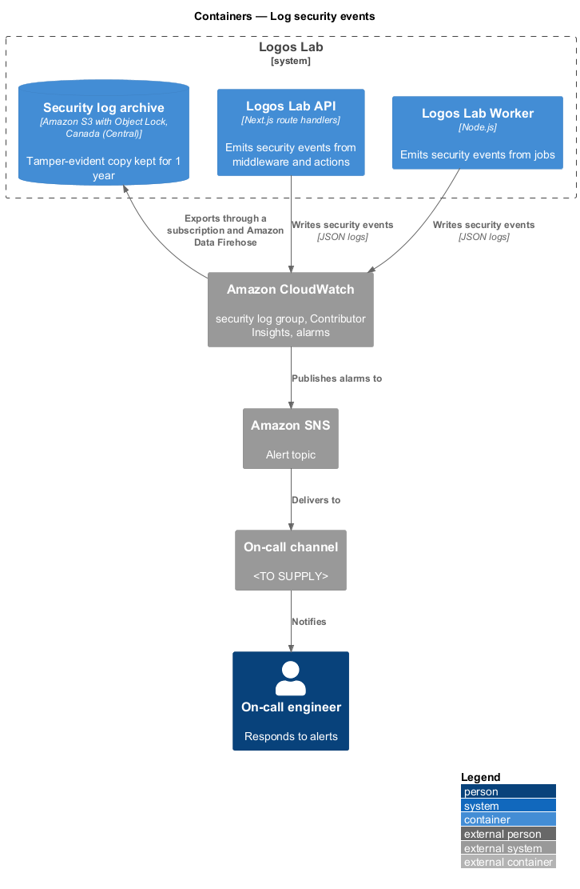
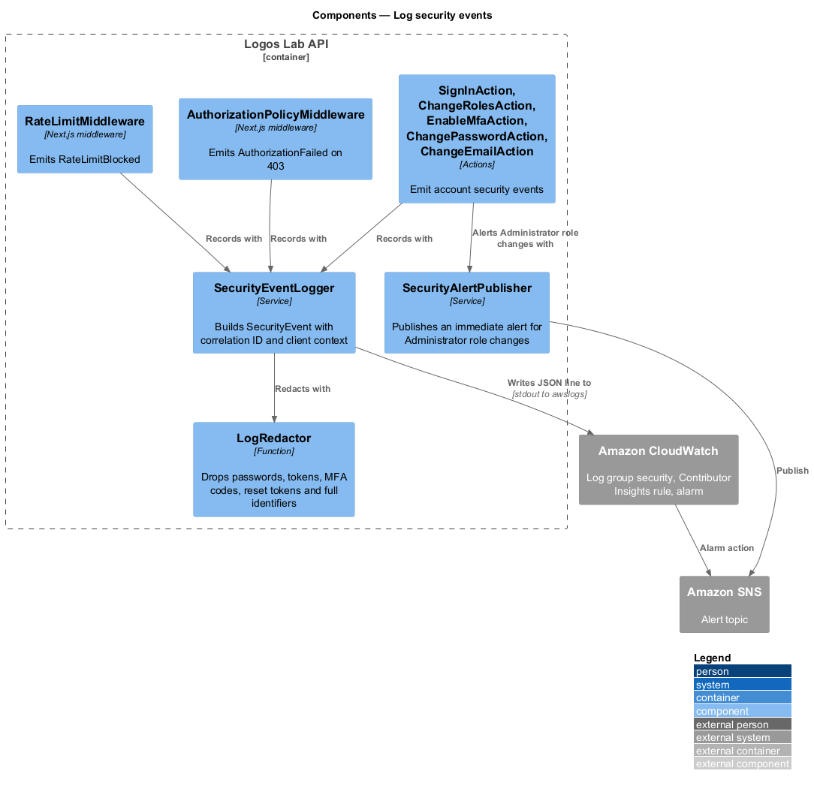
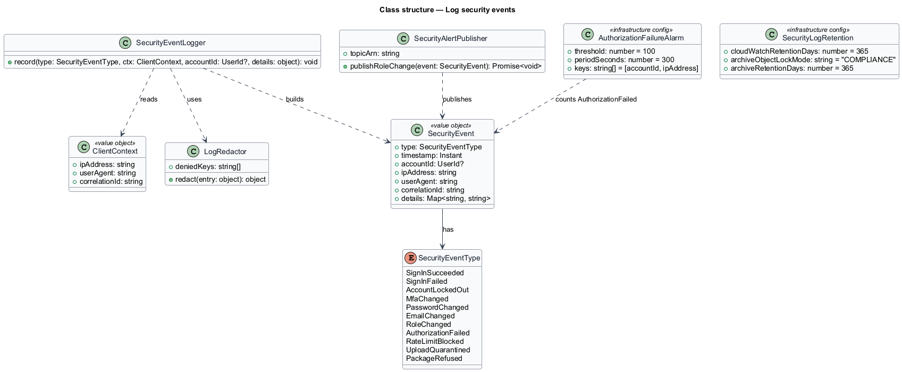
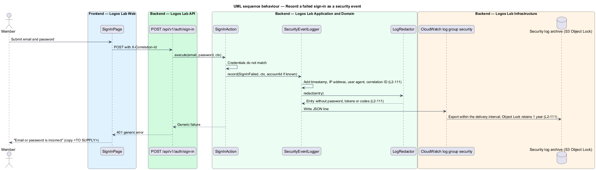
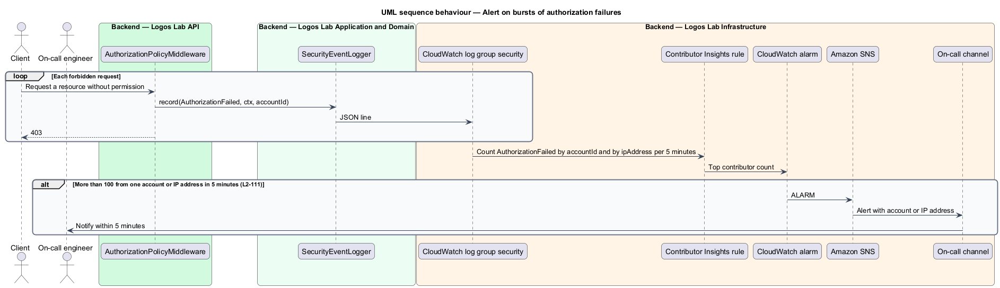
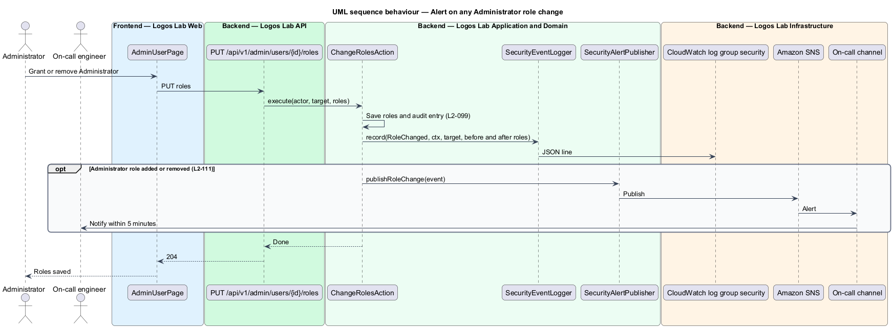

# Log security events

## Overview

Attacks on accounts leave traces: failed sign-ins, lockouts, refused requests and unexpected role
changes. This feature records each of these as a structured security event, keeps the record safe from
tampering, and alerts the on-call engineer when the pattern points to an attack in progress.

- **security event** — structured log entry for an action that affects account or platform security
- **correlation ID** — identifier shared by every log entry of one request across Logos Lab Web, the
  API, jobs and external calls (`L2-137`)
- **tamper-evident** — stored so that any change or deletion within the retention period is prevented
  or detectable
- **on-call channel** — destination that pages the engineer on duty (`<TO SUPPLY>`)

The feature belongs to the security subsystem. Other features emit events through it: brute-force
protection (`L2-009`), MFA (`L2-014`), credential changes (`L2-012`), role changes (`L2-018`), upload
scanning (`L2-108`) and rate limiting (`L2-107`). It is separate from the administrative audit log
(`L2-099`), which records editorial and administrative changes for 7 years.

## Description

**Events recorded.** `SecurityEventType` lists each event, and the emitting component.

| Event | Emitted by |
|---|---|
| `SignInSucceeded`, `SignInFailed` | `SignInAction` |
| `AccountLockedOut` | `SignInAction` under `L2-009` |
| `MfaChanged` | `EnableMfaAction`, `DisableMfaAction` |
| `PasswordChanged`, `EmailChanged` | `ChangePasswordAction`, `ChangeEmailAction`, `SetPasswordAction` |
| `RoleChanged` | `ChangeRolesAction` |
| `AuthorizationFailed` | `AuthorizationPolicyMiddleware` on every `403` |
| `RateLimitBlocked` | `RateLimitMiddleware` on every `429` |
| `UploadQuarantined`, `PackageRefused` | `UploadScanJob` (`L2-108`, `L2-033`) |

**Recording.**
- **`SecurityEventLogger`** — builds a `SecurityEvent` with timestamp, account identifier (if any), IP
  address, user agent and correlation ID. It writes one JSON line to standard output, which the task's log
  driver sends to the CloudWatch log group `security`.
- **`ClientContext`** — carries the IP address, user agent and correlation ID from the request into
  actions and jobs.
- **`LogRedactor`** — removes passwords, session tokens, MFA codes, reset tokens and full payment or
  government identifiers from every entry before it is written.

**Retention and tamper evidence.**
- The `security` log group keeps entries for 365 days, which meets the 1-year retention of `L2-118`.
- A subscription filter streams the group through Amazon Data Firehose to the security log archive, an S3
  bucket in Canada (Central) with Object Lock in compliance mode for 1 year. No role, including the root
  account, can change or delete an archived entry before then.
- Both stores are encrypted with a KMS key (`L2-112`).

**Alerting.** Both alerts reach the on-call channel through Amazon SNS within 5 minutes.
- **Authorization-failure burst** — a CloudWatch Contributor Insights rule counts `AuthorizationFailed`
  by `accountId` and by `ipAddress`. An alarm fires when one contributor exceeds 100 in 5 minutes.
- **Administrator role change** — `ChangeRolesAction` calls `SecurityAlertPublisher` whenever the
  Administrator role is added or removed. The publisher sends the alert at once, without waiting for a
  metric period.

## Requirements

| L2 ID | Refines (L1) | Requirement |
|-------|--------------|-------------|
| `L2-111` | `L1-018` | **Security event logging and alerting.** Security-relevant events shall be logged and shall alert the team. |

## Diagrams

### System context

Members trigger security events in Logos Lab. Amazon CloudWatch stores and analyses them, and alarms reach
the on-call engineer through the on-call channel.

### Containers

The API and Worker write security events to CloudWatch. CloudWatch exports them to the Object Lock archive
and raises alarms through Amazon SNS.

### Components

Middleware and actions call `SecurityEventLogger`, which redacts each entry before writing it.
`SecurityAlertPublisher` sends Administrator role-change alerts directly.

### Class structure

`SecurityEventLogger` builds a `SecurityEvent` from a `ClientContext` and redacts it with `LogRedactor`.
The alarm and retention settings are infrastructure configuration.

### Behaviour — record a failed sign-in

A failed sign-in produces one redacted JSON entry with timestamp, IP address, user agent and correlation
ID, archived under Object Lock.

### Behaviour — alert on bursts of authorization failures

Contributor Insights counts `403` events per account and per IP address. More than 100 in 5 minutes
raises an alarm.

### Behaviour — alert on an Administrator role change

Any change to the Administrator role is logged, audited and alerted at once.

