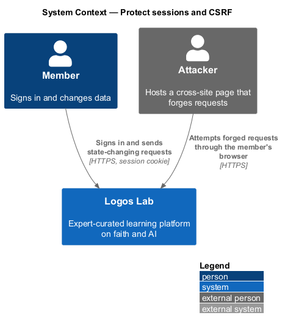
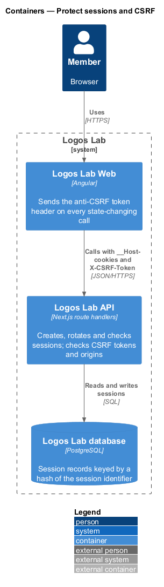
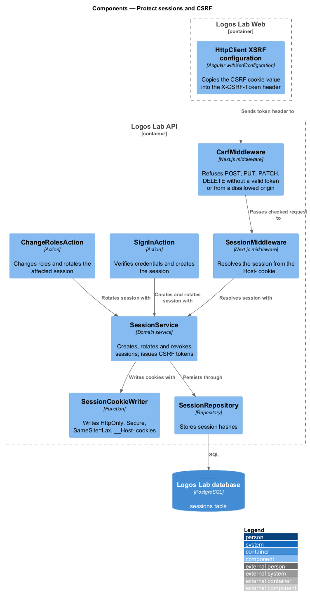
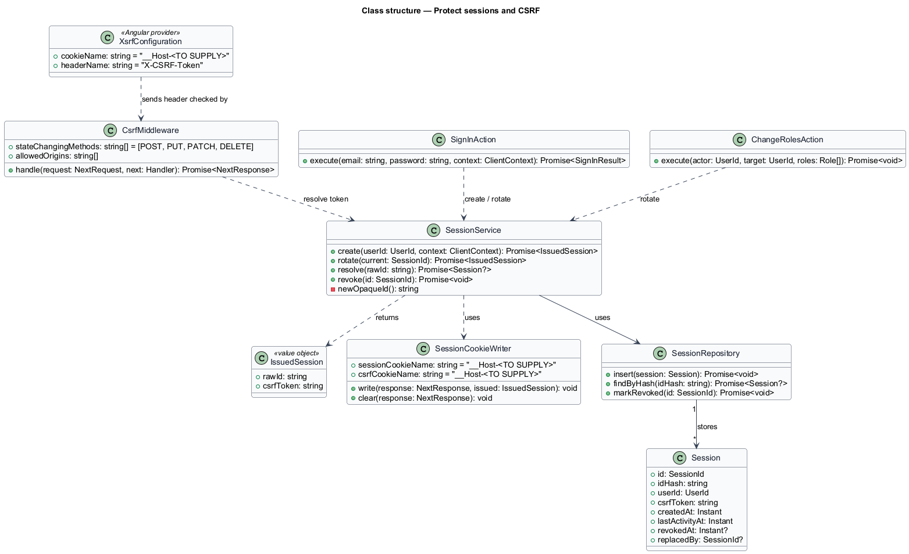
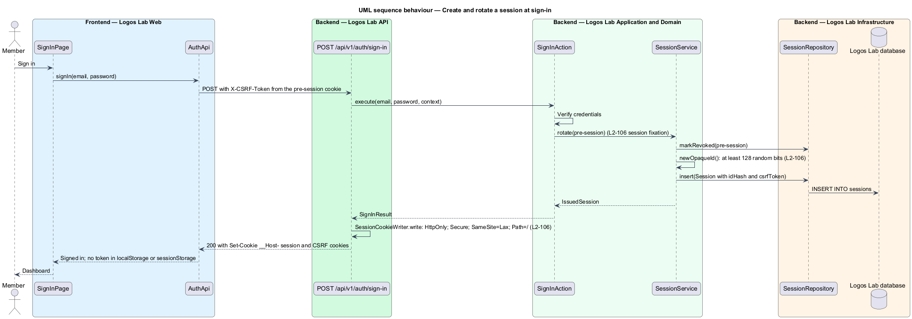
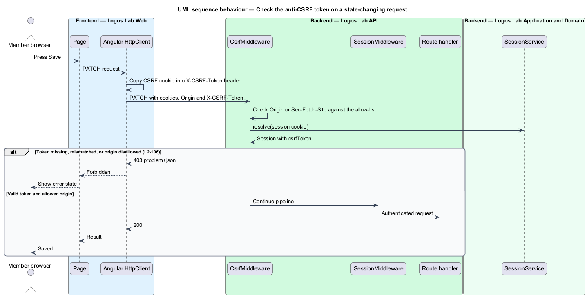
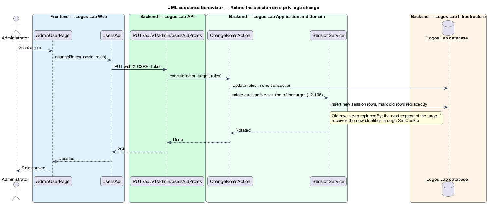

# Protect sessions and CSRF

## Overview

A member who signs in to Logos Lab receives a session. The browser presents the session on each later
request, so anyone who obtains it acts as that member. This feature keeps the session credential out of
reach of scripts and other sites, and stops other sites from sending requests in the member's name.

- **session** — server-side record that ties a browser to a signed-in member until it expires or is
  revoked
- **session identifier** — opaque random value in a cookie that names one session
- **cross-site request forgery (CSRF)** — attack in which another site makes the member's browser
  send a state-changing request that carries the member's cookies
- **anti-CSRF token** — per-session secret that a state-changing request repeats in a header to prove
  it came from Logos Lab Web
- **session fixation** — attack that plants a known session identifier before sign-in so the attacker
  shares the session afterwards

The feature belongs to the security subsystem. Session lifetimes and sign-out belong to `L2-010`; this
feature fixes how the credential is issued, stored, checked and rotated.

## Description

**Session cookie.** `SessionService.create` issues an opaque identifier of at least 128 random bits from
a cryptographically secure generator. The database stores only a hash of it (`sessions.id_hash`).
`SessionCookieWriter` sets the cookie with:

- `HttpOnly`, so page scripts cannot read it;
- `Secure`, so it travels only over HTTPS;
- `SameSite=Lax`, so cross-site sub-requests do not carry it;
- the `__Host-` prefix with `Path=/` and no `Domain`, so no subdomain can set or read it.

The cookie names are `<TO SUPPLY>`. No session token is ever stored in `localStorage` or
`sessionStorage`. The SCORM content origin shares no cookies with `www.logoslab.ca` (`L2-034`).

**CSRF check.**
- **`CsrfMiddleware`** — fourth stage of the API middleware pipeline. For `POST`, `PUT`, `PATCH` and
  `DELETE` it requires an `X-CSRF-Token` header that matches the session's token. It also checks
  `Origin`, or `Sec-Fetch-Site` when `Origin` is absent, against the allowed origins. Any failure returns
  `403` with a problem response, and the request goes no further.
- **Angular `withXsrfConfiguration`** — in Logos Lab Web, configures `HttpClient` to copy the token from
  a readable `__Host-` CSRF cookie into the `X-CSRF-Token` header on each state-changing call.
- **Anonymous forms** — sign-in and registration use a pre-session that carries its own token, so these
  forms are protected before a member is signed in.

**Rotation.** A new identifier replaces the old one when:

- **`SignInAction`** succeeds — the pre-session is revoked and a fresh session is issued;
- **`ChangeRolesAction`** changes a member's roles — each active session of that member is replaced.
  The old row keeps `replacedBy`, and the member's next request receives the new identifier through
  `Set-Cookie`;
- MFA is enabled or a password changes — the same rotation runs (`<TO SUPPLY>` whether these count as
  privilege changes beyond `L2-010` criterion 6).

**Data.** Table `sessions`: `id_hash`, `user_id`, `csrf_token`, `created_at`, `last_activity_at`,
`revoked_at`, `replaced_by`. `SessionRepository` reads and writes it.

## Requirements

| L2 ID | Refines (L1) | Requirement |
|-------|--------------|-------------|
| `L2-106` | `L1-018` | **Session cookies and CSRF protection.** Session credentials shall be protected from theft and cross-site request forgery. |

## Diagrams

### System context

A member signs in and sends state-changing requests. A hostile site tries to forge requests through the
member's browser.

### Containers

Logos Lab Web sends the token header, the API issues and checks sessions and tokens, and the database
holds only hashed identifiers.

### Components

`CsrfMiddleware` runs before `SessionMiddleware`. `SignInAction` and `ChangeRolesAction` create and rotate
sessions through `SessionService`, which writes cookies with `SessionCookieWriter`.

### Class structure

`SessionService` returns an `IssuedSession` holding the raw identifier and token; `Session` stores only the
hash. `CsrfMiddleware` reads the token through `SessionService`.

### Behaviour — create and rotate a session at sign-in

Sign-in revokes the pre-session, issues a new random identifier and sets the `__Host-` cookies.

### Behaviour — check the anti-CSRF token

A state-changing request without a matching token, or from a disallowed origin, receives `403`.

### Behaviour — rotate the session on a privilege change

A role change replaces each active session of the affected member in the same use case.

