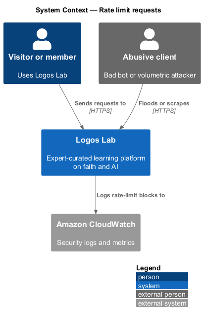
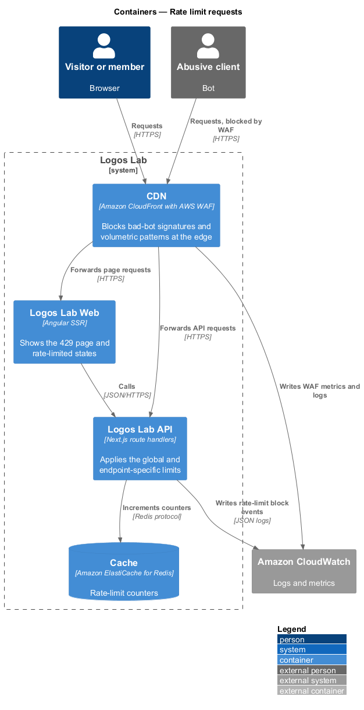
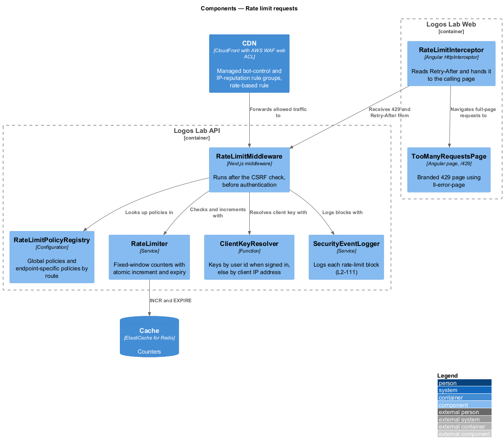
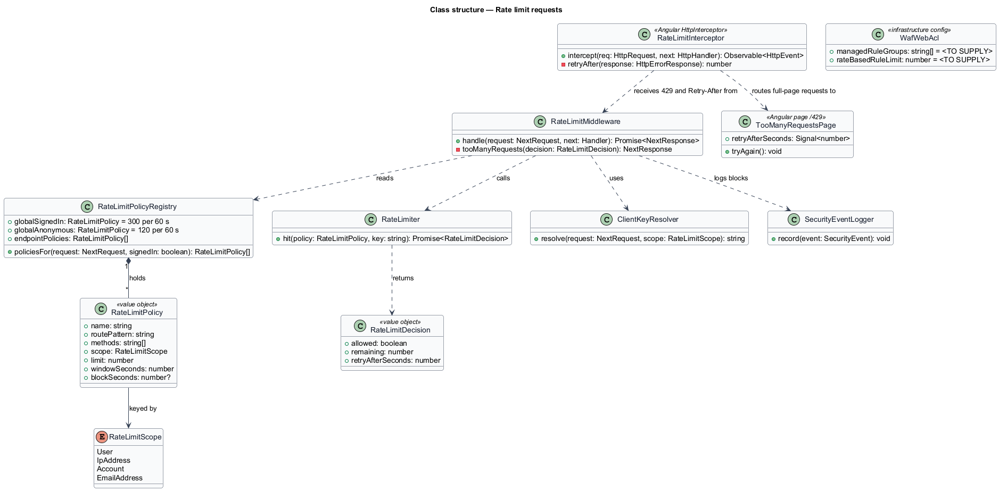
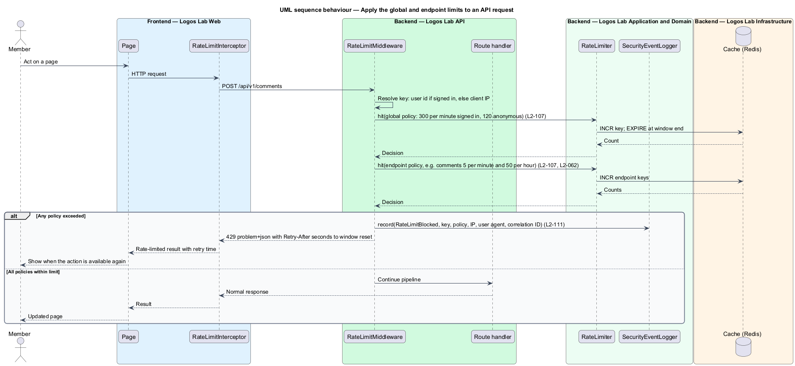
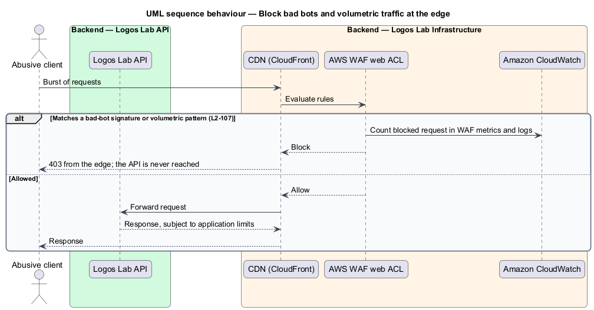

# Rate limit requests

## Overview

Logos Lab is open to anonymous visitors and has thousands of members. A single client that sends too
many requests can slow the platform for everyone, guess codes and passwords, or flood comments and
messages. This feature caps request rates at two layers and tells legitimate clients when they may try
again.

- **rate limit** — maximum number of requests one client may make within a fixed time window
- **client key** — value that identifies the client a limit counts against: user id, account, email
  address or IP address
- **global limit** — rate limit that applies to every API request
- **endpoint limit** — stricter rate limit that applies to one endpoint in addition to the global limit
- **web application firewall (WAF)** — edge filter that inspects requests before they reach the
  application

The feature belongs to the security subsystem. Endpoint limits are set by the owning feature's L2
requirement; this feature holds the shared mechanism, the global limits and the edge protection.

## Description

**Edge protection.** An AWS WAF web ACL on the CloudFront distribution blocks traffic that matches
known bad-bot signatures or volumetric attack patterns before it reaches the application. The managed
rule groups and the rate-based rule threshold are `<TO SUPPLY>`. WAF metrics and sampled requests go to
Amazon CloudWatch.

**API mechanism.**
- **`RateLimitMiddleware`** — fifth stage of the API middleware pipeline, after the CSRF check and before
  authentication, as the baseline orders it. It evaluates every policy that applies to the request.
- **`RateLimitPolicyRegistry`** — holds the global policies and the endpoint policies, each as a
  `RateLimitPolicy` with route pattern, methods, scope, limit, window and optional block period.
- **`ClientKeyResolver`** — keys a request that carries a valid session by its user id, read through `SessionService`, and any other
  request by the client IP address taken from the CDN viewer-address header.
- **`RateLimiter`** — fixed-window counters in ElastiCache for Redis with atomic increment and expiry.
  It returns a `RateLimitDecision` with the seconds until the window resets.
- **Refusal** — when any policy is exceeded, the API responds `429` with a problem body and a
  `Retry-After` header set to the seconds until the window resets. The middleware records a
  `RateLimitBlocked` security event (`L2-111`).

**Global limits.**

| Client | Limit |
|---|---|
| Signed in | 300 API requests per minute |
| Anonymous | 120 API requests per minute |

**Endpoint limits, applied in addition to the global limit.**

| Endpoint | Limit | Source |
|---|---|---|
| Sign-in | 5 failures per account in 15 minutes locks the account for 15 minutes; 20 failures per IP address in 15 minutes returns `429` for 15 minutes | `L2-009` |
| Registration | More than 5 attempts per IP address in 10 minutes returns `429` | `L2-006` |
| Password reset | More than 3 requests per email address in an hour sends no email; the response is unchanged | `L2-011` |
| Search | More than 60 requests per client in a minute returns `429` with `Retry-After` | `L2-004` |
| Comments | More than 5 in 1 minute or 50 in 1 hour returns `429` | `L2-062` |
| Messages | More than 20 messages per minute or 10 new conversations per day returns `429` | `L2-066` |
| Reports | More than 10 in an hour returns `429` | `L2-085` |
| Certificate verification | More than 30 per IP address in a minute returns `429` | `L2-032` |
| Follow and unfollow | More than 10 toggles of one expert in a minute returns `429` | `L2-024` |

**Logos Lab Web.**
- **`RateLimitInterceptor`** — Angular `HttpInterceptor` that reads `Retry-After` from a `429` and hands
  the retry time to the calling page. Forms keep what the member typed.
- **`TooManyRequestsPage`** — branded `/429` page built on `ll-error-page`, with "Try again" and a
  support contact (`docs/mocks/pages/too-many-requests/`). It is shown, with status `429`, for a
  rate-limited page request (`L2-141`).
- **Inline states** — pages show the retry time inline for endpoint limits, for example the
  `rate-limited` state of `docs/mocks/pages/register/` and of `docs/mocks/pages/certificate-verify/`.

## Requirements

| L2 ID | Refines (L1) | Requirement |
|-------|--------------|-------------|
| `L2-107` | `L1-018` | **Rate limiting and abuse protection.** The API shall limit request rates to protect availability and prevent abuse. |

## Diagrams

### System context

Members and abusive clients send requests to Logos Lab, which records rate-limit blocks in Amazon
CloudWatch.

### Containers

AWS WAF on the CDN filters bad bots and floods. The API counts requests in the Redis cache, and Logos Lab
Web presents the `429` states.

### Components

`RateLimitMiddleware` resolves the client key, looks up the applicable policies and checks each with
`RateLimiter`. A block is logged with `SecurityEventLogger`.

### Class structure

`RateLimitPolicyRegistry` holds every `RateLimitPolicy`, each keyed by a `RateLimitScope`.
`RateLimiter` returns a `RateLimitDecision` that carries the `Retry-After` value.

### Behaviour — apply the global and endpoint limits

The middleware checks the global limit and then the endpoint limit. Exceeding either returns `429` with
`Retry-After` and logs a security event.

### Behaviour — block bad bots at the edge

AWS WAF blocks matching traffic at the CDN, so the API never receives it.

