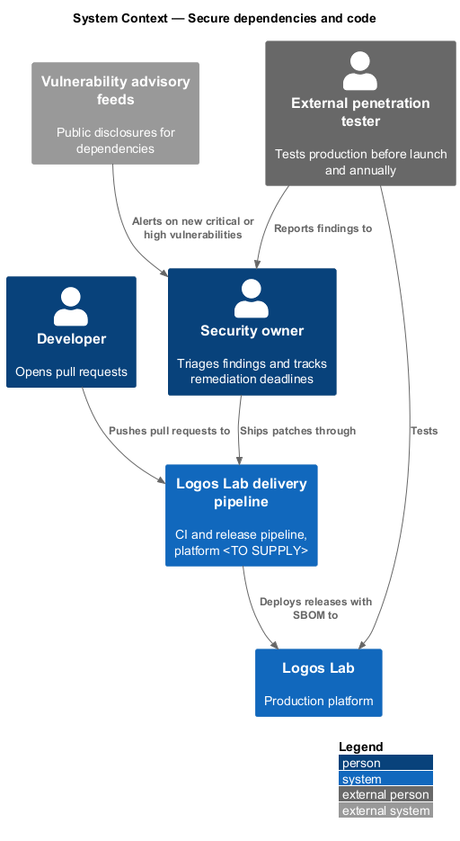
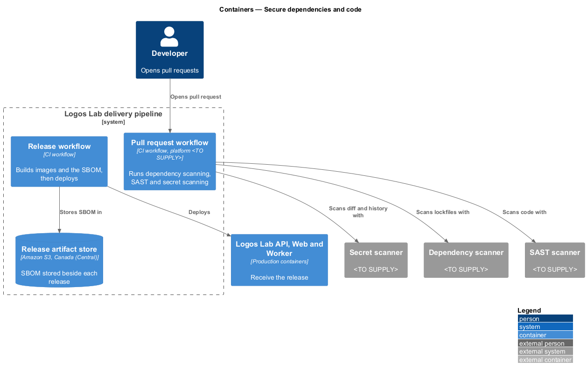
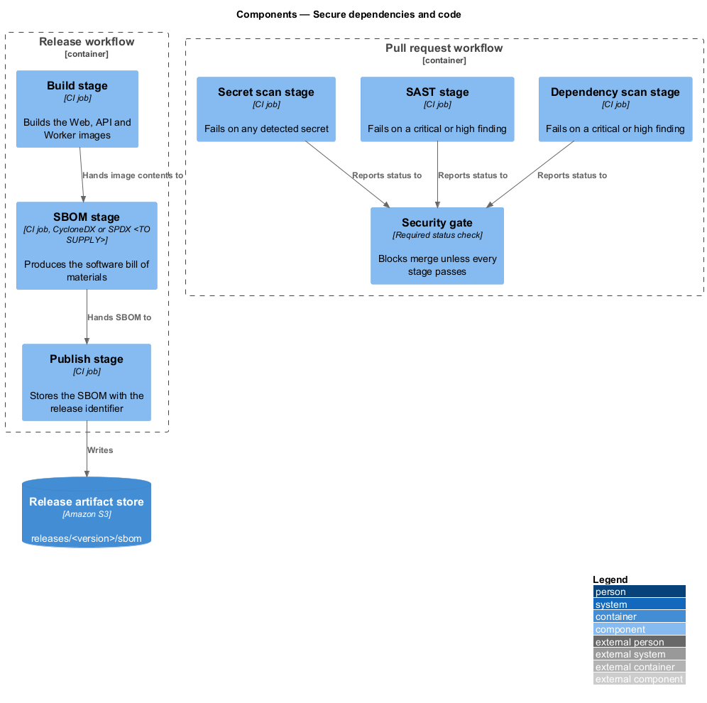
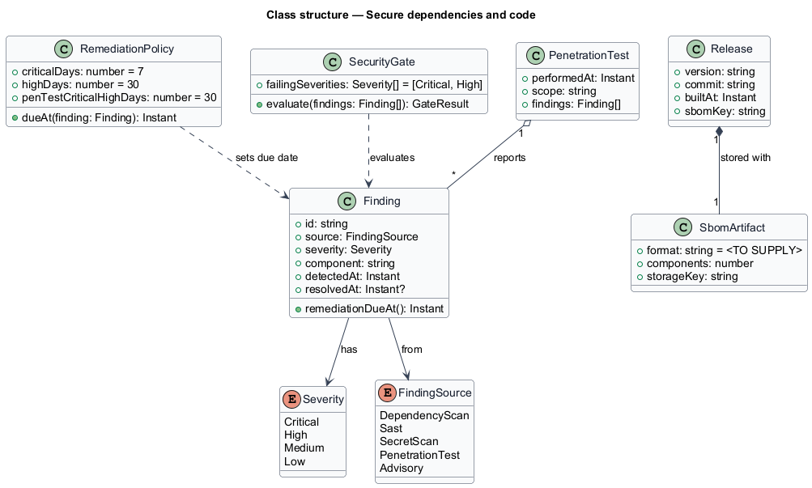
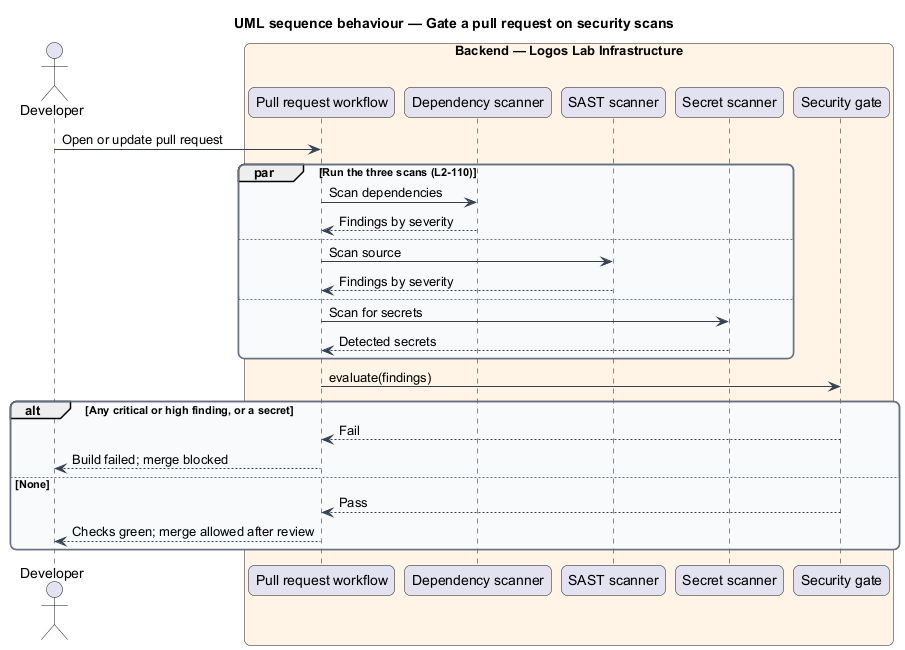
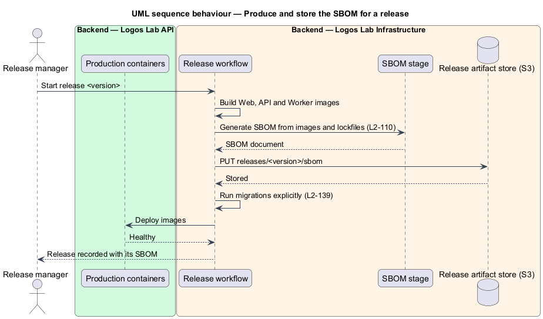
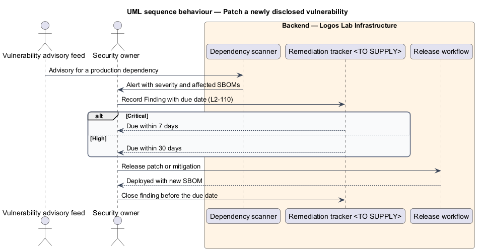

# Secure dependencies and code

## Overview

Logos Lab is built from its own code and from hundreds of open-source packages. A flaw in either, or a
credential committed by mistake, can expose the platform. This feature makes security checks part of
the delivery pipeline, fixes deadlines for patching disclosed vulnerabilities, and records what each
release contains.

- **dependency scanning** — automated comparison of the packages in each lockfile against published
  vulnerability advisories
- **static application security testing (SAST)** — automated analysis of source code for insecure
  patterns, without running it
- **secret scanning** — automated search of commits for credentials, keys and tokens
- **software bill of materials (SBOM)** — machine-readable list of every component and version inside a
  release
- **penetration test** — authorised attack on the production site by an external tester to find
  exploitable weaknesses

The feature belongs to the security subsystem. It acts on the delivery pipeline rather than on run-time
requests, and sits beside deployment and migrations (`L2-139`).

## Description

**Pull request workflow.** The CI platform is `<TO SUPPLY>`. On every pull request it runs three stages:

- **Dependency scan stage** — scans the Logos Lab Web, API and Worker lockfiles with the dependency
  scanner (`<TO SUPPLY>`).
- **SAST stage** — scans the TypeScript source with the SAST scanner (`<TO SUPPLY>`).
- **Secret scan stage** — scans the diff and history with the secret scanner (`<TO SUPPLY>`).

The **security gate** is a required status check. A critical or high finding, or any detected secret,
fails the build and blocks merge. Medium and low findings are recorded for triage and do not fail the
build.

**Release workflow.** For every production release the workflow:

1. builds the Web, API and Worker images;
2. generates the SBOM from the images and lockfiles in the SBOM stage (format, CycloneDX or SPDX, is
   `<TO SUPPLY>`);
3. stores the SBOM at `releases/<version>/sbom` in the release artifact store, an S3 bucket in Canada
   (Central);
4. runs migrations explicitly (`L2-139`) and deploys.

**Remediation deadlines.** `RemediationPolicy` sets the due date of each `Finding`:

| Finding | Deadline in production |
|---|---|
| Critical vulnerability in a production dependency | Patched or mitigated within 7 days of disclosure |
| High vulnerability in a production dependency | Patched or mitigated within 30 days of disclosure |
| Critical or high penetration-test finding | Fixed before launch, or within 30 days after an annual test |

The dependency scanner watches the stored SBOMs and alerts the security owner on a new advisory. The
remediation tracker (`<TO SUPPLY>`) holds each finding with its due date.

**Penetration testing.** An external penetration test runs before launch and annually afterwards. The
tester and the scope are `<TO SUPPLY>`. Its findings enter the same tracker as `Finding` records with
source `PenetrationTest`.

## Requirements

| L2 ID | Refines (L1) | Requirement |
|-------|--------------|-------------|
| `L2-110` | `L1-018` | **Dependency and code security.** The software supply chain and the code shall be checked continuously. |

## Diagrams

### System context

Developers change code through the delivery pipeline, which deploys to Logos Lab. Advisory feeds and an
external penetration tester report findings to the security owner.

### Containers

The pull request workflow calls three scanners. The release workflow stores the SBOM before it deploys
the production containers.

### Components

Three scan stages report to one security gate. The build, SBOM and publish stages produce and store the
SBOM for each release.

### Class structure

A `Finding` has a `Severity` and a `FindingSource`. `SecurityGate` fails on critical and high findings,
and `RemediationPolicy` sets their due dates. Each `Release` keeps one `SbomArtifact`.

### Behaviour — gate a pull request

The three scans run in parallel. Any critical or high finding, or a detected secret, fails the build.

### Behaviour — produce the SBOM for a release

The release workflow stores the SBOM with the release, runs migrations and deploys.

### Behaviour — patch a disclosed vulnerability

A new advisory becomes a finding with a 7-day or 30-day deadline, closed by a patch release.

