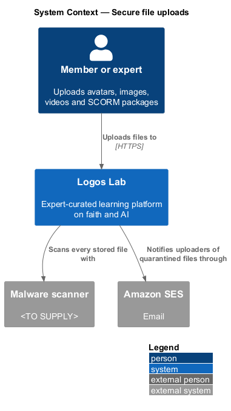
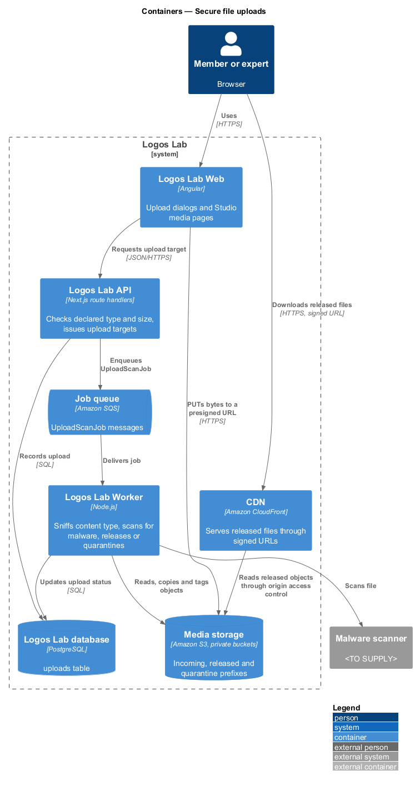
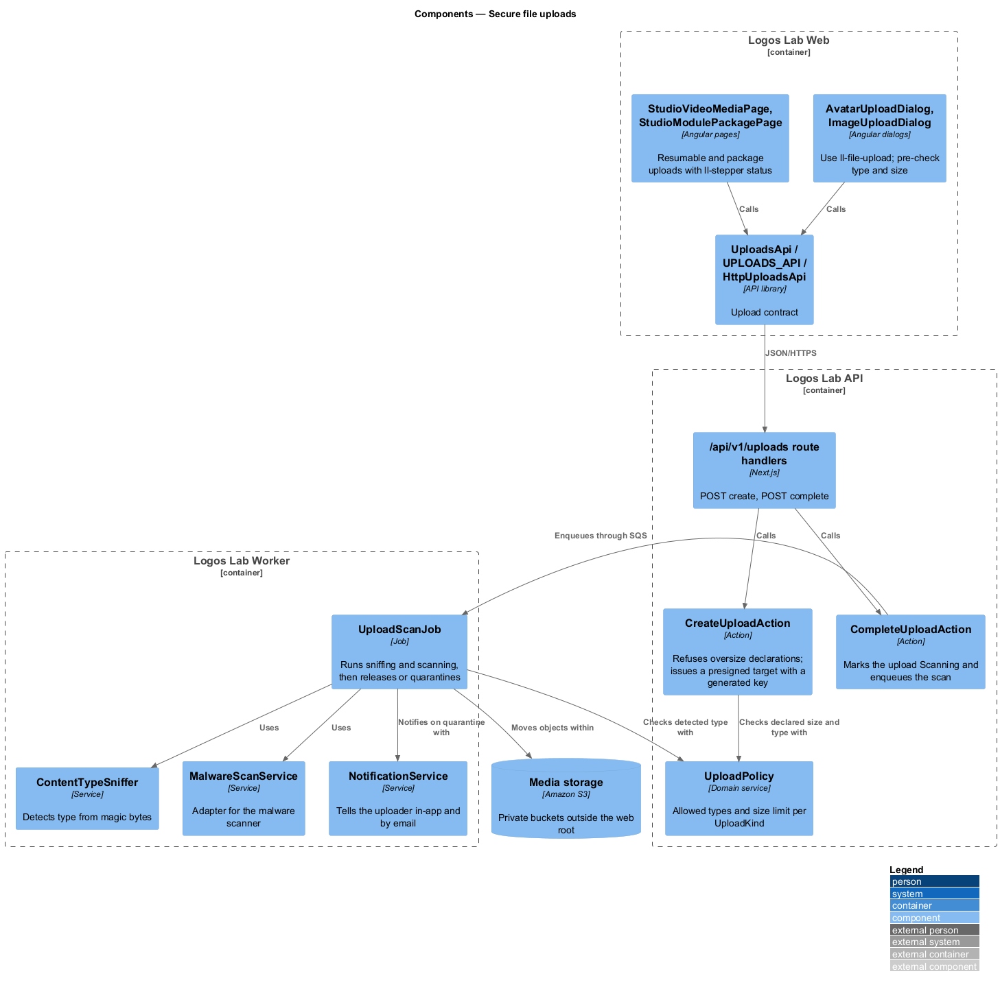
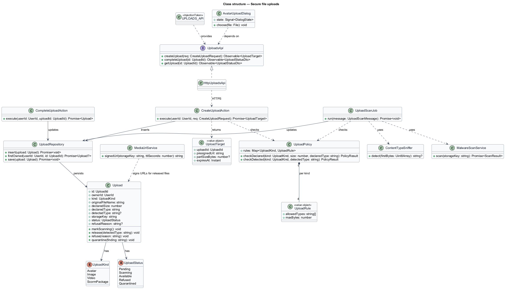
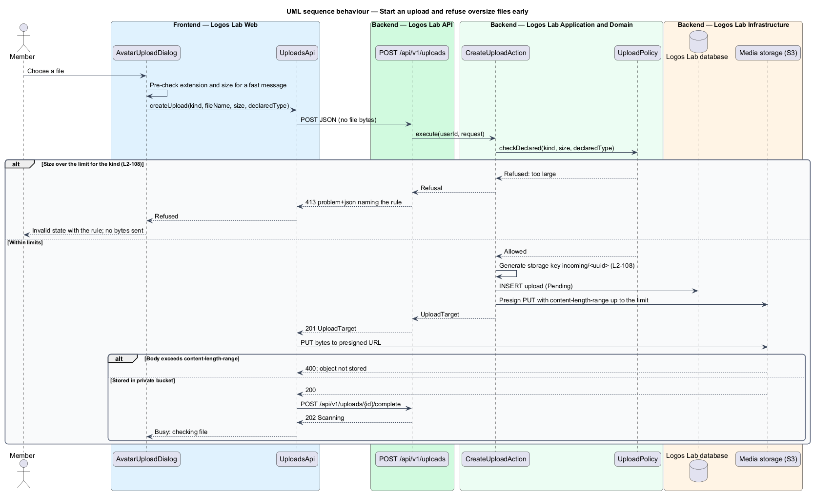
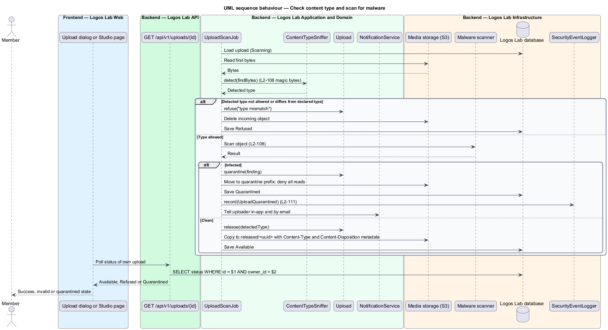
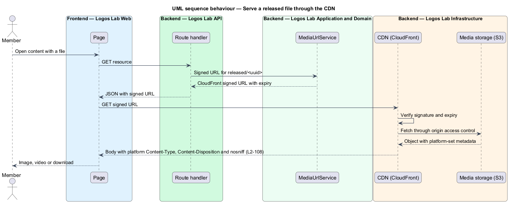

# Secure file uploads

## Overview

Members and experts upload four kinds of file to Logos Lab: profile photos, article and cover images,
video sources and SCORM packages. Any of them could carry malware, disguise one file type as another, or
be large enough to exhaust storage. This feature treats every uploaded file as untrusted until the
platform has checked it.

- **upload kind** — category of uploaded file that fixes its allowed types and size limit: `Avatar`,
  `Image`, `Video` or `ScormPackage`
- **magic bytes** — leading bytes of a file that identify its real format regardless of its name
- **quarantine** — locked storage location for a file that failed the malware scan; nobody can use or
  download it
- **presigned URL** — time-limited Amazon S3 address that lets a browser write one object without
  other storage credentials

The feature belongs to the security subsystem. It is the shared path beneath the upload features: avatars
(`L2-013`), images (`L2-083`), SCORM packages (`L2-033`) and videos (`L2-039`). Those features own their
own rules, such as image renditions and package validation; this feature owns type detection, size
refusal, scanning, storage naming and serving.

## Description

**Screens.** Each upload screen uses `ll-file-upload` and states the rules beside the drop zone.

| Screen | Mock | Upload kind | Size limit |
|---|---|---|---|
| `AvatarUploadDialog` | `docs/mocks/dialogs/avatar-upload/` | `Avatar` (JPEG, PNG, WebP) | 5 MB (`L2-013`) |
| `ImageUploadDialog` | `docs/mocks/dialogs/image-upload/` | `Image` (JPEG, PNG, WebP, AVIF) | 15 MB (`L2-083`) |
| `StudioVideoMediaPage` | `docs/mocks/pages/studio-video-media/` | `Video` (MP4, MOV, WebM) | 10 GB (`L2-039`) |
| `StudioModulePackagePage` | `docs/mocks/pages/studio-module-package/` | `ScormPackage` (zip) | 500 MB (`L2-033`) |

The mocks cover the states this feature drives: `invalid` (wrong type or too large, refused before
transfer), `busy`, `uploading` and `validating` (checking the file), `quarantined`, and `success`. The
uploader also receives an in-app notification (`docs/mocks/notifications/notification/`) and an email
when a file is quarantined.

**API contract.** `UploadsApi` in the shared API library, bound through the `UPLOADS_API` token to
`HttpUploadsApi`.

| Method and path | Action | Result |
|---|---|---|
| `POST /api/v1/uploads` | `CreateUploadAction` | `201` with an `UploadTarget`, or `413`/`415` problem naming the rule |
| `POST /api/v1/uploads/{id}/complete` | `CompleteUploadAction` | `202`; status `Scanning` |
| `GET /api/v1/uploads/{id}` | read through `UploadRepository.findOwned` | Current status of the caller's own upload |

**Size refusal before the body is read.** The browser sends only the file name, declared type and size
to `POST /api/v1/uploads`. `UploadPolicy.checkDeclared` refuses a size over the kind's limit, so no bytes
are sent. The presigned URL carries a `content-length-range` condition up to the same limit, so Amazon S3
refuses a body that exceeds it. Videos use multipart presigned parts (50 MB each, per the mock) for
resumable upload under `L2-039`.

**Generated names in private storage.** `CreateUploadAction` names every object `incoming/<uuid>` in a
private S3 bucket. The member's file name is kept only as data in the `uploads` table. No bucket is public
and none is under the web root.

**Type detection and scanning.** `CompleteUploadAction` enqueues `UploadScanJob` on SQS. The job runs in
the Logos Lab Worker:

1. `ContentTypeSniffer` reads the magic bytes. A detected type that is not allowed for the kind, or that
   differs from the declared type, refuses the upload and deletes the object.
2. `MalwareScanService` scans the object with the malware scanner (`<TO SUPPLY>`). SCORM packages are
   scanned file by file (`L2-033`).
3. A clean file is copied to `released/<uuid>` with `Content-Type` set from the detected type and
   `Content-Disposition` set by the platform. The upload becomes `Available`.
4. An infected file moves to the `quarantine/` prefix, which denies all reads. The upload becomes
   `Quarantined`, `SecurityEventLogger` records `UploadQuarantined` (`L2-111`), and `NotificationService`
   tells the uploader in-app and by email.

**Serving.** `MediaUrlService` issues CloudFront signed URLs for released objects only. CloudFront reads
S3 through origin access control and returns the platform-set `Content-Type` and `Content-Disposition`
with `X-Content-Type-Options: nosniff`.

**Entity and table.** `Upload` (`uploads` table): `id`, `owner_id`, `kind`, `original_file_name`,
`declared_size`, `declared_type`, `detected_type`, `storage_key`, `status` (`Pending`, `Scanning`,
`Available`, `Refused`, `Quarantined`) and `refusal_reason`. Every query takes the owner's id (`L2-017`).

## Requirements

| L2 ID | Refines (L1) | Requirement |
|-------|--------------|-------------|
| `L2-108` | `L1-018` | **File upload security.** Every uploaded file shall be treated as untrusted. |

## Diagrams

### System context

Members and experts upload files. Logos Lab scans each file with the malware scanner and emails the
uploader through Amazon SES when a file is quarantined.

### Containers

The browser writes bytes straight to private S3 through a presigned URL. The Worker checks and scans each
file, and the CDN serves only released files.

### Components

Upload dialogs and Studio pages call `UploadsApi`. `CreateUploadAction` applies `UploadPolicy`, and
`UploadScanJob` sniffs, scans, releases or quarantines.

### Class structure

`Upload` carries its `UploadKind` and `UploadStatus`. `UploadPolicy` holds one `UploadRule` per kind and
is checked twice: on the declared values and on the detected type.

### Behaviour — start an upload

An oversize declaration is refused before any bytes move. Otherwise the browser writes to a generated key
under a size-limited presigned URL, then marks the upload complete.

### Behaviour — check content type and scan for malware

The job refuses a type mismatch, quarantines an infected file with a security event and notification, and
releases a clean file with platform-set headers.

### Behaviour — serve a released file

CloudFront verifies the signed URL, reads the object through origin access control and returns the
platform-set headers.

