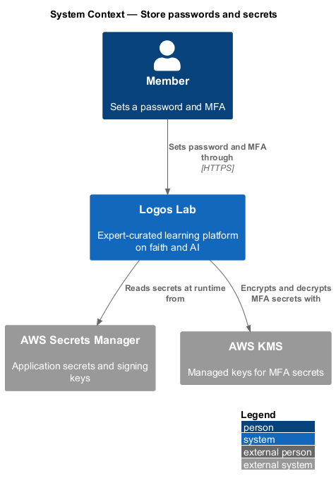
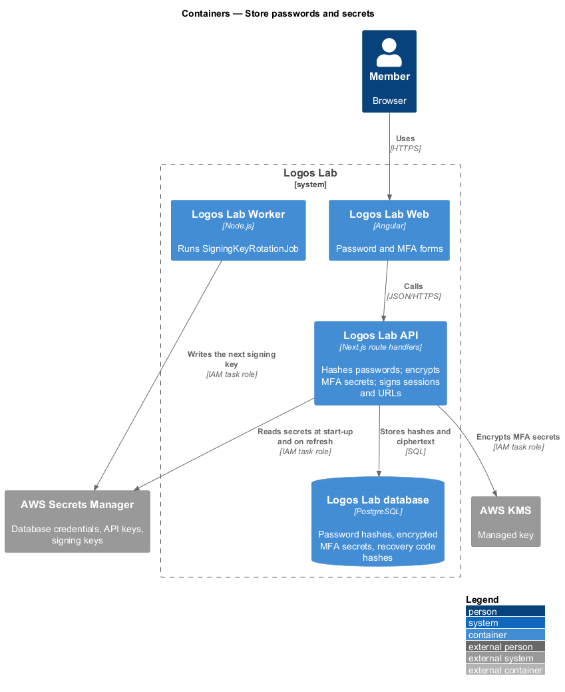
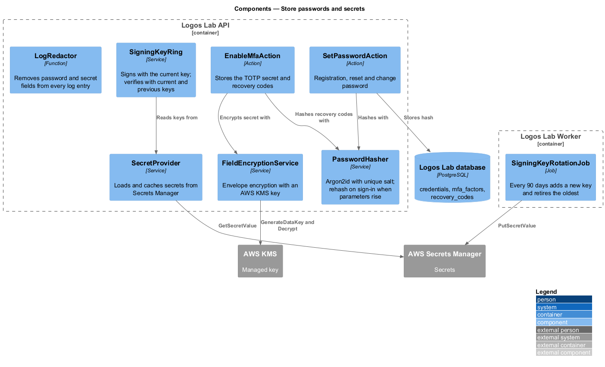
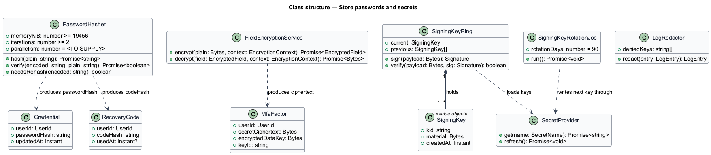
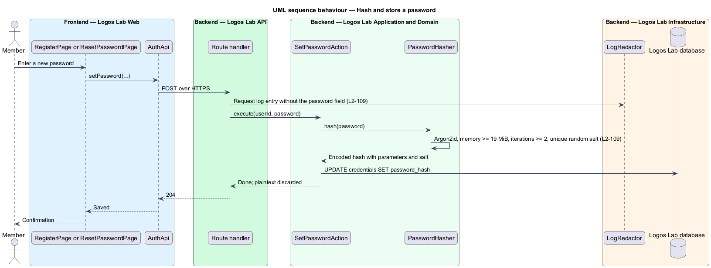
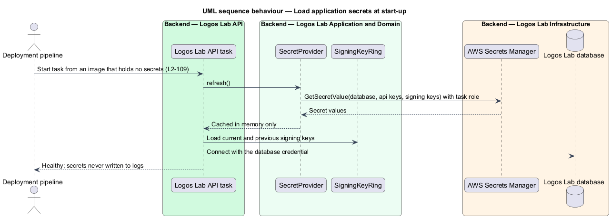
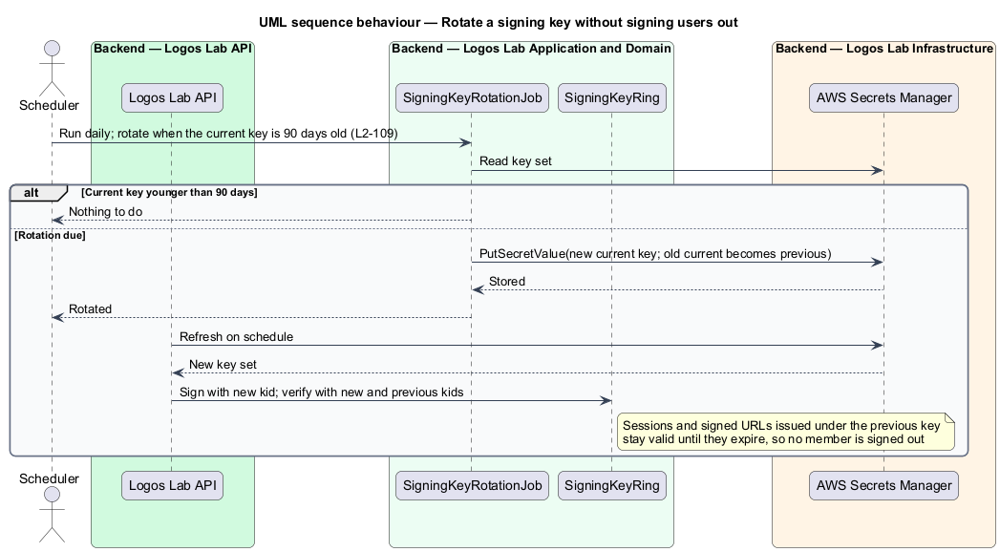

# Store passwords and secrets

## Overview

Logos Lab holds two families of secret. Member credentials are the passwords, two-step verification
secrets and recovery codes that members set. Application secrets are the database credentials, API keys
and signing keys the platform itself uses. A leak of either family would let an attacker act as a member
or as the platform. This feature fixes how each secret is stored so that a copy of the database or of a
container image does not reveal it.

- **password hash** — one-way value derived from a password and a salt, from which the password cannot
  be recovered
- **Argon2id** — memory-hard password-hashing function that resists guessing on GPUs
- **salt** — random value, unique per password, mixed into the hash so equal passwords hash differently
- **MFA secret** — shared TOTP seed that generates a member's two-step verification codes (`L2-014`)
- **recovery code** — single-use code that replaces a TOTP code when the member's device is lost
- **signing key** — secret that signs session data and signed URLs so the platform can detect tampering
- **managed secret store** — AWS Secrets Manager, which holds application secrets outside source control

The feature belongs to the security subsystem. Registration (`L2-006`), password reset (`L2-011`),
password change (`L2-012`) and MFA set-up (`L2-014`) all store secrets through it.

## Description

**Passwords.**
- **`PasswordHasher`** — hashes with Argon2id, memory at least 19 MiB (19,456 KiB), at least 2
  iterations, and a unique random salt per password. The parallelism setting is `<TO SUPPLY>`. The
  encoded hash carries its parameters, so `needsRehash` can detect older parameters and
  `SignInAction` re-hashes on the next successful sign-in.
- **`SetPasswordAction`** — the single path that stores a password, used by registration, reset and
  change. It writes `credentials.password_hash` and discards the plaintext.
- **`LogRedactor`** — removes password fields from request logs and error reports before they are
  written. Plaintext passwords are never stored or logged.

**MFA secrets and recovery codes.**
- **`EnableMfaAction`** — encrypts the TOTP secret with `FieldEncryptionService` before it is stored in
  `mfa_factors`. Recovery codes are hashed with `PasswordHasher` and stored in `recovery_codes`; the
  plaintext codes are shown once (`docs/mocks/pages/mfa-setup/`) and never stored.
- **`FieldEncryptionService`** — envelope encryption under an AWS KMS managed key. Its design is
  shared with `encrypt-data-at-rest` (`L2-112`).

**Application secrets.**
- **`SecretProvider`** — reads database credentials, API keys and signing keys from AWS Secrets Manager
  at start-up and on a refresh interval (`<TO SUPPLY>`). The API and Worker tasks authenticate with
  their IAM task roles. Values live only in process memory.
- **Build and source rules** — container images and the repository hold no secret. The secret scan stage
  of `secure-dependencies-and-code` (`L2-110`) enforces this in CI. `LogRedactor` keeps secret values out
  of logs.

**Signing-key rotation.**
- **`SigningKeyRing`** — holds the current signing key and the previous keys, each with a key id
  (`kid`). It signs with the current key and verifies with any key in the ring.
- **`SigningKeyRotationJob`** — Worker job that runs daily and rotates when the current key reaches 90
  days. It writes the new key set to Secrets Manager; the old current key becomes a previous key. A
  previous key leaves the ring only after the longest-lived item it signed has expired (30 days for a
  Learner or Expert session under `L2-010`). Active members therefore stay signed in.

**Tables.** `credentials` (`user_id`, `password_hash`, `updated_at`); `mfa_factors` (`user_id`,
`secret_ciphertext`, `encrypted_data_key`, `key_id`); `recovery_codes` (`user_id`, `code_hash`,
`used_at`).

## Requirements

| L2 ID | Refines (L1) | Requirement |
|-------|--------------|-------------|
| `L2-109` | `L1-018` | **Password and secret storage.** Credentials and secrets shall be stored safely. |

## Diagrams

### System context

Members set passwords and MFA through Logos Lab. The platform reads its own secrets from AWS Secrets
Manager and protects MFA secrets with AWS KMS.

### Containers

The API hashes and encrypts before writing to the database and reads secrets at runtime. The Worker writes
the next signing key during rotation.

### Components

`SetPasswordAction` hashes with `PasswordHasher`. `EnableMfaAction` encrypts with
`FieldEncryptionService`, and `SigningKeyRing` loads keys through `SecretProvider`.

### Class structure

`PasswordHasher` produces the hashes in `Credential` and `RecoveryCode`. `FieldEncryptionService`
produces the ciphertext in `MfaFactor`. `SigningKeyRing` holds one or more `SigningKey` values.

### Behaviour — hash and store a password

The request log omits the password, and the action stores only the Argon2id hash.

### Behaviour — load application secrets at start-up

A task starts from an image without secrets and reads them from Secrets Manager with its task role.

### Behaviour — rotate a signing key

Every 90 days the job adds a new current key. Items signed under the previous key still verify, so no
member is signed out.

