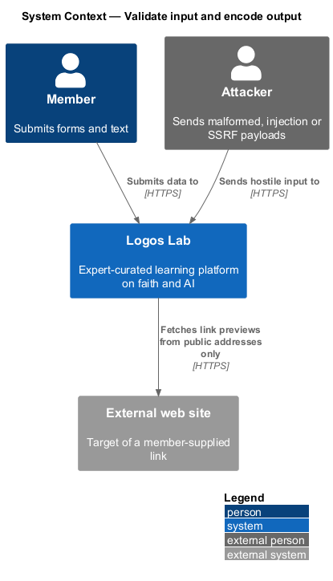
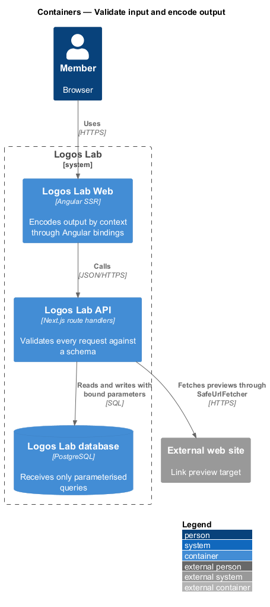
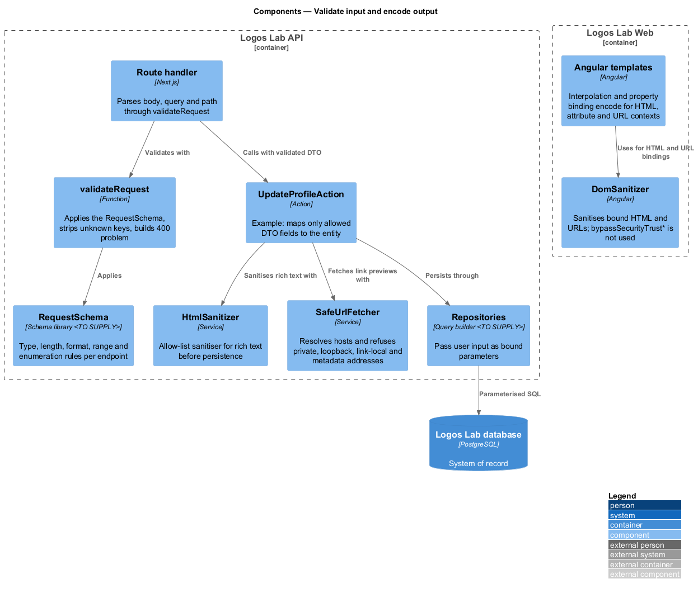
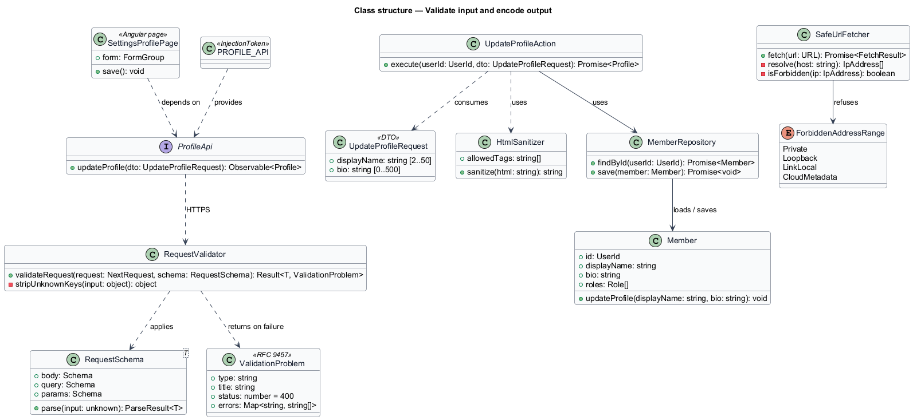
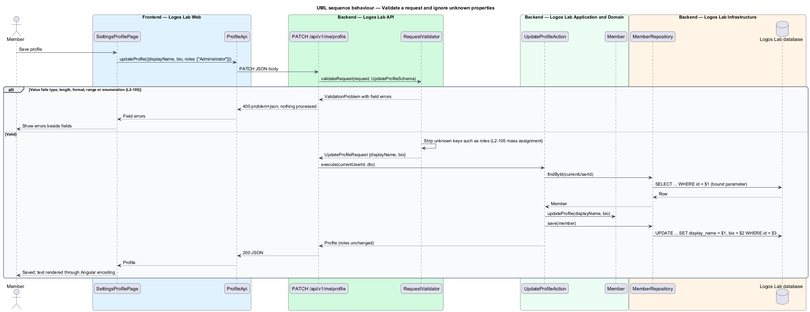
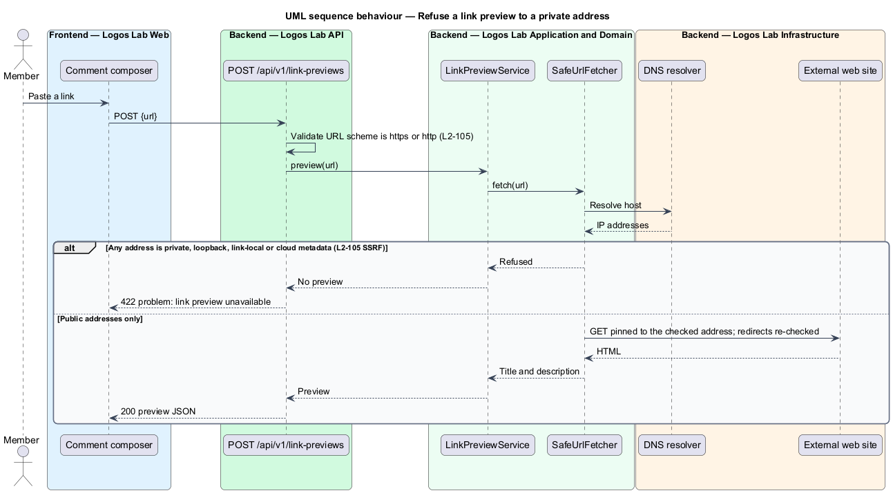

# Validate input and encode output

## Overview

Every request that reaches the Logos Lab API carries data a client chose. Some of it is malformed by
accident, and some is crafted to attack the platform. This feature makes the server the single place that
decides what input is acceptable, and makes every rendering of user text safe for the place it lands.

The feature covers four classic attack families, in OWASP terms:

- **mass assignment** — attack that sets protected fields by adding unexpected properties to a request
  body
- **SQL injection** — attack that changes a database query by placing SQL syntax in user input
- **cross-site scripting (XSS)** — attack that runs script in another user's browser through
  unencoded user text
- **server-side request forgery (SSRF)** — attack that makes the server fetch an internal address,
  such as the cloud metadata service, on the attacker's behalf

It also defines two local terms:

- **request schema** — declarative rule set for the body, query and path of one endpoint
- **output context** — place in a page where text is inserted, such as HTML content, an attribute, a
  URL or a script

The feature belongs to the security subsystem and applies to every API route handler and every
Angular template.

## Description

**Input validation (Logos Lab API).**
- **`RequestSchema<T>`** — one per route handler, covering body, query and path values. It states type,
  length, format, range and enumeration rules. Lengths and ranges come from the owning L2 requirement,
  for example display name 2 to 50 characters and bio up to 500 characters (`L2-013`). The schema library
  is `<TO SUPPLY>`.
- **`RequestValidator.validateRequest`** — called first by every route handler. A failing value returns
  `400` with an RFC 9457 problem whose `errors` member maps each field to its messages. The handler does
  not call the action, so nothing is processed.
- **Unknown properties** — the validator strips keys that the schema does not declare. Actions receive a
  typed DTO, never the raw body, and map only declared fields onto entities. A learner who sends
  `"roles": ["Administrator"]` to `PATCH /api/v1/me/profile` changes nothing.
- **Repositories** — every query passes user input as a bound parameter through the query builder
  (`<TO SUPPLY>`). No repository concatenates input into SQL.

**Output encoding (Logos Lab Web).**
- **Angular templates** — interpolation and property binding encode text for HTML content and
  attributes. URL bindings pass through Angular's `DomSanitizer`.
- **No trust bypass** — components do not call `bypassSecurityTrustHtml`, `bypassSecurityTrustUrl` or
  related methods on user text. Review enforces this rule; no architecture test does.
- **`HtmlSanitizer`** — server-side allow-list sanitiser. It cleans rich text (articles, comment
  formatting under `L2-062`) before it is persisted, so stored HTML is already safe. Links keep
  `rel="nofollow ugc noopener noreferrer"` where `L2-062` requires it.
- **JavaScript context** — server rendering serialises state for hydration with Angular's transfer
  state, which escapes the JSON for a script context.

**SSRF protection.**
- **`SafeUrlFetcher`** — the only path for a server-side request to a member-supplied URL, such as a
  link preview from `POST /api/v1/link-previews`. It resolves the host, refuses private, loopback,
  link-local and cloud metadata addresses, pins the connection to the checked address, and re-checks
  each redirect. A refused fetch yields no preview.
- **`ForbiddenAddressRange`** — enumeration of the refused ranges: `Private`, `Loopback`, `LinkLocal`
  and `CloudMetadata`.

**Test suites.** Two acceptance suites prove the behaviour. An integration suite sends SQL injection
payloads to every search and filter endpoint and expects no errors and no extra data. A Playwright suite
enters XSS payloads in every user-text field and expects no script to run. The payload lists are
`<TO SUPPLY>`.

## Requirements

| L2 ID | Refines (L1) | Requirement |
|-------|--------------|-------------|
| `L2-105` | `L1-018` | **Input validation and output encoding.** All input shall be validated on the server, and all output shall be encoded for its context. |

## Diagrams

### System context

Members and attackers send input to Logos Lab. The platform reaches external web sites only to fetch
link previews, and only at public addresses.

### Containers

The API validates and the database receives only parameterised queries. Logos Lab Web encodes output by
context.

### Components

Route handlers validate with `RequestSchema` before calling an action. Actions sanitise rich text, fetch
previews through `SafeUrlFetcher` and persist through parameterised repositories.

### Class structure

`RequestValidator` applies a `RequestSchema` and returns a typed DTO or a `ValidationProblem`.
`UpdateProfileAction` shows the mass-assignment rule: it reads only `displayName` and `bio`.

### Behaviour — validate a request and ignore unknown properties

An invalid value ends the request with `400` and field errors. A valid body loses its undeclared `roles`
property before the action runs, and every SQL statement binds its values.

### Behaviour — refuse a link preview to a private address

`SafeUrlFetcher` resolves the host and refuses the fetch when any address falls in a forbidden range.

