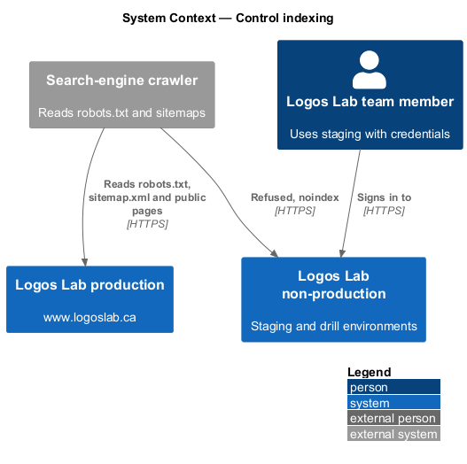
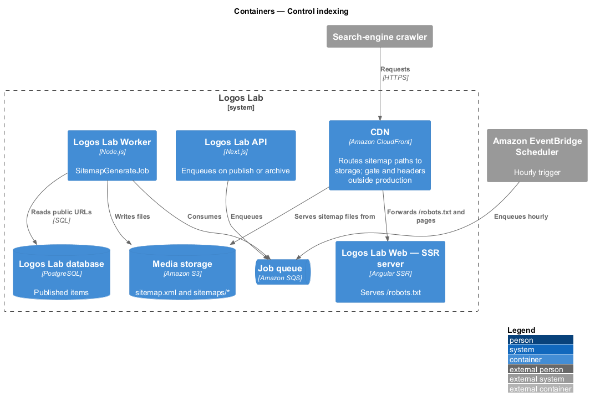
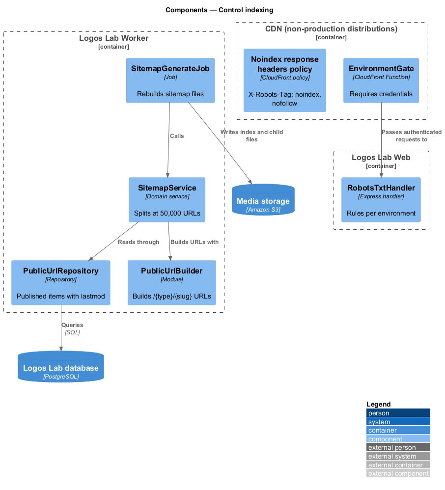
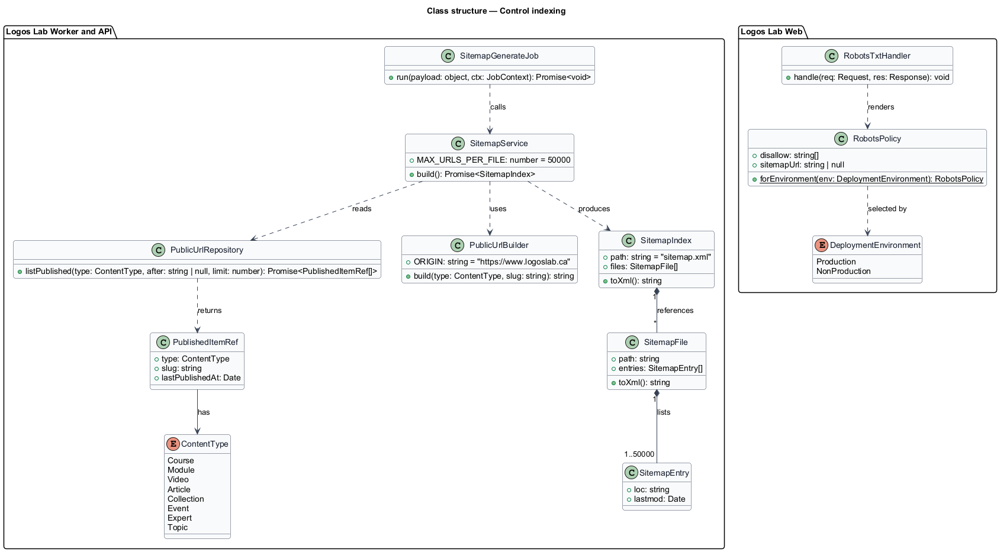
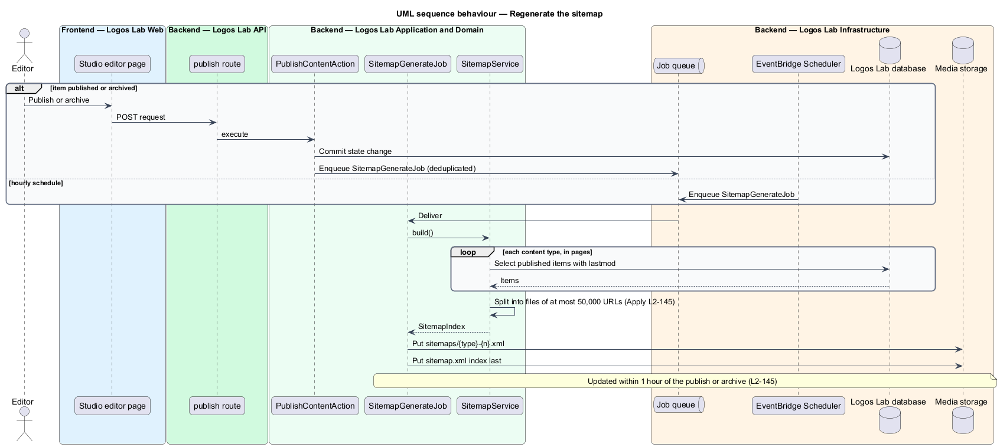
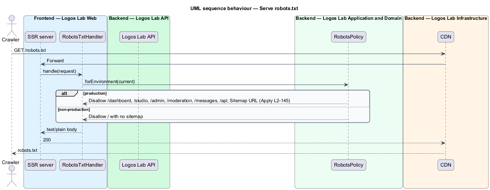
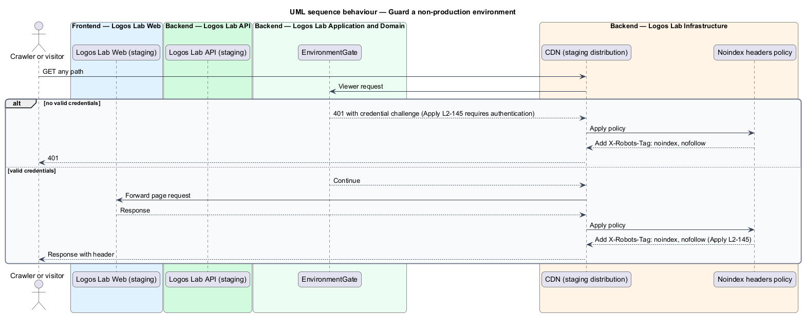

# Control indexing

## Overview

Search engines discover pages by following links and by reading files the site publishes for them.
Logos Lab wants every public item found quickly and every member-only or internal area left alone. This
feature belongs to the SEO subsystem and covers the sitemap, the robots rules and the guard that keeps
non-production environments out of search indexes.

The following terms are used throughout:

- **sitemap** — XML file listing a site's public URLs with the time each last changed (`lastmod`)
- **sitemap index** — XML file that lists child sitemap files, used when one file would exceed 50,000 URLs
- **robots.txt** — plain-text file at the site root that tells crawlers which paths not to fetch
- **`X-Robots-Tag`** — HTTP response header that tells crawlers not to index a response or follow its links
- **non-production environment** — any deployment other than production, such as staging or the restore-drill environment

Authenticated-only pages also carry `X-Robots-Tag: noindex` from the server-render-public-pages feature
(`L2-142`). Public URL patterns come from the keep-stable-urls feature (`L2-146`).

## Description

### Sitemap

- **`SitemapGenerateJob`** — Worker job that rebuilds the sitemap. It is enqueued after each publish or
  archive of public content, with deduplication per time window (`<TO SUPPLY>`), and also runs on an
  hourly EventBridge schedule. Either path keeps the sitemap updated within 1 hour of a publish or
  archive.
- **`SitemapService`** — reads every public URL through `PublicUrlRepository`: the home page, `/explore`,
  and the published items at `/courses/{slug}`, `/modules/{slug}`, `/videos/{slug}`,
  `/articles/{slug}`, `/collections/{slug}`, `/events/{slug}`, `/experts/{slug}` and `/topics/{slug}`.
  `lastmod` is the item's last published change. Archived and unpublished items are left out.
- **Files** — `sitemap.xml` is a sitemap index. It references child files
  `sitemaps/{type}-{n}.xml`, each holding at most 50,000 URLs. Whether certificate verification pages
  (`/certificates/{code}`) are listed is `<TO SUPPLY>`.
- **Serving** — the job writes the files to a public prefix in Media storage, and a CDN behaviour serves
  `/sitemap.xml` and `/sitemaps/*` from there.

### Robots rules

- **`/robots.txt`** — served by the Logos Lab Web SSR server from `RobotsTxtHandler`, which reads the
  environment. In production it returns:

```text
User-agent: *
Disallow: /dashboard
Disallow: /studio
Disallow: /admin
Disallow: /moderation
Disallow: /messages
Disallow: /api
Sitemap: https://www.logoslab.ca/sitemap.xml
```

### Non-production guard

- **`EnvironmentGate`** — CloudFront Function on the viewer-request event of every non-production
  distribution (baseline choice). It rejects requests without valid credentials with `401`. The
  credential method (for example basic authentication or single sign-on) is `<TO SUPPLY>`.
- **Response headers policy** — attached to every non-production distribution. It adds
  `X-Robots-Tag: noindex, nofollow` to every response, including `401` responses and static files.
- In non-production environments `RobotsTxtHandler` returns `Disallow: /` and no sitemap reference.

The sitemap and robots files have no screen and no mock.

## Requirements

| L2 ID | Refines (L1) | Requirement |
|-------|--------------|-------------|
| `L2-145` | `L1-024` | **Sitemap, robots and indexing control.** Search engines shall be guided to public content and kept away from everything else. |

## Diagrams

### System context

Search engines read the robots rules and sitemap from Logos Lab production, and are refused by the
non-production environments.



### Containers

The Worker writes sitemap files to Media storage, the CDN serves them, the SSR server answers
`/robots.txt`, and the non-production CDN applies the gate and the header policy.



### Components

`SitemapGenerateJob` uses `SitemapService` and `PublicUrlRepository` to write the index and child
files; `RobotsTxtHandler` and `EnvironmentGate` act per request.



### Class structure

`SitemapService` splits `SitemapEntry` values into `SitemapFile` objects of at most 50,000 URLs under one
`SitemapIndex`; `RobotsPolicy` holds the per-environment rules.



### Behaviour — regenerate the sitemap

A publish or archive, or the hourly schedule, enqueues the job, which rewrites the index and child files
from the current public URLs.



### Behaviour — serve robots.txt

The SSR server returns the production rules with the sitemap reference, or a full disallow in a
non-production environment.



### Behaviour — guard a non-production environment

The CDN function requires credentials before any request reaches the environment, and every response
carries `X-Robots-Tag: noindex, nofollow`.


