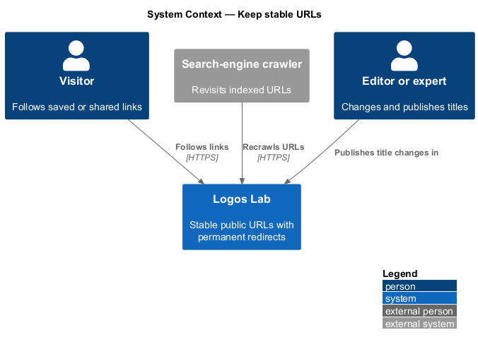
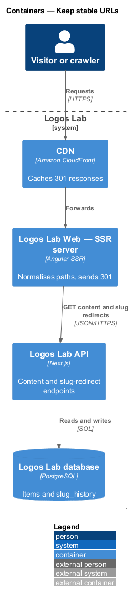
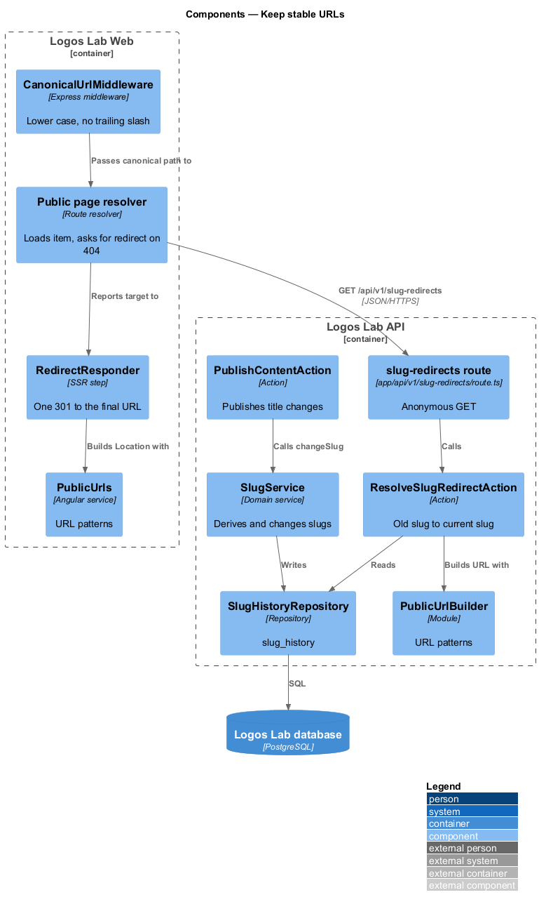
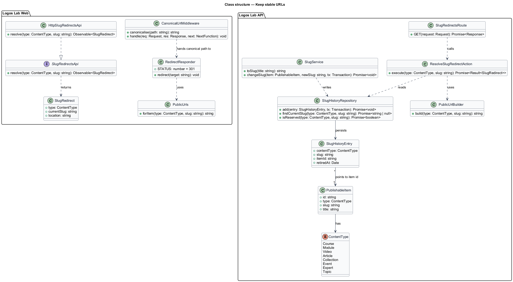
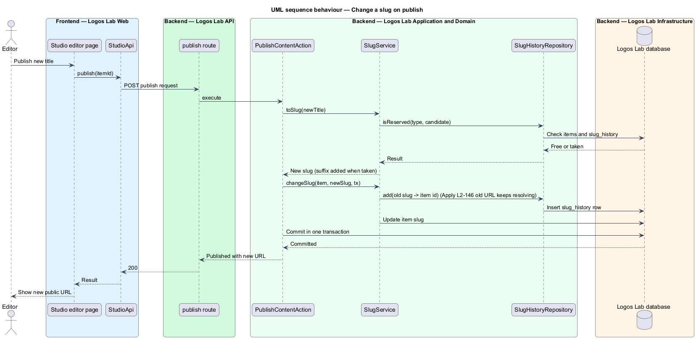
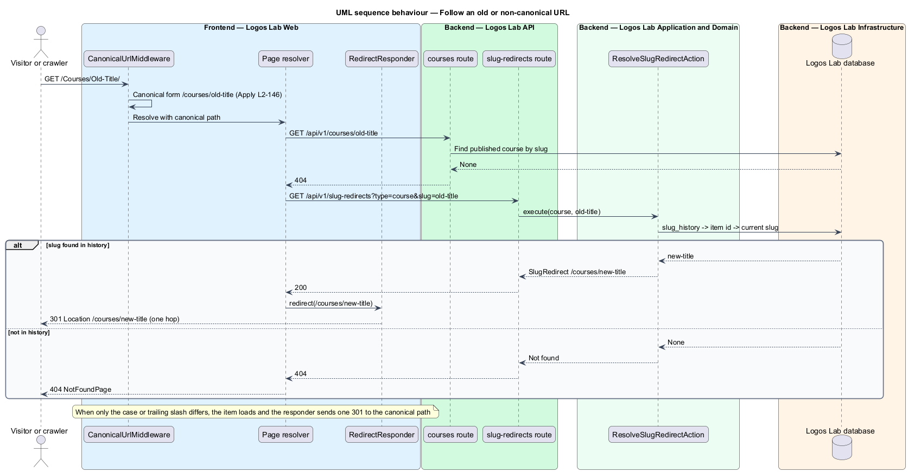

# Keep stable URLs

## Overview

Links to Logos Lab content end up in bookmarks, sermon notes, emails, social posts and search indexes.
When a title changes, those links should keep working and lead to the current page in a single step.
This feature belongs to the SEO subsystem and defines the public URL patterns, how slugs change, and the
permanent redirects that keep old and non-canonical URLs working.

The following terms are used throughout:

- **slug** — lower-case, hyphen-separated, human-readable path segment derived from an item's title, such as `imago-dei-in-an-age-of-machines`
- **canonical form** — lower-case version of a URL path without a trailing slash
- **permanent redirect** — HTTP `301` response that points a client and search engines to a new URL
- **redirect chain** — sequence of redirects followed before reaching the final page; Logos Lab allows at most one hop
- **slug history** — record of every earlier slug of an item, kept so that old URLs keep resolving

The canonical URL in each page's metadata (`L2-143`) and every sitemap entry (`L2-145`) use the same
patterns. An archived item answers with the gone page (`410`) of the show-error-pages feature
(`L2-141`) instead of a redirect.

## Description

### URL patterns

- **`PublicUrlBuilder`** — shared module (API and Worker) and **`PublicUrls`** (Logos Lab Web) that
  generate every public URL from a content type and slug: `/courses/{slug}`, `/modules/{slug}`,
  `/videos/{slug}`, `/articles/{slug}`, `/collections/{slug}`, `/events/{slug}`, `/experts/{slug}` and
  `/topics/{slug}`. No other code builds these paths by hand.

### Slugs and slug history

- **`SlugService`** — derives a slug from a title: lower-case, letters and digits only, separated by
  single hyphens. When a slug is already taken within the same content type, a numeric suffix is added
  (suffix rule `<TO SUPPLY>`). Transliteration of accented characters is `<TO SUPPLY>`.
- **Slug change on publish** — when a published item's title changes and the new slug is published,
  the publishing action calls `SlugService.changeSlug`. It writes the old slug to `slug_history`
  (`content_type`, `slug`, `item_id`, `retired_at`) and sets the new current slug on the item. Whether a
  title change always produces a new slug, or only when the editor confirms it, is `<TO SUPPLY>`.
- **One hop only** — each `slug_history` row points to the item id, not to another slug. Lookup of any
  old slug returns the item's current slug, so a redirect always lands on the final URL in one hop.
- A retired slug stays reserved for its item and is never reused by another item of the same type.

### Resolving requests

- **`CanonicalUrlMiddleware`** — Express middleware in the Logos Lab Web SSR server. It computes the
  canonical form of the request path (lower case, no trailing slash, the root `/` unchanged) and keeps
  the query string. When the path differs, it records the canonical path for the response.
- **Public page resolvers** — fetch the item by the canonical slug, for example
  `GET /api/v1/courses/{slug}`. When the API answers `404`, the resolver calls
  `GET /api/v1/slug-redirects?type={type}&slug={slug}` (anonymous).
- **`ResolveSlugRedirectAction`** — looks the slug up in `slug_history` and returns the item's current
  slug, or `404` when none exists.
- **`RedirectResponder`** — SSR step that, when either the canonical form or a slug redirect changed
  the target, sends one `301` with `Location` set to the final URL. A request with upper case and an old
  slug therefore also takes one hop.
- The CDN caches `301` responses for public paths (lifetime `<TO SUPPLY>`).

There is no screen for this feature and no mock.

## Requirements

| L2 ID | Refines (L1) | Requirement |
|-------|--------------|-------------|
| `L2-146` | `L1-024` | **Stable URLs and redirects.** Public URLs shall be stable and human-readable. |

## Diagrams

### System context

Visitors and crawlers follow old or non-canonical links into Logos Lab and receive one permanent
redirect to the current URL.

### Containers

The SSR server normalises the path and asks the API for slug redirects; the API reads the slug history
from the database.

### Components

`CanonicalUrlMiddleware`, the page resolver and `RedirectResponder` act in the web server;
`SlugService` writes slug history and `ResolveSlugRedirectAction` reads it in the API.

### Class structure

`SlugService` writes `SlugHistoryEntry` rows that point to an item id; `PublicUrlBuilder` and
`PublicUrls` hold the single set of URL patterns.

### Behaviour — change a slug on publish

Publishing a new title records the old slug in the history and makes the new slug current in one
transaction.

### Behaviour — follow an old or non-canonical URL

The SSR server normalises the path, resolves an old slug to the current one, and sends a single `301`
to the final URL.

