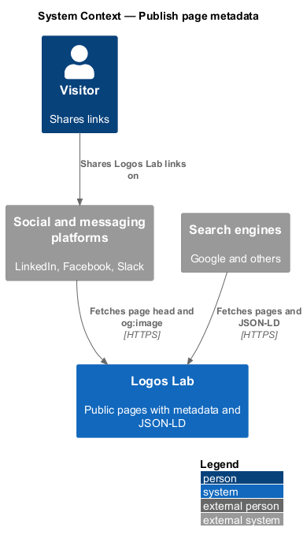
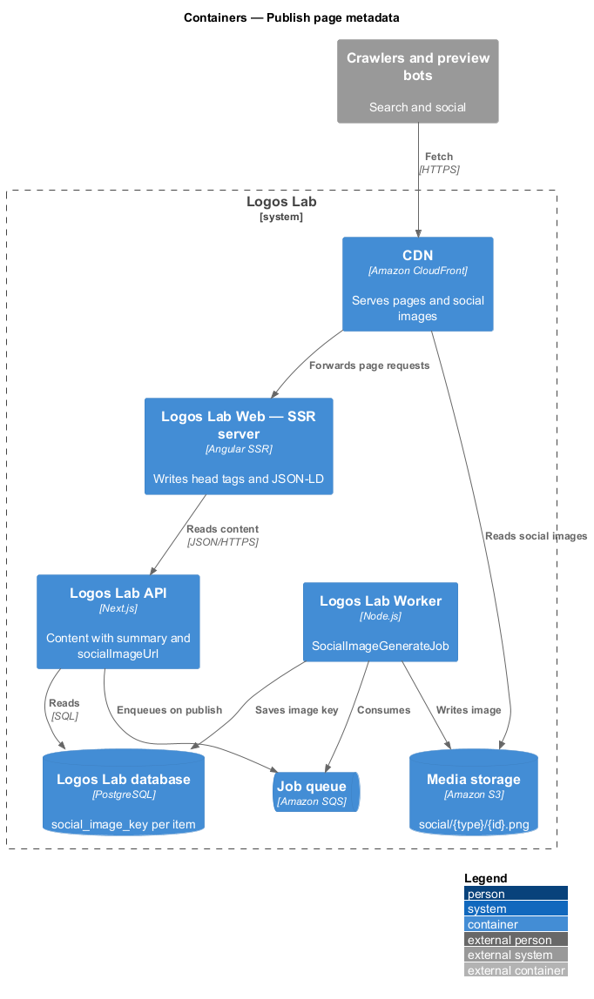
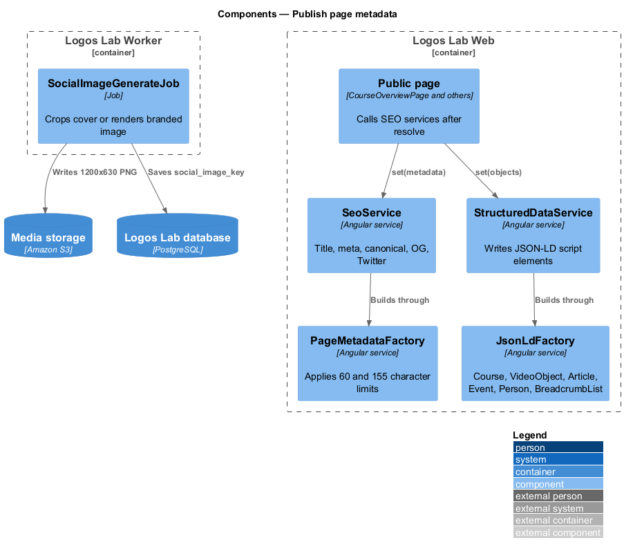
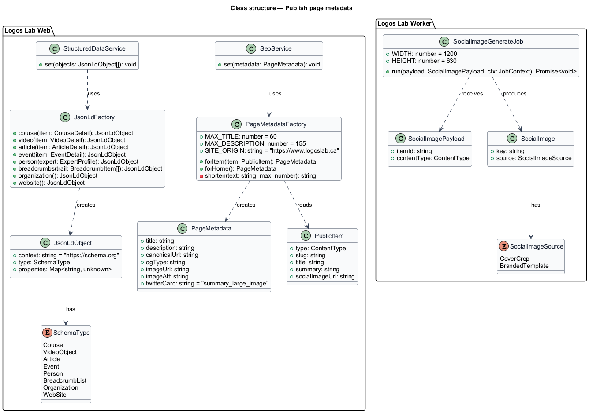
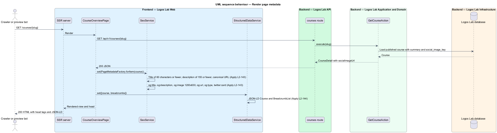
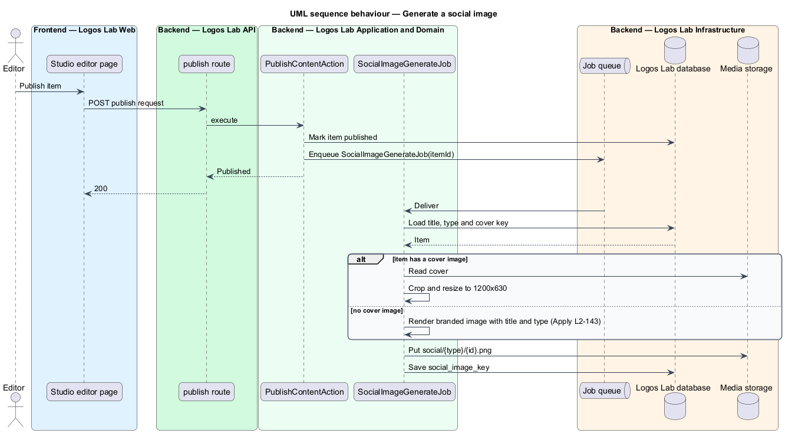

# Publish page metadata

## Overview

When a Logos Lab page appears in search results or is shared in LinkedIn, Facebook or Slack, what
people see comes from tags in the page's HTML head, not from the visible page. This feature belongs to
the SEO subsystem. It gives every public page a title, description, canonical URL, social preview tags,
a preview image and schema.org structured data, all present in the server-rendered HTML.

The following terms are used throughout:

- **canonical URL** — single preferred URL of a page, declared with `<link rel="canonical">` so that search engines merge duplicates
- **Open Graph tags** — `og:*` meta tags that social platforms read to build a link preview
- **Twitter card** — `twitter:*` meta tags for the same purpose; Logos Lab uses the `summary_large_image` card
- **social image** — 1200x630 image referenced by `og:image`
- **structured data** — machine-readable description of a page in schema.org vocabulary, embedded as JSON-LD in a `<script type="application/ld+json">` element
- **breadcrumb trail** — ordered list of parent pages from the home page to the current page

Tags are written during server-side rendering (`L2-142`), so crawlers and preview bots read them without
running JavaScript. Canonical URLs follow the patterns of the keep-stable-urls feature (`L2-146`).

## Description

### Page metadata

- **`SeoService`** — Logos Lab Web service that writes the `<title>`, `meta[name=description]`,
  `link[rel=canonical]`, Open Graph and Twitter tags through Angular's `Title` and `Meta` services and
  the `DOCUMENT` token. Each public page calls it once its resolver data is available.
- **`PageMetadata`** — value object with `title`, `description`, `canonicalUrl`, `ogType`, `imageUrl`
  and `imageAlt`.
- **`PageMetadataFactory`** — builds `PageMetadata` from a page's content:
  - title of 60 characters or fewer, unique per page; it shortens at a word boundary when the item
    title plus brand suffix is longer. The suffix format is `<TO SUPPLY>`.
  - meta description of 155 characters or fewer, taken from the item's summary and shortened at a word
    boundary.
  - canonical URL on `https://www.logoslab.ca` in the lower-case public pattern (`L2-146`).
  - `og:type` of `website` for the home page and listings, and `article`, `video.other` or `profile`
    for item pages (mapping `<TO SUPPLY>` beyond these).
- **Social tags** — `og:title`, `og:description`, `og:image` (1200x630), `og:url`, `og:type`, plus
  `twitter:card` set to `summary_large_image`.

### Social images

- **`SocialImageGenerateJob`** — Worker job enqueued when an item is published or its title or cover
  changes. With a cover image, it writes a 1200x630 crop of the cover. Without one, it renders a branded
  image showing the item's title and type (rendering library and template `<TO SUPPLY>`).
- The image is stored in Media storage under `social/{type}/{id}.png`, served through the CDN, and its
  key is saved as `social_image_key` on the item. Content APIs return the resulting `socialImageUrl`.

### Structured data

- **`StructuredDataService`** — writes one `<script type="application/ld+json">` element per schema
  object during SSR.
- **`JsonLdFactory`** — builds schema.org objects from page data:

| Page | JSON-LD types |
|------|---------------|
| Home (`/`) | `Organization`, `WebSite` with a `SearchAction` targeting `/search?q={search_term_string}` |
| Course | `Course`, `BreadcrumbList` |
| Video | `VideoObject`, `BreadcrumbList` |
| Article | `Article`, `BreadcrumbList` |
| Event | `Event`, `BreadcrumbList` |
| Expert | `Person`, `BreadcrumbList` |
| Every other page below the home page | `BreadcrumbList` |

- **`BreadcrumbList`** — built from the same trail that the page's `ll-breadcrumb` shows.
- The mocks tag `docs/mocks/pages/home/` and `docs/mocks/pages/expert-profile/` with these requirements;
  the metadata itself is not visible on screen.

### Verification

- A Playwright suite fetches each public page type without JavaScript and checks the title and
  description lengths, the canonical URL, the social tags and the JSON-LD types.
- Before each release that changes a page template, the Google Rich Results Test and the LinkedIn,
  Facebook and Slack preview validators are run for each page type, and the results are recorded
  (`<TO SUPPLY>` where).

## Requirements

| L2 ID | Refines (L1) | Requirement |
|-------|--------------|-------------|
| `L2-143` | `L1-024` | **Page metadata and social previews.** Every public page shall have complete metadata for search and sharing. |
| `L2-144` | `L1-024` | **Structured data.** Public pages shall provide schema.org structured data. |

## Diagrams

### System context

Search engines and social platforms fetch Logos Lab pages and read their metadata and structured data
to build results and previews.

### Containers

The SSR server writes the tags from API data; the Worker generates social images into Media storage,
which the CDN serves.

### Components

Pages call `SeoService` and `StructuredDataService`, which use `PageMetadataFactory` and
`JsonLdFactory`; `SocialImageGenerateJob` produces the preview image.

### Class structure

`PageMetadataFactory` produces `PageMetadata` within the length limits; `JsonLdFactory` produces one
`JsonLdObject` per schema type; the job writes a `SocialImage` for each item.

### Behaviour — render metadata

During SSR the page builds its metadata and JSON-LD from the API response and the server returns them
in the HTML head.

### Behaviour — generate a social image

On publish, the job crops the cover to 1200x630 or renders a branded image with the title and type,
then stores its key on the item.

