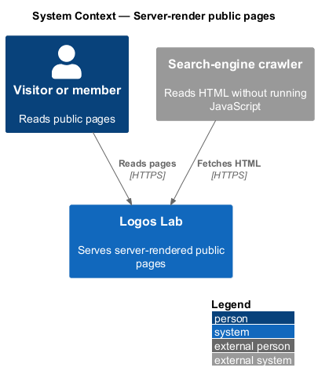
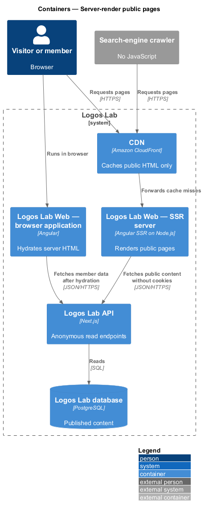
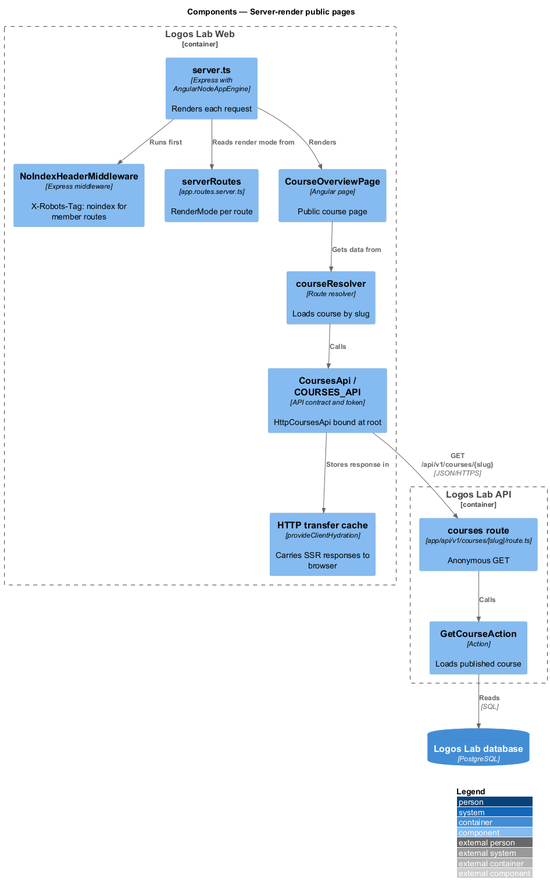
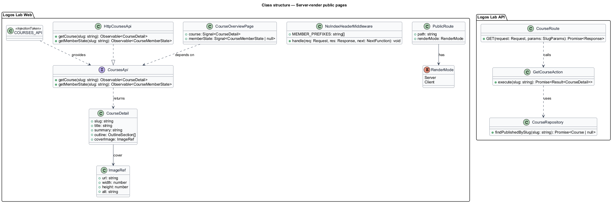
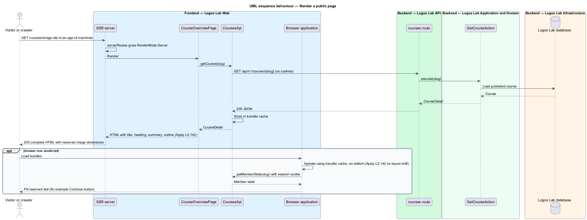
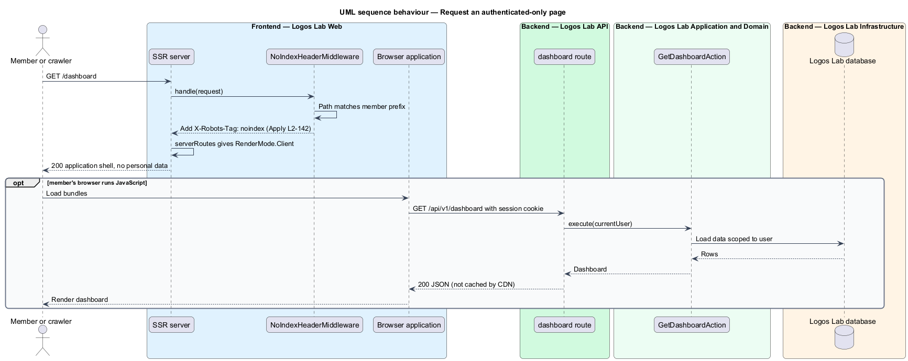

# Server-render public pages

## Overview

Logos Lab's public content (courses, modules, videos, articles, collections, events, experts and
topics) is meant to be found through search engines and read by visitors on slow devices. Search
crawlers and link-preview bots often read only the first HTML response, without running JavaScript.
This feature belongs to the SEO subsystem and makes every public page arrive as complete HTML, while
member-only pages stay out of server rendering and out of search indexes.

The following terms are used throughout:

- **server-side rendering (SSR)** — generation of a page's HTML on the server for each request, before any JavaScript runs in the browser
- **hydration** — step in which the browser application attaches to server-rendered HTML instead of rebuilding it
- **layout shift** — visible movement of page content after it first appears
- **public page** — page that a signed-out visitor may read and a search engine may index
- **authenticated-only page** — page that shows a member's own data and requires a session (dashboard, studio, admin, messages)

Page metadata and structured data are added by the publish-page-metadata feature (`L2-143`, `L2-144`).
Sitemaps and robots rules belong to the control-indexing feature (`L2-145`).

## Description

### Rendering

- **Angular SSR server** — `server.ts` in Logos Lab Web, an Express server using `@angular/ssr`
  (`AngularNodeAppEngine`). It renders each request with the same application code that runs in the
  browser.
- **`serverRoutes`** — the server route configuration (`app.routes.server.ts`). It assigns
  `RenderMode.Server` to public routes and `RenderMode.Client` to authenticated-only routes.

| Public route | Page |
|--------------|------|
| `/` | `HomePage` (`docs/mocks/pages/home/`) |
| `/explore` | `ExplorePage` (catalogue) |
| `/topics/{slug}` | `TopicPage` |
| `/experts/{slug}` | `ExpertProfilePage` |
| `/courses/{slug}` | `CourseOverviewPage` |
| `/modules/{slug}` | `ModulePage` |
| `/videos/{slug}` | `VideoPage` |
| `/articles/{slug}` | `ArticlePage` |
| `/collections/{slug}` | `CollectionPage` |
| `/events/{slug}` | `EventPage` |
| `/certificates/{code}` | `CertificateVerifyPage` |

- **Public data** — route resolvers fetch each page's content through the area API contracts (for
  example `CoursesApi` and `HttpCoursesApi`) from the anonymous read endpoints such as
  `GET /api/v1/courses/{slug}`. During SSR these calls carry no session cookie, so the HTML holds only
  public content: title, main heading, summary and primary content.
- **Member-specific parts** — elements that depend on the session (for example a Continue button or a
  Follow state) render after hydration inside slots whose size is reserved in the server HTML, so they
  cause no layout shift. The mock `docs/mocks/pages/home/signed-in.html` shows the signed-in variant.
- **CDN caching** — server-rendered public HTML holds no personal data, so the CDN may cache it
  (`L2-113`). The cache lifetime and invalidation on publish are `<TO SUPPLY>`.

### Hydration

- **`provideClientHydration(withEventReplay())`** — enables full hydration, and replays clicks made
  before hydration ends.
- **HTTP transfer cache** — API responses fetched during SSR travel to the browser in the page's
  transfer state, so the browser does not fetch them again and the content does not change.
- **Reserved dimensions** — images and embeds carry `width` and `height` (or an aspect-ratio box), as
  required by Core Web Vitals (`L2-120`).

### Authenticated-only pages

- Routes under `/dashboard`, `/studio`, `/admin`, `/moderation`, `/messages` and `/settings` use
  `RenderMode.Client`. The server returns the application shell only, with no personal data.
- **`NoIndexHeaderMiddleware`** — Express middleware in the SSR server that adds
  `X-Robots-Tag: noindex` to every response for those routes.

## Requirements

| L2 ID | Refines (L1) | Requirement |
|-------|--------------|-------------|
| `L2-142` | `L1-024` | **Server-rendered public pages.** Public pages shall be readable by search engines and shall render meaningful content before JavaScript runs. |

## Diagrams

### System context

Visitors, members and search-engine crawlers request pages from Logos Lab, which answers public pages
with complete HTML.

### Containers

The CDN forwards page requests to the Angular SSR server, which calls the API anonymously for public
content and returns HTML that the browser hydrates.

### Components

`serverRoutes` selects the render mode; resolvers call the area API contracts; the transfer cache
carries responses to the browser; `NoIndexHeaderMiddleware` marks authenticated-only pages.

### Class structure

Each `PublicRoute` maps a path to a page and a `RenderMode`; public pages depend on area API contracts
such as `CoursesApi`, bound to HTTP implementations at the composition root.

### Behaviour — render a public page

The SSR server renders the course page from anonymous API data, returns full HTML, and the browser
hydrates it from the transfer cache without refetching.

### Behaviour — request an authenticated-only page

The SSR server returns the application shell with `X-Robots-Tag: noindex`; the browser loads the
member's data after hydration with the session cookie.

