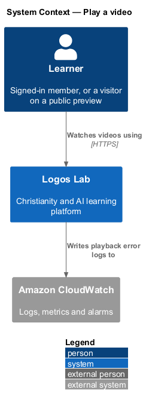
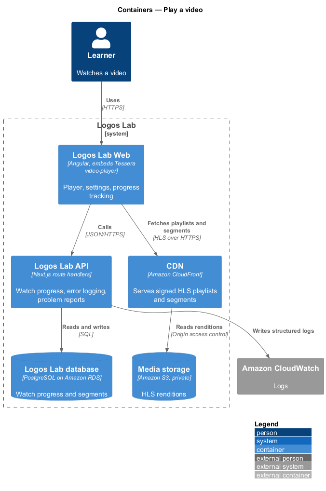
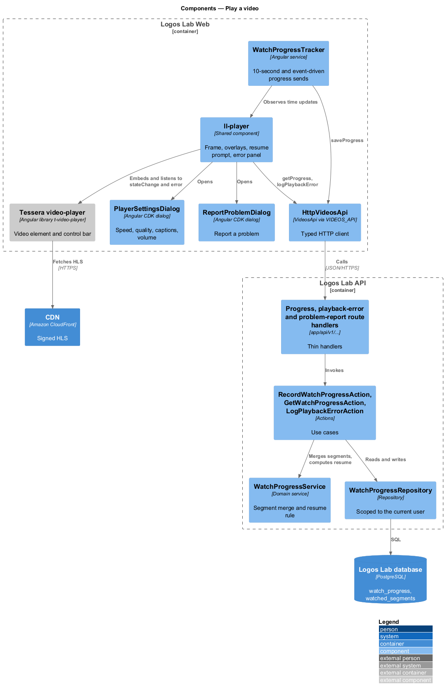
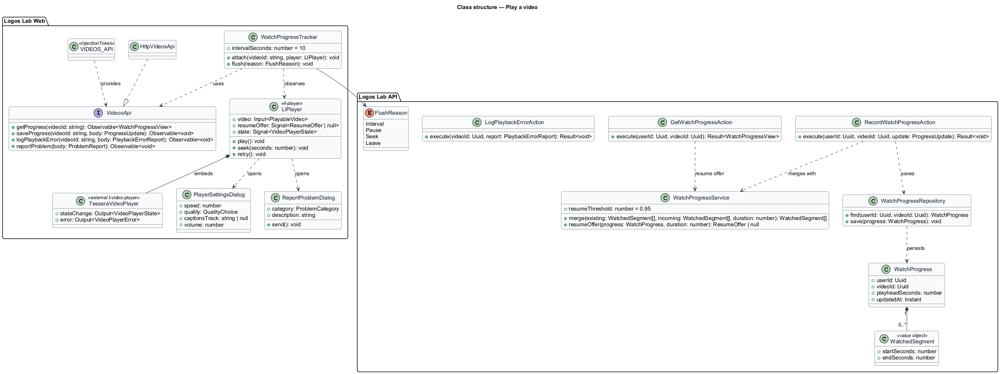
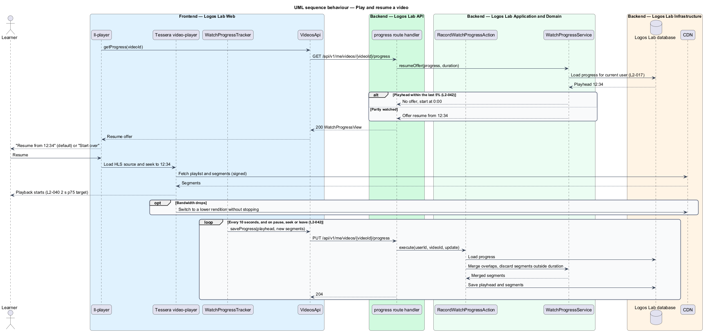
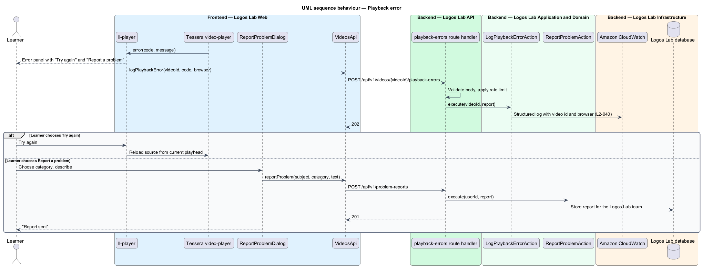

# Play a video

## Overview

Videos are the most watched content type on Logos Lab. This feature covers what happens once a viewer
presses Play: adaptive playback in the Tessera video-player, the player controls, playback errors, and
recording how far each learner has watched so they can resume later.

The feature sits in the videos subsystem between delivery and the pages that host a player. The video page
(`view-video-page`) and the lesson player in the courses subsystem both embed the same player. Access to
the stream itself is decided by `protect-video-delivery`.

Terms used below:

- **Tessera video-player** — external Angular library (`@tessera/video-player`, selector `t-video-player`) that renders a video element and its control bar
- **adaptive bitrate streaming** — playback that switches between renditions as available bandwidth changes, without stopping
- **playhead** — current playback position, in seconds
- **watched segment** — continuous interval of the video, in seconds, that the learner actually played
- **watch progress** — stored playhead position and merged watched segments for one learner and one video

## Description

### Screens and states

- **`ll-player`** — shared component that frames the stage (the design-system `player` component). It
  embeds `t-video-player`, keeps a 16:9 box, and owns the overlays from `docs/mocks/pages/video-page/`:
  the `resume` overlay ("Resume from 12:34" with focus on Resume, and "Start over"), the
  `player-error` panel ("Try again" and "Report a problem") and the loading spinner. Its BEM classes
  (`player__screen`, `player__controls`, `player__scrub`) follow the mock.
- **`PlayerSettingsDialog`** — dialog opened from the player's settings button, covering
  `docs/mocks/dialogs/player-settings/` (`default`, `selected`). It sets speed (0.5x to 2x in 0.25 steps),
  quality (Auto by default, 1080p, 720p, 360p), captions and volume, and applies each change at once.
- **`ReportProblemDialog`** — dialog for `docs/mocks/dialogs/report-problem/` (`default`, `invalid`, `busy`,
  `failed`, `success`). It attaches the video identifier and the browser automatically.
- **`WatchProgressTracker`** — injectable service in Logos Lab Web. It listens to player time updates and
  sends the playhead and the segments played since the last send.

### The Tessera video-player

Logos Lab Web consumes the Tessera video-player as an external library and never copies it. The
published library plays live fragmented-MP4 streams over SignalR. It has no seek bar, speed, quality
selection or picture-in-picture, and takes one caption track. `L2-040` requires on-demand adaptive
playback with all of those controls. The design therefore depends on an on-demand HLS mode in Tessera,
or an ADR that records an alternative: `<TO SUPPLY>`. `ll-player` uses the Tessera `stateChange` and
`error` outputs to drive its overlays and error logging.

### Player controls (`L2-040` criterion 3)

Play and pause, seek, 10-second skip back and forward, volume and mute, playback speed (0.5x to 2x in
0.25 steps), quality selection with Auto by default, captions, picture-in-picture where the browser
supports it, and full screen. The keyboard map from the mock: Space plays or pauses, J and L skip 10
seconds, M mutes, C toggles captions.

### API contract

- **`VideosApi`** contract, **`VIDEOS_API`** token and **`HttpVideosApi`** implementation. Methods used
  here: `getProgress`, `saveProgress`, `logPlaybackError` and `reportProblem`.

| Method | Path | Purpose |
|---|---|---|
| `GET` | `/api/v1/me/videos/{videoId}/progress` | Returns the caller's playhead and duration |
| `PUT` | `/api/v1/me/videos/{videoId}/progress` | Records the playhead and new watched segments |
| `POST` | `/api/v1/videos/{videoId}/playback-errors` | Logs a playback failure with the video id and browser; anonymous for public previews |
| `POST` | `/api/v1/problem-reports` | Sends a "Report a problem" message with its subject attached |

### Application and domain

- **Actions** — `GetWatchProgressAction`, `RecordWatchProgressAction`, `LogPlaybackErrorAction` and
  `ReportProblemAction`.
- **`WatchProgressService`** — merges overlapping segments, discards any segment outside the video's
  duration (`L2-042` criterion 4), and decides the resume offer.
- **Entities and tables** — `WatchProgress` (`watch_progress`: user, video, playhead, updated time) and
  `WatchedSegment` (`watched_segments`: start and end seconds). `WatchProgressRepository` filters every
  query by the current user's id (`L2-017`).
- **Logging** — `LogPlaybackErrorAction` writes a structured log entry to Amazon CloudWatch with the video
  identifier, the Tessera error code and the browser (`L2-040` criterion 4).

### Rules from the acceptance criteria

- Playback starts within 2 seconds at p75 on a 10 Mbps connection (`L2-040` criterion 1). The measurement
  mechanism is `<TO SUPPLY>`.
- When bandwidth drops, the player switches to a lower rendition without stopping (criterion 2).
- Progress is sent every 10 seconds of playback, and on pause, seek and leaving the page (`L2-042`
  criterion 1). Leaving the page uses a `keepalive` request so the last send completes.
- A partly watched video offers "Resume from 12:34" and "Start over", with resume as the default
  (criterion 2).
- A learner who stopped within the last 5% of the video starts from the beginning (criterion 3).

## Requirements

The feature realizes the following level-2 (L2) requirements. Each L2 requirement refines the level-1 (L1) requirement cited beside it.

| L2 ID | Refines (L1) | Requirement |
|-------|--------------|-------------|
| `L2-040` | `L1-007` | **Video playback.** Videos play in the Tessera video-player with adaptive bitrate streaming. |
| `L2-042` | `L1-007` | **Watch progress and resume.** The platform shall record what each learner has watched and let them resume. |

## Diagrams

### System context

Learners watch through Logos Lab; streams come from the CDN, and playback failures go to Amazon
CloudWatch as structured logs.

### Containers

Logos Lab Web embeds the Tessera video-player, which fetches HLS segments from the CDN. The API stores
watch progress in the database.

### Components

`ll-player` wraps the Tessera library; `WatchProgressTracker` sends progress through `VideosApi` to
`RecordWatchProgressAction`, which uses `WatchProgressService`.

### Class structure

`WatchProgress` holds a playhead and a set of `WatchedSegment` values. `WatchProgressService` merges
segments and computes the resume offer.

### Behaviour — play and resume

On load, the player asks for saved progress and offers resume unless the learner stopped in the last 5%.
During playback, progress is sent every 10 seconds and on pause, seek or leave.

### Behaviour — playback error

A Tessera error shows the error panel with "Try again", and the failure is logged with the video
identifier and the browser.

