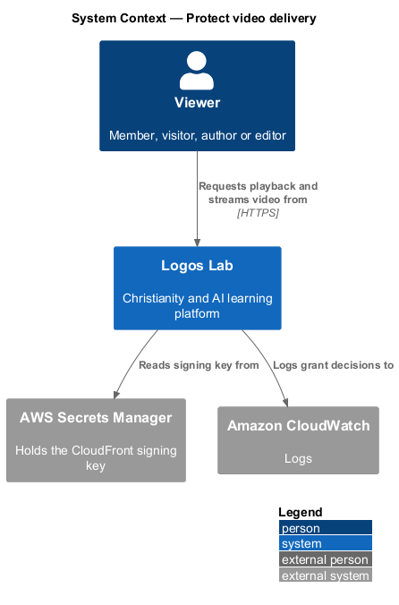
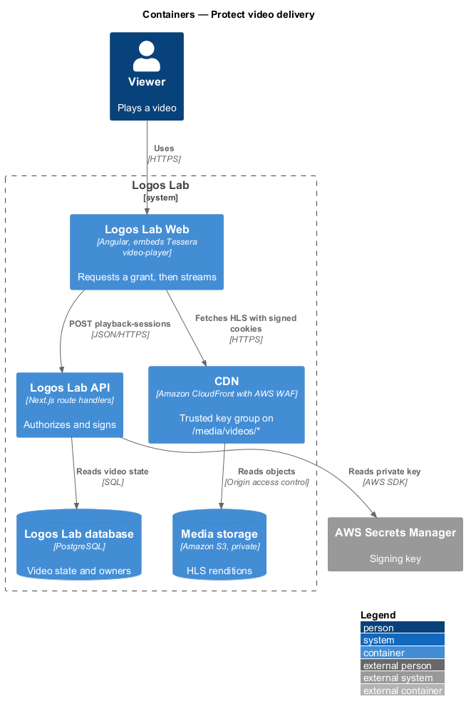
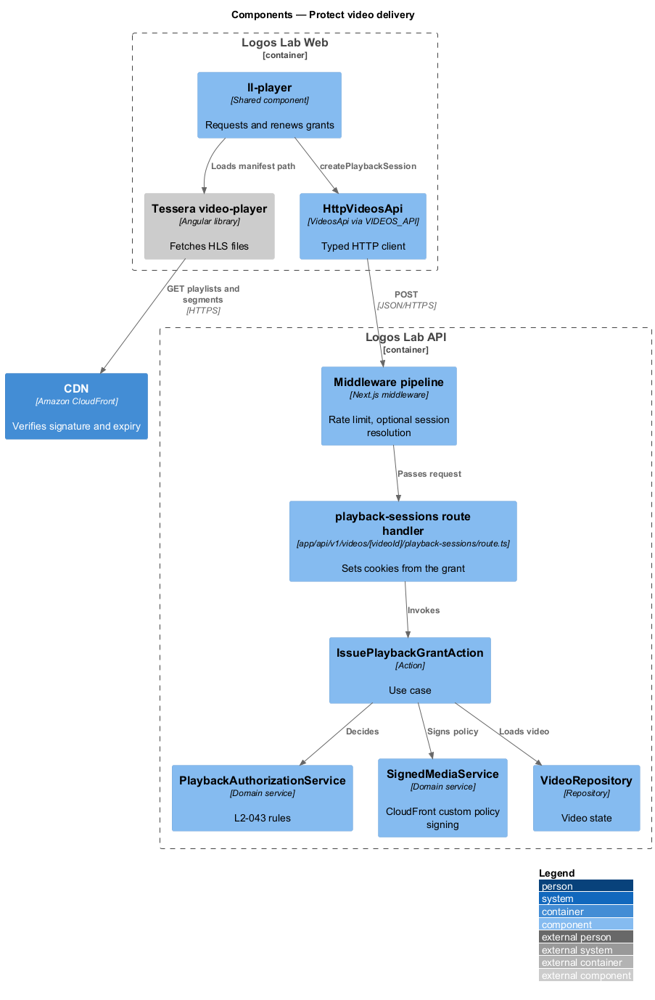
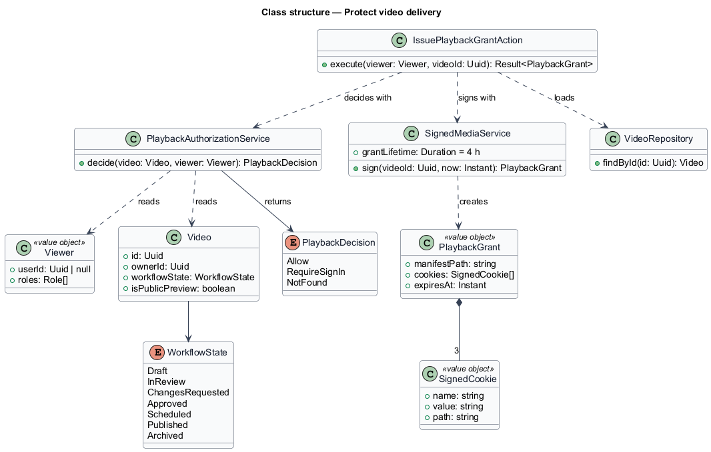
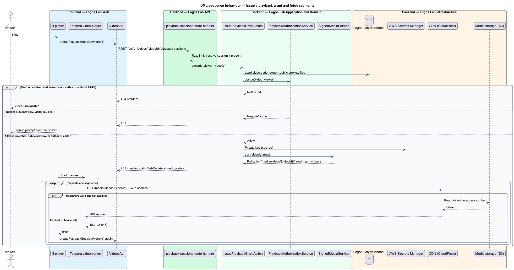

# Protect video delivery

## Overview

Logos Lab videos are free for members, but they are not public files. A visitor who copies a stream
address, or a learner who tries to watch a draft, shall not receive the video. This feature decides who
may play a video and makes the CDN enforce that decision on every playlist and segment request.

The feature is a cross-cutting slice of the videos subsystem. It sits between the player (`play-video`)
and the HLS renditions produced by `upload-and-process-video`. Every place that plays a video, including
the lesson player and event recordings, asks this feature for a playback grant first.

Terms used below:

- **playback grant** — short-lived permission to fetch one video's HLS files, issued by the API after authorization
- **signed cookie** — CloudFront cookie set (`CloudFront-Policy`, `CloudFront-Signature`, `CloudFront-Key-Pair-Id`) that carries a signed access policy for a path and an expiry
- **public preview** — flag an editor sets on a published video so visitors may play it without signing in
- **trusted key group** — set of public keys a CloudFront cache behaviour accepts for signed requests

## Description

### Mechanism

- **CDN path** — renditions are served from the CDN under `/media/videos/{videoId}/` on the same
  distribution as the web application (baseline choice). That cache behaviour requires signed requests
  from a trusted key group, so CloudFront itself rejects an expired or tampered request with 403
  (`L2-043` criterion 2).
- **Origin** — the private S3 bucket admits only the CDN, through origin access control. No public
  bucket policy exists.
- **Signing key** — the CloudFront private key lives in AWS Secrets Manager. `SignedMediaService` reads it
  at start-up and on rotation; the key never reaches Logos Lab Web.
- **Grant form** — signed cookies scoped to `/media/videos/{videoId}/` with a 4-hour expiry (baseline
  choice; `L2-043` allows signed URLs or signed cookies). Cookies cover every HLS segment without
  rewriting the playlists. They are `Secure`, `HttpOnly` and `SameSite=Lax`.

### API contract

- **`VideosApi`** (token `VIDEOS_API`) gains `createPlaybackSession(videoId)`. `ll-player` calls it before
  loading the source, and again when a grant expires during a long session.

| Method | Path | Purpose |
|---|---|---|
| `POST` | `/api/v1/videos/{videoId}/playback-sessions` | Authorizes the caller and sets the signed cookies; returns the HLS manifest path and expiry. Anonymous only for public previews |

### Application and domain

- **`IssuePlaybackGrantAction`** — loads the video, calls `PlaybackAuthorizationService`, then
  `SignedMediaService`, and returns a `PlaybackGrant`.
- **`PlaybackAuthorizationService`** — applies the rules below. It returns `NotFound` rather than
  `Forbidden` for drafts, so the response does not reveal that a draft exists (`L2-017`).
- **`SignedMediaService`** — builds the custom policy (resource `/media/videos/{videoId}/*`, expiry now
  plus 4 hours) and signs it with the CloudFront private key.
- **Entities** — `Video` (workflow state, owner, `isPublicPreview`) and the viewer's role from the
  session. No new table is needed; each grant is logged as a structured event.

### Authorization rules

| Video state | Viewer | Result |
|---|---|---|
| Published | Signed-in member | Grant (`L2-043` criterion 1) |
| Published, public preview | Visitor or member | Grant without sign-in (criterion 4, `L2-015`) |
| Published, not public preview | Visitor | 401; the page shows the sign-in prompt |
| Draft, in review or archived | Author or editor | Grant, for Studio preview |
| Draft, in review or archived | Anyone else | Refused, 404 (criterion 3) |

The playback-sessions endpoint is rate limited (`L2-107`). Grant issue and refusal are logged with the
video id and user id, never with the signature.

Open points: the private key rotation period is `<TO SUPPLY>`. Whether a grant ends early when a member
is suspended (`L2-019`) is `<TO SUPPLY>`; the 4-hour expiry bounds it.

## Requirements

The feature realizes the following level-2 (L2) requirements. Each L2 requirement refines the level-1 (L1) requirement cited beside it.

| L2 ID | Refines (L1) | Requirement |
|-------|--------------|-------------|
| `L2-043` | `L1-007` | **Protected video delivery.** Video streams shall be delivered only to authorized viewers. |

## Diagrams

### System context

Viewers obtain a playback grant from Logos Lab and then fetch the stream from the CDN; the signing key
comes from AWS Secrets Manager.

### Containers

The API issues signed cookies; the CDN verifies them on every request and reads the private bucket
through origin access control.

### Components

`IssuePlaybackGrantAction` combines `PlaybackAuthorizationService` and `SignedMediaService`; the CDN's
trusted key group enforces the signature.

### Class structure

`PlaybackAuthorizationService` decides from the video state, the public preview flag and the viewer's role.
`SignedMediaService` turns an allowed decision into a `PlaybackGrant`.

### Behaviour — issue a grant and fetch segments

The API authorizes the viewer, sets 4-hour signed cookies, and the CDN serves segments only while the
signature is valid. An expired or tampered request receives 403.

