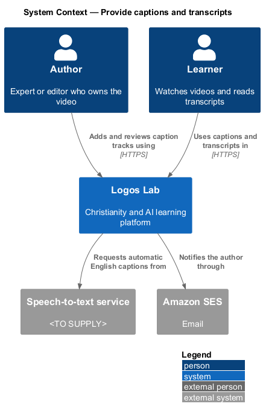
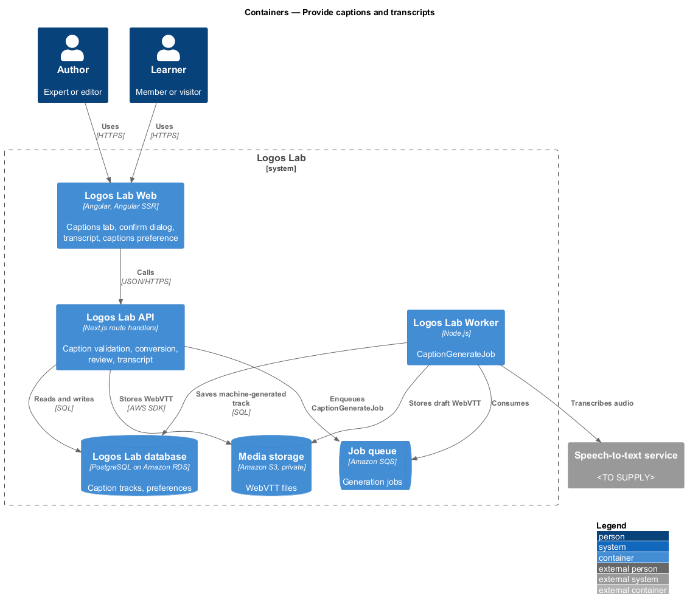
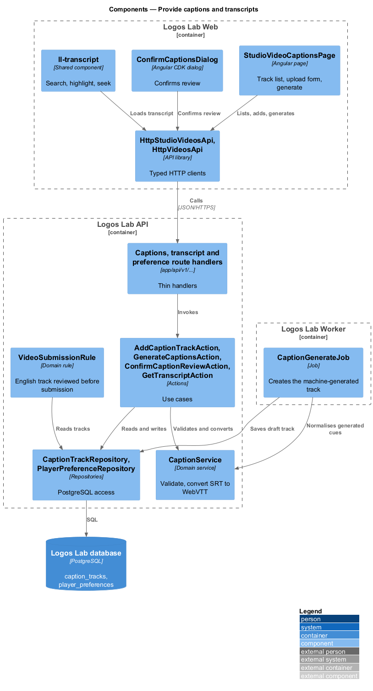
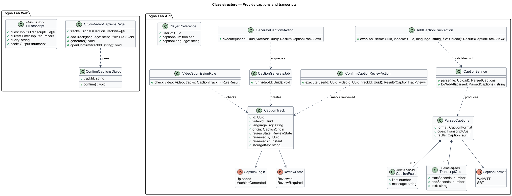
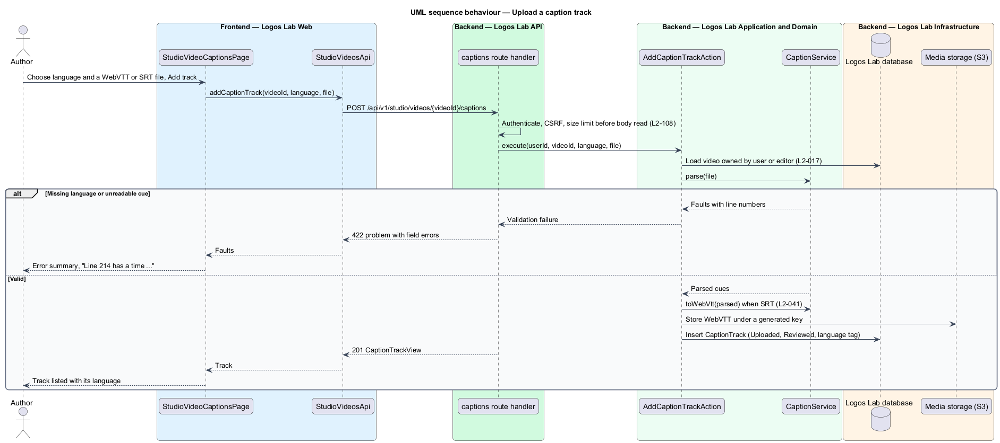
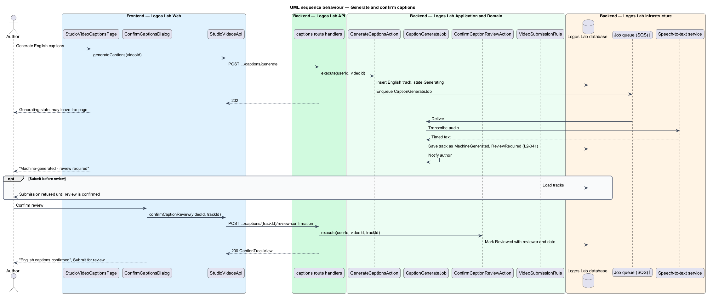
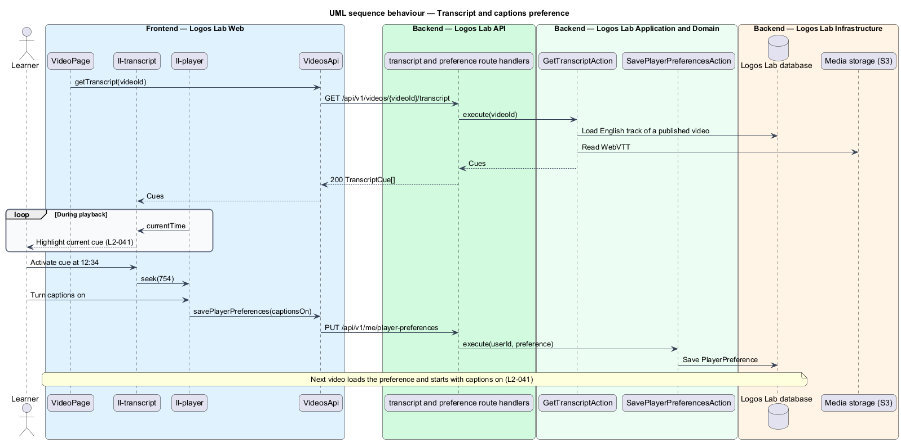

# Provide captions and transcripts

## Overview

Every published Logos Lab video carries captions, and its page shows a full transcript. Captions make the
video usable without sound and for Deaf and hard-of-hearing learners. The transcript lets any learner read,
search and jump through what was said.

This feature covers both sides. Authors add caption tracks in Studio, by upload or by automatic generation,
and confirm machine-generated tracks after review. Learners turn captions on in the player and use the
transcript on the video page. The feature sits in the videos subsystem beside `upload-and-process-video`
and feeds `play-video` and `view-video-page`.

Terms used below:

- **caption track** — timed text file in one language, stored as WebVTT and labelled with a language tag (for example `en`, `fr-CA`)
- **cue** — one timed line of a caption track, with a start time, an end time and text
- **machine-generated track** — draft caption track produced by speech-to-text, marked "Machine-generated - review required" until an author confirms review
- **transcript** — full text of the English caption track, shown as a list of cues on the video page

## Description

### Screens and states

- **`StudioVideoCaptionsPage`** — routed page for the **Captions and transcript** tab of a video in Studio.
  Route: `/studio/videos/{videoId}/captions` (baseline choice). It covers
  `docs/mocks/pages/studio-video-captions/`: `empty`, `default` (tracks marked Reviewed), `uploading`
  ("Checking and converting"), `invalid` (missing language, unreadable time on a named line), `generating`,
  `review-required`, `loading` and `error`.
- **`ConfirmCaptionsDialog`** — dialog for `docs/mocks/dialogs/confirm-captions/` (`default`, `busy`,
  `failed`, `success`). On success it offers "Submit for review".
- **Learner side** — `ll-transcript` on the video page, covered by `docs/mocks/pages/video-page/transcript.html`:
  a search field with a match count, a cue list, the current cue highlighted, and each time button seeking
  the video. The captions choice in `PlayerSettingsDialog` (`docs/mocks/dialogs/player-settings/selected.html`)
  persists for the next video.
- **Shared components** — `ll-tabs`, `ll-workflow-bar`, `ll-list` (track rows), `ll-badge` (Reviewed,
  Machine-generated), `ll-select` (language), `ll-file-upload`, `ll-alert`, `ll-form-field` with an error
  summary, `ll-transcript`, `ll-dialog`, `ll-spinner`.

### API contract

- **`StudioVideosApi`** (token `STUDIO_VIDEOS_API`) gains `listCaptions`, `addCaptionTrack`,
  `replaceCaptionTrack`, `generateCaptions` and `confirmCaptionReview`.
- **`VideosApi`** (token `VIDEOS_API`) gains `getTranscript`, `getPlayerPreferences` and
  `savePlayerPreferences`.

| Method | Path | Purpose |
|---|---|---|
| `GET` | `/api/v1/studio/videos/{videoId}/captions` | Lists tracks with language, origin and review state |
| `POST` | `/api/v1/studio/videos/{videoId}/captions` | Adds a track from a WebVTT or SRT file and a language |
| `PUT` | `/api/v1/studio/videos/{videoId}/captions/{trackId}` | Replaces a track's file |
| `POST` | `/api/v1/studio/videos/{videoId}/captions/generate` | Starts automatic English captions |
| `POST` | `/api/v1/studio/videos/{videoId}/captions/{trackId}/review-confirmation` | Records the author's review of a machine-generated track |
| `GET` | `/api/v1/videos/{videoId}/transcript` | Returns transcript cues; anonymous for published videos |
| `GET`, `PUT` | `/api/v1/me/player-preferences` | Reads and saves the captions-on choice |

### Application and domain

- **Actions** — `AddCaptionTrackAction`, `ReplaceCaptionTrackAction`, `GenerateCaptionsAction`,
  `ConfirmCaptionReviewAction`, `GetTranscriptAction` and `SavePlayerPreferencesAction`.
- **`CaptionService`** — validates a caption file, reports each fault with its line number, and converts SRT
  to WebVTT. It requires a language tag for every track.
- **`VideoSubmissionRule`** — content-type rule called by the editorial `SubmitForReviewAction`. It refuses
  submission unless the video has at least one English track and no track awaits review confirmation
  (`L2-039` criterion 5, `L2-041` criterion 2).
- **Entities and tables** — `CaptionTrack` (`caption_tracks`: language, origin, review state, reviewer,
  review time, storage key) and `PlayerPreference` (`player_preferences`: user, captions on, caption
  language). Repositories: `CaptionTrackRepository`, `PlayerPreferenceRepository`.
- **`CaptionGenerateJob`** — Worker job that sends the audio to a speech-to-text service (`<TO SUPPLY>`),
  stores the result as a machine-generated English track, and notifies the author.

### Rules from the acceptance criteria

- An uploaded WebVTT or SRT file is validated, converted to WebVTT if needed, and attached with a language
  label (`L2-041` criterion 1).
- A generated track is marked "Machine-generated - review required", and the video cannot be submitted
  until an author confirms review (criterion 2).
- The transcript shows the full text, highlights the current cue during playback, and seeks on activation
  (criterion 3).
- A learner who turns captions on gets captions on by default for the next video (criterion 4). For
  visitors, the choice is kept in browser storage (baseline choice).

Open points: the maximum caption file size and the speech-to-text service are `<TO SUPPLY>`. Which track
feeds the transcript when a video has several English tracks is `<TO SUPPLY>`.

## Requirements

The feature realizes the following level-2 (L2) requirements. Each L2 requirement refines the level-1 (L1) requirement cited beside it.

| L2 ID | Refines (L1) | Requirement |
|-------|--------------|-------------|
| `L2-041` | `L1-007` | **Captions and transcripts.** Every published video shall have captions, and its transcript shall be available on the page. |

## Diagrams

### System context

Authors add captions through Logos Lab, which calls a speech-to-text service for automatic captions.
Learners read transcripts and use captions on video pages.

### Containers

The API validates and converts caption files and stores them in media storage. The Worker runs
generation jobs.

### Components

`CaptionService` validates and converts tracks; `VideoSubmissionRule` blocks submission until an English
track is present and reviewed.

### Class structure

A `Video` has many `CaptionTrack` rows, each with an origin and a review state; a `PlayerPreference`
holds each member's captions choice.

### Behaviour — upload a caption track

The API validates the file, reports line-level faults, converts SRT to WebVTT, and attaches the track with
its language.

### Behaviour — generate and confirm captions

A generation job creates a machine-generated English track. Submission stays blocked until the author
confirms review in `ConfirmCaptionsDialog`.

### Behaviour — transcript and captions preference

The video page loads the transcript, highlights the current cue, and seeks on activation. Turning captions
on saves the preference for the next video.

