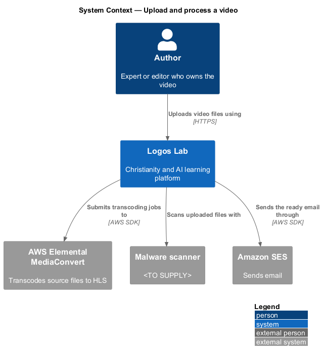
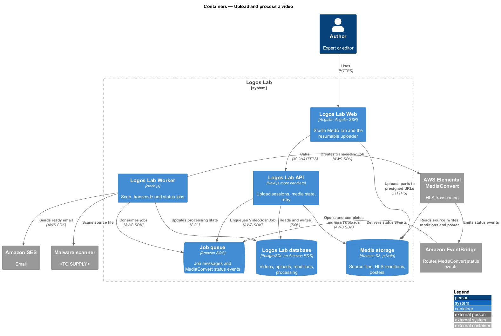
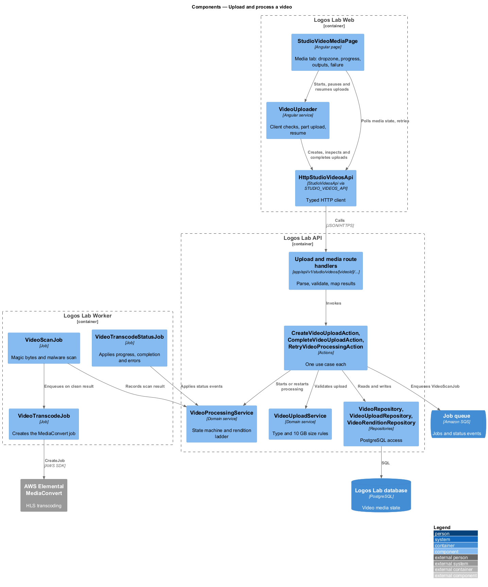
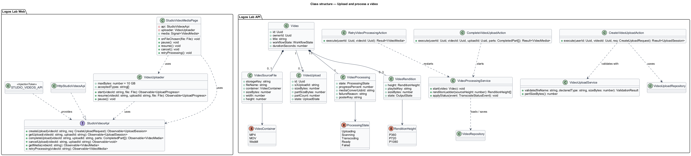
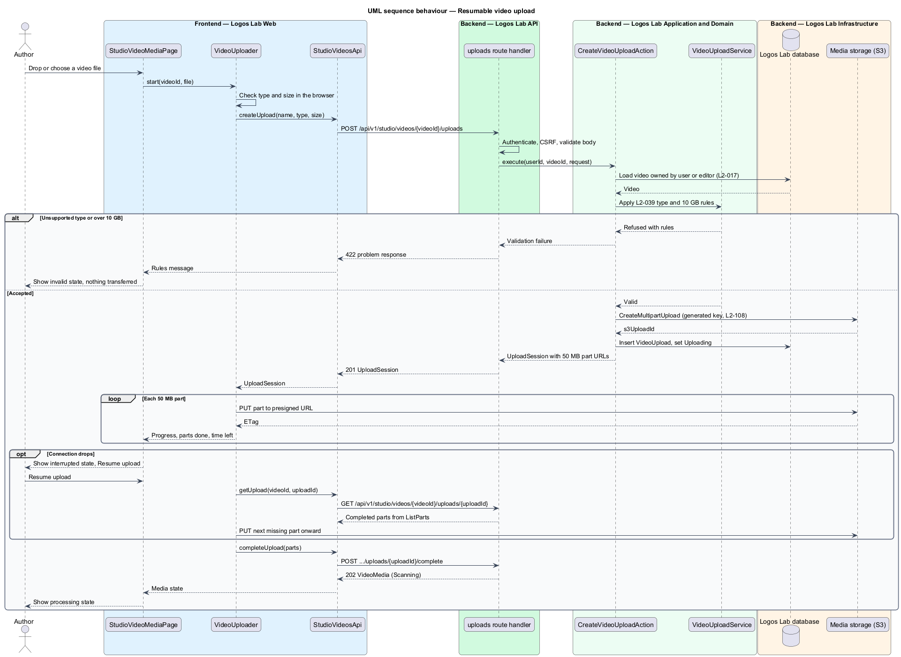
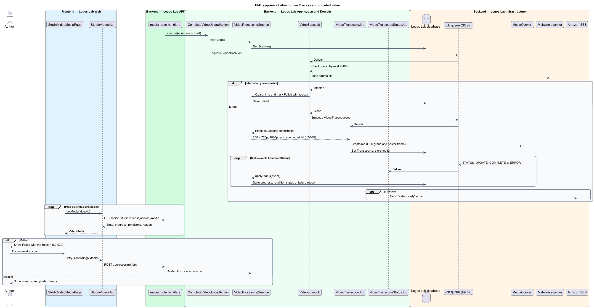

# Upload and process a video

## Overview

Logos Lab publishes videos made by experts and by the Logos Lab editors. Before a video can be watched, its
source file has to reach the platform and be turned into streams that play well on any connection. This
feature covers that path, from choosing a file in Studio to a set of ready streams and a poster image.

The feature sits at the start of the videos subsystem. Its output feeds every other video feature:
playback (`play-video`), captions (`provide-captions-and-transcripts`), protected delivery
(`protect-video-delivery`) and the public video page (`view-video-page`).

Terms used below:

- **source file** — original MP4, MOV or WebM file an author uploads, kept private in media storage
- **resumable upload** — upload sent in fixed-size parts, so a dropped connection resumes from the last completed part
- **rendition** — encoded copy of the video at one resolution (360p, 720p or 1080p)
- **adaptive stream** — HLS playlist set that lists every rendition, so the player can switch between them as bandwidth changes
- **poster** — still image taken from the video and shown before playback starts
- **processing** — sequence of malware scan, transcoding and poster capture that turns a source file into an adaptive stream

An author is an expert who owns the video, or an editor (`L2-016`). Authors work on the **Media** tab of the
video in Studio. The tab shows the upload rules, the file, each rendition's state, and a checklist of what
submission for review still needs.

## Description

### Screens and states

- **`StudioVideoMediaPage`** — routed page in Logos Lab Web for the **Media** tab of a video in Studio. Route:
  `/studio/videos/{videoId}/media` (baseline choice). It covers every state in
  `docs/mocks/pages/studio-video-media/`: `empty` (dropzone only), `uploading` (progress, part count, time
  left, Pause and Cancel), `interrupted` (parts saved, Resume upload), `invalid` (file refused before
  transfer), `processing` (overall progress and each output's state), `default` (all outputs ready),
  `failed` (reason, Try processing again, Replace file), `loading` and `error`.
- **Shared components** — `ll-tabs` (Media, Captions and transcript), `ll-workflow-bar`, `ll-file-upload`
  (dropzone and progress), `ll-progress-bar`, `ll-table` (streams and poster), `ll-badge` (output
  state), `ll-alert` (interrupted, failed), `ll-inline-message` (malware check result), `ll-empty-state`,
  `ll-skeleton` and an `ll-panel` aside holding the upload rules and the submission checklist.
- **`VideoUploader`** — injectable service in Logos Lab Web. It checks the file type and size in the
  browser, sends parts in sequence to presigned URLs, retries a failed part, and records the upload id so
  a reload can resume.

### API contract

- **`StudioVideosApi`** contract, **`STUDIO_VIDEOS_API`** token and **`HttpStudioVideosApi`** implementation
  in the shared API library. Methods: `createUpload`, `getUpload`, `completeUpload`, `cancelUpload`,
  `getMedia` and `retryProcessing`.
- Endpoints, all authenticated and limited to the video's owner or an editor (`L2-016`, `L2-017`):

| Method | Path | Purpose |
|---|---|---|
| `POST` | `/api/v1/studio/videos/{videoId}/uploads` | Validates name, declared type and size, then opens a multipart upload and returns part size and presigned part URLs |
| `GET` | `/api/v1/studio/videos/{videoId}/uploads/{uploadId}` | Returns the completed parts, so the client resumes from the next one |
| `POST` | `/api/v1/studio/videos/{videoId}/uploads/{uploadId}/complete` | Closes the multipart upload and starts processing |
| `DELETE` | `/api/v1/studio/videos/{videoId}/uploads/{uploadId}` | Cancels the upload and discards the parts |
| `GET` | `/api/v1/studio/videos/{videoId}/media` | Returns the source file, processing state, progress, renditions, poster and failure reason |
| `POST` | `/api/v1/studio/videos/{videoId}/processing/retry` | Runs processing again on the stored source file |

### Application and domain

- **Actions** — `CreateVideoUploadAction`, `CompleteVideoUploadAction`, `CancelVideoUploadAction`,
  `GetVideoMediaAction` and `RetryVideoProcessingAction`. Each owns its transaction.
- **`VideoUploadService`** — holds the upload rules: types MP4, MOV and WebM; size 10 GB or less. It refuses
  any other request before a byte is transferred (`L2-039`). Part size is 50 MB, as the mock states.
- **`VideoProcessingService`** — owns the processing state machine (`Uploading`, `Scanning`, `Transcoding`,
  `Ready`, `Failed`). It builds the rendition ladder from the source height, so no rendition exceeds the
  source resolution.
- **Entities** — `Video` (the content item), `VideoSourceFile`, `VideoUpload`, `VideoRendition` and
  `VideoProcessing`. Repositories: `VideoRepository`, `VideoUploadRepository`, `VideoRenditionRepository`.
- **Tables** — `videos`, `video_source_files`, `video_uploads`, `video_renditions`, `video_processing`.

### Jobs and external systems

- **`VideoScanJob`** — confirms the type from the file's magic bytes and sends the file to the malware
  scanner (`L2-108`). A clean file moves to transcoding; an infected file is quarantined and the author
  is notified.
- **`VideoTranscodeJob`** — submits an AWS Elemental MediaConvert job with an HLS output group (one
  output per rendition in the ladder) and a frame-capture output for the poster.
- **`VideoTranscodeStatusJob`** — consumes MediaConvert status events (progress, complete, error) that
  reach the job queue through Amazon EventBridge. It updates the progress percentage, marks renditions
  ready, records a failure reason, and on completion sends the "ready" email through Amazon SES.
- **Media storage** — the browser writes parts directly to the private S3 bucket through presigned URLs;
  the API never proxies the file body. Objects use generated keys (`L2-108`).

### Rules from the acceptance criteria

- An interrupted upload resumes from the last completed part (`L2-039` criterion 1).
- Processing produces 360p, 720p and 1080p renditions and a poster, with no upscaling past the source
  resolution, and the author sees progress (criterion 2).
- A failed run shows the state "Failed" with the reason, and offers retry or replace (criterion 3).
- A file over 10 GB or of another type is refused before transfer, with a message stating the rules
  (criterion 4).
- Submission for review requires at least one English caption track (criterion 5). The
  `provide-captions-and-transcripts` feature enforces this rule.

Open points: the rendition ladder when the source is below 360p is `<TO SUPPLY>`. The poster frame time is
`<TO SUPPLY>` (the mock shows a frame at 0:42). The Studio polling interval for progress is `<TO SUPPLY>`.

## Requirements

The feature realizes the following level-2 (L2) requirements. Each L2 requirement refines the level-1 (L1) requirement cited beside it.

| L2 ID | Refines (L1) | Requirement |
|-------|--------------|-------------|
| `L2-039` | `L1-007` | **Video upload and processing.** Experts and editors shall be able to upload videos, which the platform processes into adaptive streams. |

## Diagrams

### System context

Authors upload through Logos Lab, which scans files with the malware scanner, transcodes them with
MediaConvert, and emails the author through Amazon SES when the streams are ready.

### Containers

The browser sends file parts straight to media storage; the API records the upload and enqueues jobs, and
the Worker runs scanning and transcoding.

### Components

The Studio page calls `StudioVideosApi`; route handlers call one action each; the jobs share
`VideoProcessingService` with the actions.

### Class structure

`Video` owns one `VideoSourceFile`, one `VideoProcessing` record and up to three `VideoRendition` rows.
`VideoUpload` tracks the multipart upload until it completes.

### Behaviour — resumable upload

The API refuses a disallowed type or size before transfer. Accepted files go to S3 in 50 MB parts, and a
reload resumes from the next missing part.

### Behaviour — processing and failure

After the upload completes, the Worker scans, then transcodes. Status events update progress, mark the
renditions ready, or record the failure reason that the author can retry.

