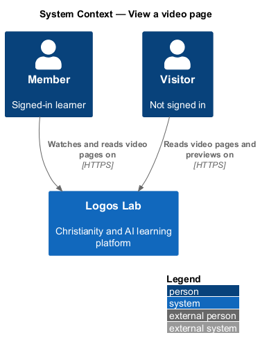
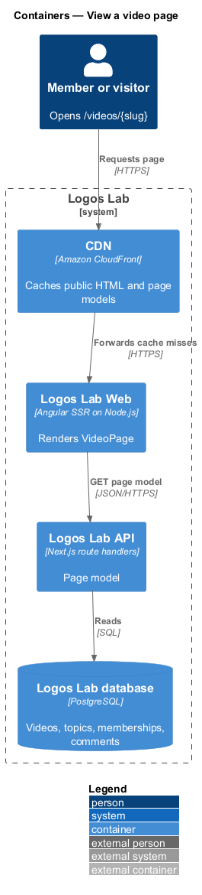
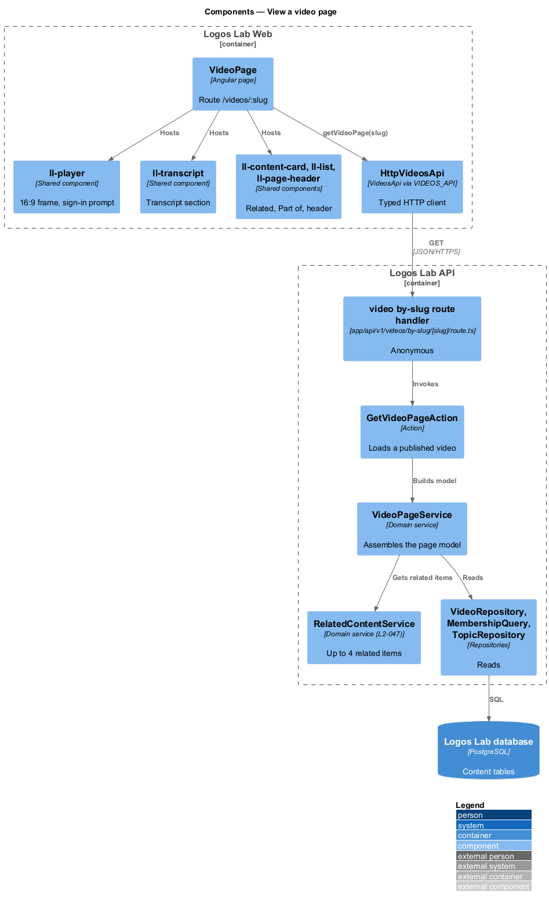
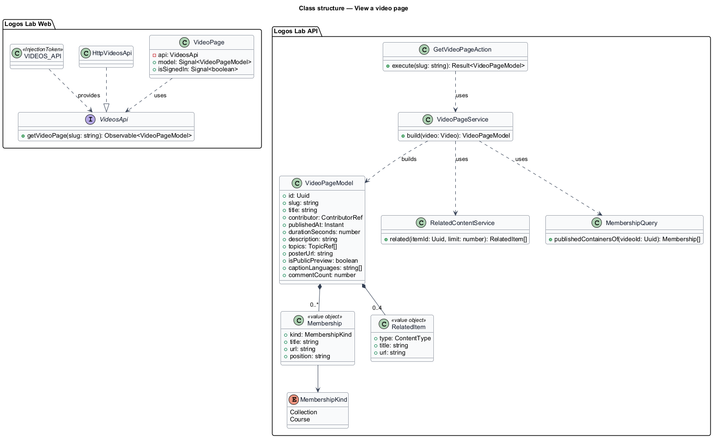
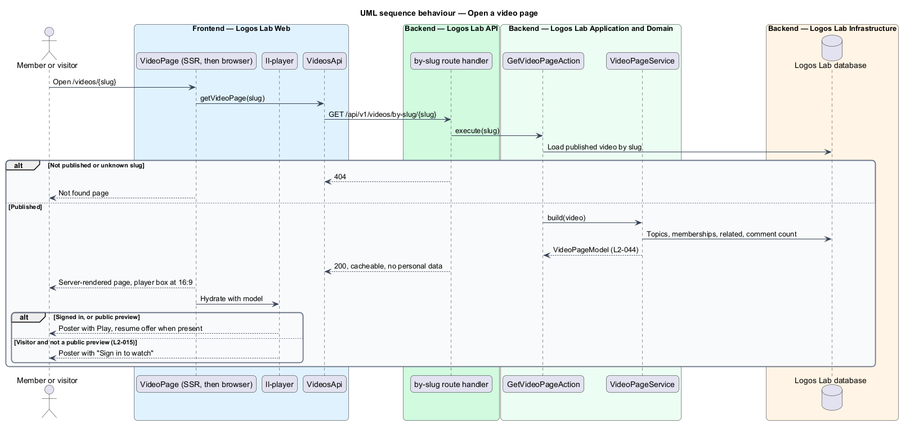

# View a video page

## Overview

Each published Logos Lab video has its own page at `/videos/{slug}`. The page is where a learner watches
the video and where a visitor first meets it, often from search or a shared link. It brings together the
player, what the video is about, who made it, where it belongs, its transcript, its comments and related
content.

The page is the main surface of the videos subsystem. It hosts the player from `play-video`, the transcript
from `provide-captions-and-transcripts` and the access rules from `protect-video-delivery`. Comments
(`L2-060`), related content (`L2-047`) and saving (`L2-071`) are owned by other subsystems and appear here
as page sections.

Terms used below:

- **slug** — stable, readable URL segment that identifies a published video (for example `augustine-and-the-algorithm`)
- **membership** — collection or course that contains the video, listed under "Part of"
- **sign-in prompt** — overlay on the poster that asks a visitor to sign in or create an account before playing

## Description

### Screens and states

- **`VideoPage`** — routed page in Logos Lab Web at `/videos/:slug`, server-rendered for public access
  (`L2-142`). It covers every state in `docs/mocks/pages/video-page/`: `default` (signed in), `visitor`
  (poster with "Sign in to watch"), `preview` (public preview plays without an account), `resume`,
  `transcript`, `player-error`, `loading` (16:9 frame and skeletons), `error` and `long` (wrapping of long
  text).
- **Sections and components** — breadcrumb (`ll-breadcrumb`), header with eyebrow, title, contributor link,
  publish date and Save (`ll-page-header`, `ll-button`), the player (`ll-player`), "About this video"
  (`ll-prose` and topic `ll-chip` links), "Part of" (`ll-list`), "Transcript" (`ll-transcript`), a
  "Details" aside with length, publish date and caption languages (`ll-description-list` in an
  `ll-panel`), a "Comments" aside with the count and a link, and "Related" (`ll-content-card`).
- **Layout** — `ll-player` reserves a 16:9 box with CSS `aspect-ratio` before the media loads, so nothing
  shifts. From XS through MD the player spans the full content width (`L2-044` criterion 3).
- **Sign-in prompt** — for a visitor on a video that is not a public preview, `ll-player` shows the poster
  and the prompt. Sign in returns to the same page and action (`L2-015`).

### API contract

- **`VideosApi`** (token `VIDEOS_API`) method `getVideoPage(slug)`.

| Method | Path | Purpose |
|---|---|---|
| `GET` | `/api/v1/videos/by-slug/{slug}` | Returns the page model; anonymous. 404 for a slug that is not published |

The page model holds title, contributor, publish date, duration, description, topics, poster URL, public
preview flag, caption languages, memberships, comment count and up to 4 related items. The transcript and
the playback grant are separate calls (`provide-captions-and-transcripts`, `protect-video-delivery`), so the
page model stays cacheable for anonymous viewers (`L2-124`). The model never contains personal data, so
the CDN may cache it (`L2-113`); the caller's progress and saved state come from `/api/v1/me/...` calls
after hydration.

### Application and domain

- **`GetVideoPageAction`** — loads a published video by slug and assembles the page model.
- **`VideoPageService`** — composes the model from `VideoRepository`, `TopicRepository`,
  `MembershipQuery` (collections and courses that contain the video and are published, `L2-044`
  criterion 2), `RelatedContentService` (`L2-047`) and the comment count (`L2-060`).
- **Tables read** — `videos`, `caption_tracks`, `content_topics`, `collection_items`, `course_lessons`,
  `comments`.

### Rules from the acceptance criteria

- The page shows the player, or the sign-in prompt over the poster for visitors, plus title, contributor,
  publish date, duration, description, topics, transcript, comments and related content (`L2-044`
  criterion 1).
- Collections and courses that contain the video are listed (criterion 2).
- From XS through MD, the player spans the full content width and keeps 16:9 without layout shift
  (criterion 3).

Open points: page metadata and structured data for the video (`L2-143`, `L2-144`) follow the SEO features;
the exact `VideoObject` fields are `<TO SUPPLY>`.

## Requirements

The feature realizes the following level-2 (L2) requirements. Each L2 requirement refines the level-1 (L1) requirement cited beside it.

| L2 ID | Refines (L1) | Requirement |
|-------|--------------|-------------|
| `L2-044` | `L1-007` | **Video page.** Each published video has a page at `/videos/{slug}`. |

## Diagrams

### System context

Members and visitors open the video page on Logos Lab; visitors see the sign-in prompt unless the video is
a public preview.

### Containers

Logos Lab Web server-renders the page from the API's page model; the CDN caches the anonymous response.

### Components

`VideoPage` composes shared components; `GetVideoPageAction` uses `VideoPageService`, which gathers
memberships, related items and the comment count.

### Class structure

`VideoPageModel` aggregates the video's public facts with `Membership` and `RelatedItem` lists.

### Behaviour — open a video page

The server renders the page for any viewer. After hydration, a member's progress is loaded, while a
visitor sees the sign-in prompt over the poster.

